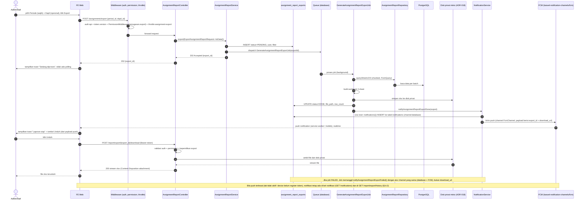
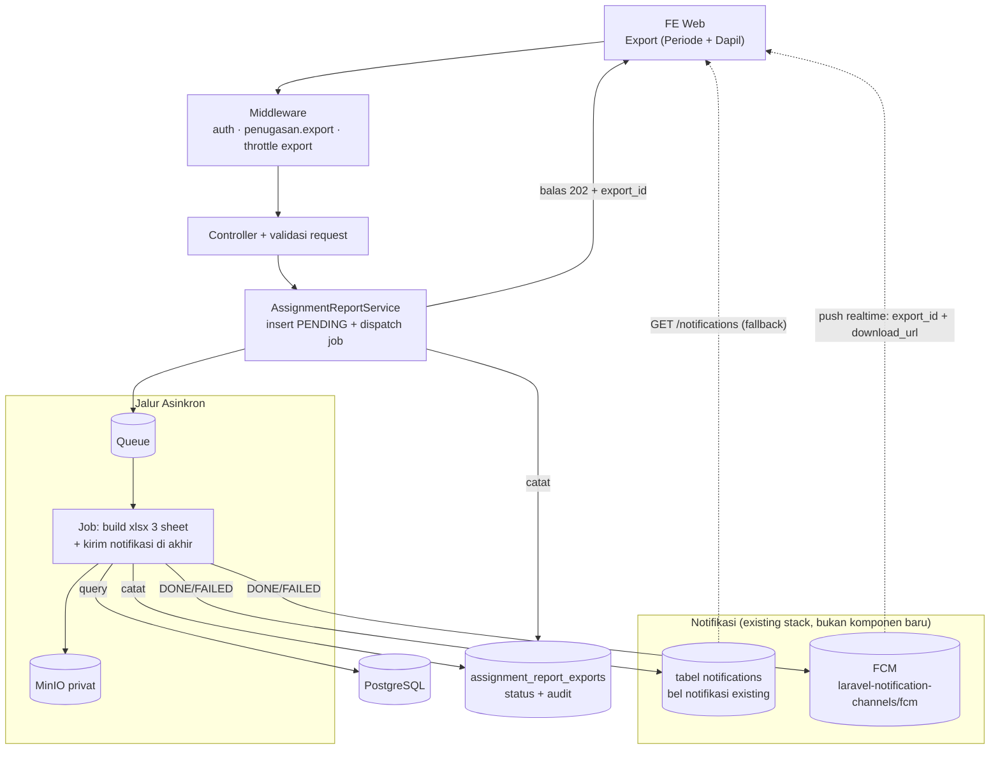
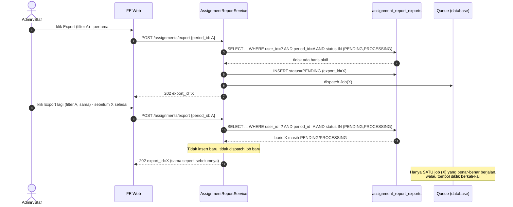

# Penugasan | Ringkasan Penugasan per Periode

# Informasi Dokumen

**e-PARLEMEN DPRD KOTA MAGELANG — Modul Penugasan** Laporan Excel Penugasan (Filter Periode & Dapil): Spesifikasi Fungsional, Rekomendasi TRD & API Contract

| Atribut      | Keterangan                                                                                                   |
| ------------ | ------------------------------------------------------------------------------------------------------------ |
| Nama Dokumen | Assignment_Report_Export_Spec_TRD_v0.1 — Laporan Excel Penugasan                                             |
| Versi        | 0.1                                                                                                          |
| Tanggal      | 19 November 2026                                                                                             |
| Disusun oleh | Ayu Widya Inggit                                                                                             |
| Isi Dokumen  | Bagian A – Spesifikasi Fungsional · Bagian B – Rekomendasi Analisa TRD · Bagian C – API Docs                 |
| Acuan desain |                                                                                                              |
| Export Excel | [Link](https://docs.google.com/spreadsheets/d/1Gi0os2iteh-jbLvb_MyeaR-9n1cYRq10DRif_yFQ1Y0/edit?usp=sharing) |

## Riwayat Revisi

<div class="joplin-table-wrapper"><table dir="auto" style="min-width: 289px;"><tbody><tr dir="auto"><th dir="auto" colspan="1" rowspan="1" colwidth="127"><p data-id="itkyfdhqmfmq" dir="auto">Versi</p></th><th dir="auto" colspan="1" rowspan="1" colwidth="137"><p data-id="kdldolvbqcqt" dir="auto">Tanggal</p></th><th dir="auto" colspan="1" rowspan="1"><p data-id="uqvditxfqzyy" dir="auto">Perubahan</p></th></tr><tr dir="auto"><td dir="auto" colspan="1" rowspan="1" colwidth="127"><p data-id="pjfhocferymi" dir="auto">0.1</p></td><td dir="auto" colspan="1" rowspan="1" colwidth="137"><p data-id="miepeohqnpyv" dir="auto">19 Nov 2026</p></td><td dir="auto" colspan="1" rowspan="1"><p data-id="fskggtvybrxa" dir="auto">Initial draft.</p></td></tr><tr dir="auto"><td dir="auto" colspan="1" rowspan="1" colwidth="127"><p data-id="uxulbkwuxtua" dir="auto">0.2</p></td><td dir="auto" colspan="1" rowspan="1" colwidth="137"><p data-id="vifjwimpwehy" dir="auto">20 Nov 2026</p></td><td dir="auto" colspan="1" rowspan="1"><ol dir="auto"><li dir="auto"><p data-id="kfwyefilavvv" dir="auto">Proses export disepakati <strong>asinkron-only</strong> — jalur sinkron dihapus dari seluruh bagian dokumen (lingkup, istilah, alur proses, aturan bisnis, arsitektur, model data, API).</p></li><li dir="auto"><p data-id="seqhjucdelyb" dir="auto">Tambah kolom <code>type</code> pada <code>assignment_report_exports</code> (Penugasan / Surat Masuk / Surat Keluar / Rapat) agar tabel ini jadi riwayat export lintas modul; lihat IT-08.</p></li><li dir="auto"><p data-id="adowrknhphtb" dir="auto">Link download <strong>tidak lagi temporary</strong> — presigned URL &amp; <code>expires_at</code> dihapus; unduhan lewat endpoint API terautentikasi yang divalidasi per request (BR-13, §14.3). Kebijakan retensi file jadi isu terbuka (IT-05).</p></li><li dir="auto"><p data-id="klhelwjqimky" dir="auto">Method endpoint dikonfirmasi: <code>POST /assignments/export</code>, <code>POST /report/export/{exportId}/download</code>, <code>GET /report/export/history</code>. Endpoint status yang di-poll (<code>/assignments/export/{exportId}/status</code>) <strong>dihapus</strong>, diganti notifikasi push realtime (<code>database</code> + <code>FcmChannel</code>, mengikuti pola <code>AssignmentApprovedNotification</code>), ditambah <code>GET /report/export/history</code> sebagai fallback manual. Lihat BR-16/BR-17, §2.7, §4.1, §6.1–§6.2, IT-09.</p></li></ol></td></tr><tr dir="auto"><td dir="auto" colspan="1" rowspan="1" colwidth="127"><p dir="auto">0.3</p></td><td dir="auto" colspan="1" rowspan="1" colwidth="137"><p dir="auto">23 Nov 2026</p></td><td dir="auto" colspan="1" rowspan="1"><p dir="auto">Tambah filter <strong>opsional</strong> <code>start_date</code>/<code>end_date</code> untuk mempersempit periode yang sudah dipilih (BR-18/BR-19) — divalidasi berada di dalam rentang <code>periods.start_date</code>–<code>periods.end_date</code> milik <code>period_id</code> terpilih, bukan jalur filter rentang tanggal independen seperti <code>AssignmentRepository::assignmentListFilters()</code> (BR-02, IT-01). Lihat §1.2, §2.1, §9.1, §9.4.1–§9.4.3, §14.1.</p></td></tr></tbody></table></div>

# Bagian A — Spesifikasi Fungsional

## 1\. Pendahuluan

### 1.1 Tujuan

Dokumen ini menjelaskan kebutuhan fungsional fitur **Export Laporan Excel** pada modul **Penugasan** (Duty Assignment).

Admin/staf yang berwenang (mendapat akses fitur penugasan) dapat mengunduh workbook `.xlsx` berisi data penugasan, peserta, dan hasil/aspirasi, difilter berdasarkan **Periode (wajib)** dan **Dapil (opsional)**.

- **Bagian B** berisi rekomendasi teknis (arsitektur, query, performa, keamanan) untuk TRD.
- **Bagian C** berisi rancangan API.

### 1.2 Ruang Lingkup

**Termasuk dalam lingkup:**

- Export laporan penugasan dari tabel `duty_assignments` dan relasinya (`duty_assignment_participants`, `duty_assignment_results`, `duty_assignment_locations`).
- Filter Periode wajib (kolom `duty_assignments.period_id`), filter Dapil opsional (kolom `duty_assignments.dapil_id`), dan filter rentang tanggal opsional (`duty_assignments.start_date`/`end_date`) untuk mempersempit periode yang sudah dipilih (§2.1, BR-18/BR-19).
- Workbook 3 sheet: Ringkasan Penugasan, Detail Peserta, Detail Hasil/Aspirasi.
- Jalur asinkron untuk seluruh permintaan export (job antrean + unduh lewat endpoint download terautentikasi, **tanpa** presigned URL sementara), tanpa jalur sinkron.
- Notifikasi **push realtime** (database + FCM) ke pengekspor saat job selesai (`DONE`/`FAILED`) — FE tidak perlu polling status.
- Audit trail setiap export.

**Di luar lingkup:**

| No  | Item                                                                                                                         | Keterangan & Usulan                                                                                                                                                 | Ref.         |
| --- | ---------------------------------------------------------------------------------------------------------------------------- | ------------------------------------------------------------------------------------------------------------------------------------------------------------------- | ------------ |
| 1   | Migrasi filter list "Daftar Penugasan" (`AssignmentRepository::assignmentListFilters()`) dari rentang tanggal ke `period_id` | Direkomendasikan sebagai langkah lanjutan. API terdampak: `GET /assignments` (contoh di bawah tabel).                                                               | §12.2, IT-01 |
| 2   | Perubahan skema `dapil_assignments` untuk menyimpan riwayat dapil anggota per periode                                        | Saat ini `dapil_assignments` belum punya field `period_id`. Usulan: tambahkan `period_id`. Dampak: manajemen user.                                                  | §7.4, IT-03  |
| 3   | Validasi anti-tumpang-tindih rentang tanggal saat pembuatan Periode baru                                                     | Sistem harus menolak periode baru/ubahan yang rentang tanggalnya beririsan dengan periode lain, bukan meloloskannya seperti sekarang. Usulan detail di bawah tabel. | §7.4, IT-02  |

Contoh API yang terdampak item 1:

```bash
curl 'https://api-dev-eparlemen.geekgarden.my.id/api/v1/assignments?page=1&per_page=10' \
  --header 'Authorization: Bearer YOUR_SECRET_TOKEN'
```

Usulan perbaikan item 3: tambahkan rule validasi kustom di `StorePeriodRequest` **dan** `UpdatePeriodRequest` (mengubah tanggal periode yang sudah ada juga bisa menciptakan tumpang tindih baru) yang query ke tabel `periods` — tolak bila ada baris lain dengan:

```sql
start_date <= :end_date_baru AND end_date >= :start_date_baru
```

(rumus standar cek dua rentang beririsan).

### 1.3 Aktor & Kanal

| Aktor                                                 | Kanal                                                                                                                                                        | Peran                                                                                                                                                                 |
| ----------------------------------------------------- | ------------------------------------------------------------------------------------------------------------------------------------------------------------ | --------------------------------------------------------------------------------------------------------------------------------------------------------------------- |
| Admin / Staf (pemegang permission `penugasan.export`) | WEB - Daftar Penugasan › Export Laporan                                                                                                                      | Memilih Periode & Dapil, memicu export, menerima notifikasi, mengunduh file.                                                                                          |
| Sistem - Queue worker                                 | Backend (`QUEUE_CONNECTION=database`)                                                                                                                        | Menjalankan `GenerateAssignmentReportExportJob`, mengirim notifikasi di akhir job.                                                                                    |
| Sistem - Notifikasi                                   | Backend (`Illuminate\Notifications`, channel `database` + `NotificationChannels\Fcm\FcmChannel`, package `laravel-notification-channels/fcm` yang sudah ada) | Mengantarkan status selesai ke pengekspor lewat tabel `notifications` (bel notifikasi existing) dan push FCM ke device terdaftar (`PUT /auth/devices`, Web & Mobile). |
| Sistem - Scheduler                                    | Backend (Artisan command harian)                                                                                                                             | Menandai `PENDING`/`PROCESSING` yang macet (melewati batas waktu job) jadi `FAILED` (§6.3, §9.3).                                                                     |

### 1.4 Istilah

| Istilah                     | Arti                                                                                                                                                                                                                                                                                                |
| --------------------------- | --------------------------------------------------------------------------------------------------------------------------------------------------------------------------------------------------------------------------------------------------------------------------------------------------- |
| Penugasan                   | Fitur Duty Assignment (`AssignmentController`, tabel `duty_assignments`) — penugasan tugas/kunjungan/reses untuk anggota DPRD. Dikonfirmasi lewat `ListAssignmentRequest` (sudah punya `filter.period_id` & `filter.dapil_id`) dan permission `penugasan` / `penugasan.lihat`.                      |
| Periode                     | Baris `periods` (mis. `2024-2029`). Penugasan ter-tag ke satu periode lewat `duty_assignments.period_id` saat dibuat.                                                                                                                                                                               |
| Dapil Tujuan                | `duty_assignments.dapil_id` (sesuai dapil pembuat penugasan).                                                                                                                                                                                                                                       |
| Dapil yang Diwakili Anggota | Dapil yang diwakili seorang anggota, dari `dapil_assignments`. Berbeda dari Dapil Tujuan.                                                                                                                                                                                                           |
| Dapil Terkait Hasil         | `duty_assignment_results.dapil_id` — dapil terkait hasil/aspirasi itu sendiri, bisa berbeda dari Dapil Tujuan.                                                                                                                                                                                      |
| Grain                       | Arti "1 baris" pada satu sheet (mis. 1 penugasan, atau 1 penugasan × 1 anggota).                                                                                                                                                                                                                    |
| Jalur asinkron              | Satu-satunya mekanisme proses export: workbook dibuat oleh job antrean, disimpan di disk privat, lalu diunduh lewat endpoint download terautentikasi (tanpa presigned URL sementara, lihat BR-13).                                                                                                  |
| Notifikasi push             | Pemberitahuan ke pengekspor saat job `DONE`/`FAILED`, lewat `Illuminate\Notifications` dua channel: `database` (tabel `notifications`, tampil di bel notifikasi existing) dan `FcmChannel` (push realtime ke browser/mobile via device terdaftar). Menggantikan polling status — lihat BR-16, §4.1. |

## 2\. Kebutuhan Fungsional

### 2.1 Form Filter & Tombol Export (WEB)

API: `POST /assignments/export` (§14.1). Export berjalan di background; selesai/gagal diberitahukan lewat notifikasi push (§2.7), bukan di-poll FE.

| Field           | Tipe        | Wajib | Request Body | Sumber Data / Validasi                                                                                                                                             |
| --------------- | ----------- | ----- | ------------ | ------------------------------------------------------------------------------------------------------------------------------------------------------------------ |
| Periode         | Dropdown    | Ya    | `period_id`  | Data: `GET /periods`. Filter ke `duty_assignments.period_id`.                                                                                                      |
| Dapil           | Dropdown    | Tidak | `dapil_id`   | Data: `GET /dapils`. Filter ke `duty_assignments.dapil_id`.                                                                                                        |
| Tanggal Mulai   | Date picker | Tidak | `start_date` | Mempersempit `duty_assignments.start_date >=` nilai ini. Harus berada di dalam rentang `periods.start_date`–`periods.end_date` milik `period_id` terpilih (BR-19). |
| Tanggal Selesai | Date picker | Tidak | `end_date`   | Mempersempit `duty_assignments.start_date <=` nilai ini. Harus `>= start_date` (bila diisi) dan tetap di dalam rentang periode terpilih (BR-19).                   |
| Export Laporan  | Button      | —     | —            | Nonaktif sampai Periode dipilih. Respons selalu `202` → tampilkan toast "Laporan sedang diproses, Anda akan diberi tahu saat selesai" (§2.7), tanpa polling.       |

> **Catatan desain — filter tanggal opsional (BR-18).** Satu periode bisa membentang bertahun-tahun (mis. `2024-2029`), sehingga tanpa filter tanggal, admin yang hanya butuh laporan triwulan/bulanan harus export seluruh data periode lalu menyaring manual di Excel. `start_date`/`end_date` ditambahkan sebagai filter **opsional, mempersempit periode yang sudah dipilih** — bukan jalur filter independen seperti `AssignmentRepository::assignmentListFilters()` yang justru ingin dihindari oleh laporan ini (BR-02, IT-01). Karena itu keduanya wajib divalidasi berada di dalam rentang `periods.start_date`–`periods.end_date` milik `period_id` yang sama (BR-19); kombinasi tanggal di luar periode terpilih ditolak `422`, bukan diam-diam menghasilkan laporan kosong seperti kasus tumpang-tindih periode di IT-02.

### 2.2 Struktur Workbook

Satu penugasan punya relasi 1-ke-banyak ke peserta dan hasil/aspirasi, sehingga laporan dibuat sebagai **workbook 3 sheet**, bukan satu tabel data, untuk menghindari duplikasi baris yang membingungkan.

| Sheet                     | Grain (1 baris =)              | Query  |
| ------------------------- | ------------------------------ | ------ |
| 1\. Ringkasan Penugasan   | 1 penugasan                    | §9.4.1 |
| 2\. Detail Peserta        | 1 penugasan × 1 anggota        | §9.4.2 |
| 3\. Detail Hasil/Aspirasi | 1 penugasan × 1 hasil/aspirasi | §9.4.3 |

Urutan baris seluruh sheet: `start_date ASC, assignment_number ASC`, lalu kunci sekunder per sheet (nama anggota / waktu laporan).

### 2.3 Sheet 1 — Ringkasan Penugasan

| Kolom Excel                      | Sumber Field                                                                     | Logic                                                                                                                                                     |
| -------------------------------- | -------------------------------------------------------------------------------- | --------------------------------------------------------------------------------------------------------------------------------------------------------- |
| No. Penugasan                    | `duty_assignments.assignment_number`                                             | —                                                                                                                                                         |
| Judul Penugasan                  | `duty_assignments.title`                                                         | —                                                                                                                                                         |
| Jenis Penugasan                  | `assignment_types.name`                                                          | —                                                                                                                                                         |
| Status Penugasan                 | `duty_assignments.status`                                                        | Label Indonesia (§3.2)                                                                                                                                    |
| Jenis Lokasi                     | `duty_assignments.location_type`                                                 | `DALAM_KOTA` = Dalam Kota, `LUAR_KOTA` = Luar Kota, `LUAR_NEGERI` = Luar Negeri                                                                           |
| Lokasi                           | `countries.name` / `duty_assignment_locations` → `regions.name` / `regions.name` | Prioritas: nama negara → daftar region dari `duty_assignment_locations` (digabung koma, urut `sort_order`) → region tunggal `duty_assignments.regions_id` |
| Tanggal Tunggal                  | `duty_assignments.is_single_date`                                                | —                                                                                                                                                         |
| Tanggal Mulai / Tanggal Selesai  | `start_date` / `end_date`                                                        | —                                                                                                                                                         |
| Jam Mulai / Jam Selesai          | `start_time` / `end_time`                                                        | —                                                                                                                                                         |
| Kode Dapil Tujuan / Dapil Tujuan | `dapils.code` / `dapils.name`                                                    | Join `duty_assignments.dapil_id`                                                                                                                          |
| Periode                          | `periods.name`                                                                   | —                                                                                                                                                         |
| Status Tim (agregat)             | `duty_assignments.participant_status`                                            | Label Indonesia (§3.2)                                                                                                                                    |
| Dibuat Oleh / Tanggal Dibuat     | `users.name` (`created_by`) / `created_at`                                       | —                                                                                                                                                         |
| Disetujui Oleh                   | duty_assignment_approvals → user_assignments → users.name                        | Nama approver yang status = 'APPROVED', digabung koma urut approved_at bila lebih dr satu approver.                                                       |
| Tanggal Disetujui                | duty_assignment_approvals.approved_at (terbaru)                                  | MAX(approved_at) dari baris APPROVED — waktu approval terakhir yang membuat penugasan disetujui.                                                          |
| Dibatalkan Oleh                  | `users.name` (`cancelled_by`)                                                    | `CANCEL_BY_ADMIN` → nama admin; `CANCEL_BY_SYSTEM` → "Sistem (otomatis)"; status lain → kosong                                                            |
| Tanggal Dibatalkan               | `cancelled_at`                                                                   | —                                                                                                                                                         |
| Alasan Pembatalan                | `cancellation_reason`                                                            | —                                                                                                                                                         |
| Jumlah Anggota Ditugaskan        | count `duty_assignment_participants`                                             | Hanya peserta `status = 'ACTIVE'`                                                                                                                         |
| Jumlah Hasil/Aspirasi            | count `duty_assignment_results`                                                  | Seluruh hasil pada penugasan                                                                                                                              |
| Catatan                          | `duty_assignments.notes`                                                         | —                                                                                                                                                         |

### 2.4 Sheet 2 — Detail Peserta

| Kolom Excel                                     | Sumber Field                                       | Logic                                                                              |
| ----------------------------------------------- | -------------------------------------------------- | ---------------------------------------------------------------------------------- |
| No. Penugasan, Judul Penugasan, Jenis Penugasan | `duty_assignments` / `assignment_types`            | —                                                                                  |
| Status Penugasan                                | `duty_assignments.status`                          | Label Indonesia (§3.2)                                                             |
| Tanggal Mulai / Tanggal Selesai                 | `start_date` / `end_date`                          | —                                                                                  |
| Nama Anggota                                    | `users.name`                                       | Via `duty_assignment_participants.user_assignment_id` → `user_assignments.user_id` |
| Jabatan Saat Ditugaskan                         | `positions.name`                                   | Dari `user_assignments.position_id`                                                |
| Unit/Fraksi                                     | `org_units.name`                                   | Dari `user_assignments.org_unit_id`                                                |
| Dapil yang Diwakili Anggota                     | `dapil_assignments` → `dapils.name`                | Hanya dapil milik periode terpilih;                                                |
| Status Keanggotaan Tim                          | `duty_assignment_participants.status`              | Label Indonesia (§3.2)                                                             |
| Status Konfirmasi                               | `duty_assignment_participants.confirmation_status` | Label Indonesia (§3.2)                                                             |
| Status Persetujuan                              | `duty_assignment_participants.approval_status`     | Label Indonesia (§3.2)                                                             |
| Waktu Konfirmasi                                | `confirmed_at`                                     | —                                                                                  |
| Alasan Tolak                                    | `rejection_reason`                                 | —                                                                                  |
| Jumlah Hasil/Aspirasi Dilaporkan                | count `duty_assignment_results`                    | Per peserta (`assignment_participant_id`)                                          |

### 2.5 Sheet 3 — Detail Hasil/Aspirasi

| Kolom Excel                    | Sumber Field                         | Logic                                                                                                                                                            |
| ------------------------------ | ------------------------------------ | ---------------------------------------------------------------------------------------------------------------------------------------------------------------- |
| No. Penugasan, Judul Penugasan | `duty_assignments`                   | —                                                                                                                                                                |
| Anggota Pelapor                | `users.name`                         | Via peserta pelapor (`assignment_participant_id`)                                                                                                                |
| Judul Hasil/Aspirasi           | `duty_assignment_results.title`      | —                                                                                                                                                                |
| Kategori Aspirasi              | `duty_assignment_results.category`   | `INFRASTRUKTUR` = Infrastruktur, `PENDIDIKAN` = Pendidikan, `KESEHATAN` = Kesehatan, `EKONOMI_UMKM` = Ekonomi & UMKM, `OLAHRAGA` = Olahraga, `LAINNYA` = Lainnya |
| Deskripsi                      | `description`                        | —                                                                                                                                                                |
| Nama Pengaspirasi              | `aspirant_name`                      | Data pribadi pihak eksternal (§11)                                                                                                                               |
| Alamat Lokasi                  | `location_address`                   | Data pribadi pihak eksternal (§11)                                                                                                                               |
| Dapil Terkait Hasil            | `dapils.name`                        | Join `duty_assignment_results.dapil_id`                                                                                                                          |
| Wilayah (Region)               | `regions.name`                       | Join `duty_assignment_results.region_id`                                                                                                                         |
| Tanggal Dilaporkan             | `duty_assignment_results.created_at` | —                                                                                                                                                                |

> **Catatan:** Filter Dapil pada sheet ini tetap mengacu ke `duty_assignments.dapil_id` (Dapil Tujuan), **bukan** `duty_assignment_results.dapil_id` — konsisten dengan Sheet 1 & 2 (BR-05).

### 2.6 Penamaan File

Nama file menyertakan nama periode, dan nama dapil bila difilter, agar hasil unduhan dikenali tanpa dibuka.

| Kondisi             | Format                                               | Contoh                                     |
| ------------------- | ---------------------------------------------------- | ------------------------------------------ |
| Tanpa filter dapil  | `Laporan-Penugasan_{nama_periode}.xlsx`              | `Laporan-Penugasan_2024-2029.xlsx`         |
| Dengan filter dapil | `Laporan-Penugasan_{nama_periode}_{nama_dapil}.xlsx` | `Laporan-Penugasan_2024-2029_Dapil-1.xlsx` |

### 2.7 Pemberitahuan Selesai & Unduh (Notifikasi Push)

Berlaku untuk setiap permintaan export. **Tidak ada endpoint status yang di-poll** — FE diberi tahu lewat notifikasi, mengikuti mekanisme notifikasi yang sudah berjalan (`GET /notifications`, bel notifikasi existing) ditambah push FCM.

| Elemen                           | Sumber                                                             | Logic                                                                                                                                                                                                                                                                                                                |
| -------------------------------- | ------------------------------------------------------------------ | -------------------------------------------------------------------------------------------------------------------------------------------------------------------------------------------------------------------------------------------------------------------------------------------------------------------- |
| Notifikasi push (realtime)       | FCM, lewat device terdaftar (`PUT /auth/devices`)                  | Begitu job `DONE`/`FAILED`, backend mengirim notifikasi lewat `NotificationServiceInterface` (pola sama dengan `notifyAssignmentApproved`, dkk). Payload FCM membawa `export_id`, `status`, dan `download_url` siap pakai — FE bisa langsung menawarkan tombol "Unduh" dari toast/push tanpa panggilan API tambahan. |
| Notifikasi dalam-app (fallback)  | `GET /notifications`, `GET /notifications/unread-count` (existing) | Baris yang sama tersimpan di tabel `notifications` — tetap terlihat di bel notifikasi walau push FCM terlewat (tab tidak aktif, device belum register token, dll).                                                                                                                                                   |
| Riwayat export (manual/fallback) | `GET /report/export/history` (§14.2)                               | Daftar seluruh export milik user, termasuk status terkini dan `download_url` bila `DONE`.                                                                                                                                                                                                                            |
| Tombol Unduh                     | `download_url` (dari notifikasi **atau** riwayat)                  | URL **tetap, tidak kedaluwarsa** — mengarah ke `POST /report/export/{exportId}/download` (§14.3) yang divalidasi auth + permission + kepemilikan di setiap request, bukan presigned URL sementara.                                                                                                                   |

## 3\. Status & Kamus Label

### 3.1 Status Proses Export

Dicatat di tabel `assignment_report_exports` (§7.2).

| Status       | Kapan Terjadi                                 | Dampak                                                                                 |
| ------------ | --------------------------------------------- | -------------------------------------------------------------------------------------- |
| `PENDING`    | Service menyimpan permintaan dan dispatch job | API mengembalikan `202` + `export_id`; belum ada notifikasi.                           |
| `PROCESSING` | Worker mulai menjalankan job                  | Belum ada notifikasi; terlihat di `GET /report/export/history` bila dicek manual.      |
| `DONE`       | Workbook tersimpan di disk privat `minio`     | Job mengirim notifikasi (database + FCM) berisi `download_url` ke pengekspor.          |
| `FAILED`     | Job gagal                                     | Job mengirim notifikasi gagal (database + FCM) ke pengekspor; user dapat export ulang. |

> **Catatan:** Setiap permintaan export dicatat di tabel yang sama sebagai **audit trail** (siapa mengekspor apa, kapan, berapa baris) — lihat §9.2 dan §11.

### 3.2 Kamus Kode → Label di Excel

Seluruh kolom status ditulis ke sel Excel dalam label Indonesia (bukan kode mentah), diterapkan di `WithMapping` pada class sheet.

| Kolom                                                                   | Kode BE              | Label Indonesia                         |
| ----------------------------------------------------------------------- | -------------------- | --------------------------------------- |
| Status Penugasan (`a.status`)                                           | `DRAFT`              | Draf                                    |
| Status Penugasan (`a.status`)                                           | `WAITING_APPROVAL`   | Menunggu Persetujuan                    |
| Status Penugasan (`a.status`)                                           | `APPROVED`           | Disetujui                               |
| Status Penugasan (`a.status`)                                           | `REJECTED`           | Ditolak                                 |
| Status Penugasan (`a.status`)                                           | `FINISHED`           | Selesai                                 |
| Status Penugasan (`a.status`)                                           | `CANCEL_BY_ADMIN`    | Dibatalkan Admin                        |
| Status Penugasan (`a.status`)                                           | `CANCEL_BY_SYSTEM`   | Dibatalkan Sistem                       |
| Status Tim / Persetujuan (`a.participant_status`, `ap.approval_status`) | `PENDING`            | Menunggu                                |
| Status Tim / Persetujuan (`a.participant_status`, `ap.approval_status`) | `APPROVED`           | Disetujui                               |
| Status Tim / Persetujuan (`a.participant_status`, `ap.approval_status`) | `REJECT`             | Ditolak                                 |
| Status Tim / Persetujuan (`a.participant_status`, `ap.approval_status`) | `PARTIALLY_APPROVED` | Sebagian Disetujui                      |
| Status Konfirmasi (`ap.confirmation_status`)                            | `PENDING`            | Belum Merespons                         |
| Status Konfirmasi (`ap.confirmation_status`)                            | `CONFIRMED`          | Konfirmasi Hadir                        |
| Status Konfirmasi (`ap.confirmation_status`)                            | `REJECT`             | Menolak                                 |
| Status Keanggotaan (`ap.status`)                                        | `ACTIVE`             | Aktif di Tim                            |
| Status Keanggotaan (`ap.status`)                                        | `CANCEL_BY_ADMIN`    | Dikeluarkan Admin                       |
| Jenis Lokasi (`a.location_type`)                                        | —                    | Sudah di-`CASE` di query Sheet 1 (§2.3) |
| Kategori Aspirasi (`res.category`)                                      | —                    | Sudah di-`CASE` di query Sheet 3 (§2.5) |
| Tipe Export (`assignment_report_exports.type`)                          | `PENUGASAN`          | Penugasan                               |
| Tipe Export (`assignment_report_exports.type`)                          | `SURAT_MASUK`        | Surat Masuk                             |
| Tipe Export (`assignment_report_exports.type`)                          | `SURAT_KELUAR`       | Surat Keluar                            |
| Tipe Export (`assignment_report_exports.type`)                          | `RAPAT`              | Rapat                                   |

## 4\. Alur Proses

### 4.1 Alur Export (Asinkron)

**Gambar 1. Sequence – Alur Export (Asinkron, Notifikasi Push)**



**Ringkasan langkah:**

| No  | Aktor / Kanal | Aktivitas                                                                                                                                                                    | Status Sesudah         |
| --- | ------------- | ---------------------------------------------------------------------------------------------------------------------------------------------------------------------------- | ---------------------- |
| 1   | Admin – WEB   | Klik Export.                                                                                                                                                                 | —                      |
| 2   | Service       | Insert baris export, dispatch job, balas `202 {export_id}`.                                                                                                                  | `PENDING`              |
| 3   | Queue worker  | Jalankan 3 query per batch, bangun workbook.                                                                                                                                 | `PROCESSING`           |
| 4   | Queue worker  | Simpan xlsx ke disk privat `minio`, isi `file_path` & `row_count`.                                                                                                           | `DONE` (atau `FAILED`) |
| 5   | Queue worker  | Kirim notifikasi (database + FCM) ke pengekspor lewat `NotificationService`, bukan menunggu FE polling.                                                                      | —                      |
| 6   | FE – WEB      | Terima push FCM realtime (fallback: bel notifikasi / `GET /report/export/history`), lalu unduh lewat `POST /report/export/{exportId}/download` (§14.3), bukan presigned URL. | —                      |

## 5\. Aturan Bisnis

| Kode  | Aturan                                                                                                                                                                                                                                                                       |
| ----- | ---------------------------------------------------------------------------------------------------------------------------------------------------------------------------------------------------------------------------------------------------------------------------- |
| BR-01 | Periode **wajib** dipilih; `period_id` harus UUID valid dan ada di `periods`.                                                                                                                                                                                                |
| BR-02 | Filter Periode memakai kesetaraan langsung `duty_assignments.period_id = :period_id` — **bukan** rentang tanggal `start_date BETWEEN periods.start_date AND periods.end_date` seperti filter list "Daftar Penugasan" saat ini (§7.4).                                        |
| BR-03 | Dapil **opsional**; bila diisi, hanya penugasan dengan `duty_assignments.dapil_id` tersebut yang ditampilkan.                                                                                                                                                                |
| BR-04 | `dapil_id` harus milik `period_id` yang dipilih — divalidasi di BE (`withValidator`), tidak hanya mengandalkan dropdown FE yang sudah di-scope.                                                                                                                              |
| BR-05 | Filter Dapil di seluruh sheet (termasuk Sheet 3) mengacu ke Dapil Tujuan (`duty_assignments.dapil_id`), bukan `duty_assignment_results.dapil_id`.                                                                                                                            |
| BR-06 | "Jumlah Anggota Ditugaskan" hanya menghitung peserta dengan `duty_assignment_participants.status = 'ACTIVE'`.                                                                                                                                                                |
| BR-07 | "Dibatalkan Oleh": nama admin bila `CANCEL_BY_ADMIN`; "Sistem (otomatis)" bila `CANCEL_BY_SYSTEM`; kosong untuk status lain.                                                                                                                                                 |
| BR-08 | "Lokasi": nama negara (luar negeri) → daftar region dari `duty_assignment_locations` → region tunggal, sesuai yang tersedia.                                                                                                                                                 |
| BR-09 | "Dapil yang Diwakili Anggota" hanya menampilkan dapil milik periode terpilih; untuk periode non-aktif nilainya kosong karena keterbatasan struktur `dapil_assignments` (§7.4).                                                                                               |
| BR-10 | Seluruh kolom status ditulis dengan label Indonesia (§3.2), bukan kode mentah.                                                                                                                                                                                               |
| BR-11 | Seluruh export diproses secara **asinkron** lewat job antrean, terlepas dari jumlah baris — tidak ada jalur sinkron.                                                                                                                                                         |
| BR-12 | Export hanya dapat dilakukan oleh pemegang permission `penugasan.export`.                                                                                                                                                                                                    |
| BR-13 | File hasil export disimpan di disk privat dan hanya dapat diunduh lewat endpoint API terautentikasi (`auth:api` + `PermissionMiddleware(penugasan.export)` + kepemilikan export) pada setiap request — **tidak ada presigned URL sementara**; tidak pernah di disk `public`. |
| BR-14 | Setiap export yang berhasil dicatat di audit trail (`user_id`, `period_id`, `dapil_id`, jumlah baris, waktu).                                                                                                                                                                |
| BR-15 | Kebijakan retensi/pembersihan file di `minio` dan baris `assignment_report_exports` setelah `DONE`/`FAILED` belum ditentukan pada revisi ini — link download tidak kedaluwarsa dan tidak ada penghapusan otomatis berbasis waktu. Lihat IT-05.                               |
| BR-16 | `POST /assignments/export` tidak memiliki endpoint status yang di-poll FE. Saat job `DONE`/`FAILED`, pengekspor diberi tahu lewat notifikasi (`database` + `FcmChannel`, pola sama dengan `notifyAssignmentApproved`).                                                       |
| BR-17 | Notifikasi hanya dikirim ke pengekspor (`assignment_report_exports.user_id`), bukan ke pihak lain — berbeda dari notifikasi fan-out pada modul Penugasan lain (mis. `notifyAssignmentCreated` ke seluruh peserta).                                                           |
| BR-18 | `start_date`/`end_date` **opsional**, mempersempit periode yang sudah dipilih lewat `period_id` — bukan filter pengganti/independen. Bila diisi, hanya penugasan dengan `duty_assignments.start_date` di dalam rentang tersebut yang ditampilkan.                            |
| BR-19 | Bila `start_date`/`end_date` diisi: keduanya harus berada di dalam rentang `periods.start_date`–`periods.end_date` milik `period_id` terpilih, dan `end_date >= start_date` bila kedua field diisi — divalidasi di BE (`withValidator`), selain itu `422`.                   |

# Bagian B - Rekomendasi Analisa untuk TRD

Seluruh isi Bagian B bersifat **rekomendasi**, mengikuti pola modul `AssignmentController` / `AssignmentResultController` (`Controller → FormRequest → DTO → Service → Repository`, namespace `App\*\V1`) dan dua preseden yang relevan:

1. **Penyimpanan file privat di disk** `minio` untuk dokumentasi hasil penugasan (ADR-018, `config/filesystems.php`). Catatan: endpoint download laporan ini sengaja memakai pendekatan berbeda dari ADR-018 — streaming terautentikasi langsung, bukan presigned URL (BR-13).
2. **Job antrean di** `app/Jobs/V1` (pola `Notify*Job`, `QUEUE_CONNECTION=database`).

Tujuannya agar fitur export tidak menjadi modul terisolasi dengan pola sendiri.

## 6\. Asumsi Teknis & Arsitektur

### 6.1 Komponen & Pemetaan ke Struktur Existing

| Layer               | Komponen Baru                                                                                                                                         | Mengikuti Pola                                                                                                    | Tanggung Jawab                                                                                                                                                                                                                                                                      |
| ------------------- | ----------------------------------------------------------------------------------------------------------------------------------------------------- | ----------------------------------------------------------------------------------------------------------------- | ----------------------------------------------------------------------------------------------------------------------------------------------------------------------------------------------------------------------------------------------------------------------------------- |
| Route               | `POST /assignments/export` `GET /report/export/history` `POST /report/export/{exportId}/download`                                                     | Grup `assignments` di `routes/V1/api.php`                                                                         | Trigger export; riwayat (§14.2); download file (§14.3). **Tidak ada** endpoint status yang di-poll.                                                                                                                                                                                 |
| Controller          | `App\Http\Controllers\V1\AssignmentReportController`                                                                                                  | `AssignmentResultController` (controller terpisah per sub-kapabilitas, tidak ditumpuk ke `AssignmentController`)  | Validasi auth user, delegasi ke service, bentuk response, streaming file saat download.                                                                                                                                                                                             |
| FormRequest         | `App\Http\Requests\V1\ExportAssignmentReportRequest`                                                                                                  | `ListAssignmentRequest`                                                                                           | `period_id` wajib `uuid` + `Rule::exists('periods','id')`; `dapil_id` opsional `uuid` + `Rule::exists('dapils','id')`; validasi silang dapil milik periode (`withValidator`). Guard Postgres `22P02` sesuai aturan proyek. Dibaca dari **request body** (POST), bukan query string. |
| DTO                 | `App\Data\V1\AssignmentReportFilterData`                                                                                                              | DTO input `App\Data\V1` lain                                                                                      | `{ periodId: string, dapilId: ?string }`                                                                                                                                                                                                                                            |
| Service             | `App\Contracts\V1\Services\AssignmentReportServiceInterface` + `App\Services\V1\AssignmentReportService`                                              | `AssignmentService`                                                                                               | Insert baris `PENDING`, dispatch job, cek kepemilikan saat download, catat audit.                                                                                                                                                                                                   |
| Repository          | `App\Repositories\V1\AssignmentReportRepository`                                                                                                      | `AssignmentRepository`                                                                                            | 3 query read-only (Query Builder berbinding, bukan string SQL mentah).                                                                                                                                                                                                              |
| Export              | `App\Exports\AssignmentReportExport` (+ 3 class sheet)                                                                                                | — (dependency baru)                                                                                               | `WithMultipleSheets`; tiap sheet `FromQuery` + `WithHeadings` + `WithMapping` (kamus §3.2).                                                                                                                                                                                         |
| Job                 | `App\Jobs\V1\GenerateAssignmentReportExportJob`                                                                                                       | `Notify*Job` di `app/Jobs/V1`                                                                                     | 3 query, build workbook, simpan ke disk privat, update status, **lalu kirim notifikasi** lewat `NotificationServiceInterface` di akhir `handle()` — tidak perlu job pembungkus terpisah karena sudah berjalan di queue.                                                             |
| Notification        | `App\Notifications\V1\AssignmentReportExportDoneNotification`, `AssignmentReportExportFailedNotification`                                             | `AssignmentApprovedNotification` / `AssignmentRejectedNotification` (`via()` → `['database', FcmChannel::class]`) | `toArray()` untuk tabel `notifications`; `toFcm()` untuk push, payload membawa `export_id`, `status`, `download_url`. **Tanpa package baru** — `laravel-notification-channels/fcm` sudah ada di `composer.json`.                                                                    |
| NotificationService | Method baru `notifyAssignmentReportExportDone()` / `notifyAssignmentReportExportFailed()` pada `NotificationServiceInterface` + `NotificationService` | `notifyAssignmentApproved()` dkk (dedup via `alreadyNotified()`, recipient tunggal)                               | Recipient = `assignment_report_exports.user_id` (pengekspor sendiri), bukan fan-out ke banyak user.                                                                                                                                                                                 |
| Storage             | Disk `minio` (existing, ADR-018)                                                                                                                      | Pola dokumentasi hasil penugasan                                                                                  | File privat, diakses lewat Controller dengan `Storage::disk('minio')`, bukan presigned URL — tidak ada komponen expiry.                                                                                                                                                             |
| Status/Audit        | Tabel baru `assignment_report_exports`                                                                                                                | — (migration baru, perlu approval)                                                                                | Satu tabel untuk status job asinkron **dan** audit trail export.                                                                                                                                                                                                                    |

### 6.2 Diagram Arsitektur Komponen

**Gambar 2. Arsitektur komponen export laporan penugasan**



### 6.3 Pencegahan Duplikasi Export (Anti-Spam Klik Berulang)

**Masalah**

Pada jalur asinkron, user bisa mengklik tombol Export berkali-kali untuk filter yang sama sebelum export sebelumnya selesai — double-click, tidak sabar menunggu status "Sedang diproses", atau membuka ulang halaman lalu klik lagi. Tanpa penjagaan, setiap klik men-dispatch job baru yang menjalankan 3 query dan membangun workbook yang **identik**, membebani queue dan storage tanpa manfaat tambahan.

`throttle:assignment-export` (§11) membatasi volume request per waktu, tapi alat ini kasar — bisa ikut memblokir export sah untuk filter _berbeda_, dan tidak secara spesifik mencegah duplikasi untuk filter yang _sama_.

**Rekomendasi: deduplikasi berbasis user + filter, dijaga di tiga lapis**

**Lapis 1 — Service: cek sebelum insert.** `AssignmentReportService::export()` mengecek apakah sudah ada baris `assignment_report_exports` berstatus `PENDING`/`PROCESSING` milik `user_id` yang sama dengan `period_id` + `dapil_id` yang sama. Jika ada, **jangan dispatch job baru** — kembalikan `export_id` yang sudah berjalan (`202` dengan `export_id` lama). FE tetap menunggu notifikasi untuk `export_id` tersebut.

**Lapis 2 — Database: partial unique index.** Pengecekan di lapis 1 punya race condition: dua klik yang nyaris bersamaan bisa sama-sama lolos cek sebelum salah satunya sempat insert. Codebase ini sudah punya preseden untuk masalah yang sama di tabel lain:

```sql
-- Preseden existing (duty_assignment_participants, dicek via pg_indexes):
CREATE UNIQUE INDEX uq_duty_assignment_participants_active
  ON duty_assignment_participants (duty_assignment_id, user_assignment_id)
  WHERE status = 'ACTIVE';
```

Pola yang sama diterapkan ke `assignment_report_exports`:

```sql
CREATE UNIQUE INDEX uq_assignment_report_exports_in_flight
  ON assignment_report_exports (user_id, period_id, dapil_id)
  WHERE status IN ('PENDING', 'PROCESSING');
```

Index ini membuat Postgres sendiri yang menolak baris duplikat saat dua request benar-benar bersamaan. Saat insert kedua gagal karena unique violation, Service menangkapnya dan mengambil baris yang sudah ada (lapis 1) sebagai fallback, bukan melempar error ke user.

**Lapis 3 — FE.** Nonaktifkan tombol Export segera setelah diklik sampai respons pertama diterima. Selama export untuk filter yang sama masih `PENDING`/`PROCESSING`, tombol menampilkan "Sedang diproses" dan menunggu notifikasi untuk `export_id` yang sudah ada. Lapis 1 & 2 tetap jadi penjaga utama karena FE bisa dilewati lewat panggilan API langsung.

**Bonus murah (opsional)**

Bila export untuk kombinasi `user_id` + `period_id` + `dapil_id` yang sama sudah `DONE` dan file-nya masih ada di `minio`, kembalikan langsung info unduhan yang sudah ada alih-alih membangun ulang workbook identik — memakai tabel yang sama, tanpa komponen tambahan.

**Jaga-jaga: job macet tidak boleh mengunci selamanya**

Karena unique index hanya mengizinkan satu baris `PENDING`/`PROCESSING` per kombinasi user+filter, job yang gagal tanpa sempat update status (worker crash, restart) bisa membuat kombinasi itu terkunci. Mitigasi:

- Set `$job->timeout` eksplisit pada `GenerateAssignmentReportExportJob` (mis. 5 menit) dan definisikan method `failed()` untuk mengubah status jadi `FAILED` saat gagal/timeout, bukan dibiarkan menggantung di `PROCESSING`.
- Scheduled command harian (§9.3, §11 poin 5) menandai baris `PENDING`/`PROCESSING` yang `updated_at`\-nya melewati N menit (mis. 15 menit, lebih lama dari timeout job) jadi `FAILED`, sehingga kunci unique index terlepas otomatis.

**Gambar 3. Sequence — dua klik nyaris bersamaan untuk filter yang sama**



## 7\. Model Data

### 7.1 Tabel Sumber (Existing)

| Tabel                                                 | Dipakai di                        | Peran                                                            |
| ----------------------------------------------------- | --------------------------------- | ---------------------------------------------------------------- |
| `duty_assignments`                                    | Sheet 1, 2, 3                     | Data utama penugasan; kolom filter `period_id`, `dapil_id`.      |
| `assignment_types`                                    | Sheet 1, 2                        | Jenis penugasan.                                                 |
| `duty_assignment_locations` + `regions`               | Sheet 1                           | Daftar lokasi multi-region.                                      |
| `countries`, `regions`                                | Sheet 1, 3                        | Lokasi negara / region.                                          |
| `dapils`                                              | Sheet 1, 2, 3                     | Dapil tujuan, dapil diwakili, dapil terkait hasil (per periode). |
| `periods`                                             | Semua                             | Nama periode & validasi filter.                                  |
| `duty_assignment_participants`                        | Sheet 1 (agregat), 2, 3           | Peserta penugasan.                                               |
| `user_assignments`, `users`, `positions`, `org_units` | Sheet 2, 3                        | Identitas, jabatan, unit/fraksi anggota.                         |
| `dapil_assignments`                                   | Sheet 2                           | Dapil yang diwakili anggota (lihat keterbatasan §7.4).           |
| `duty_assignment_results`                             | Sheet 1 (agregat), 2 (agregat), 3 | Hasil/aspirasi.                                                  |

### 7.2 Tabel Baru — `assignment_report_exports`

> **Status:** rekomendasi, perlu approval. Nama tabel tetap `assignment_report_exports`, tetapi dengan kolom `type` tabel ini berfungsi sebagai **riwayat export lintas modul** (dipakai bersama oleh `GET /report/export/history`, §8) — bukan hanya Penugasan.

| Kolom           | Key | Tipe        | Null | Keterangan                                                                                                                                                                                                |
| --------------- | --- | ----------- | ---- | --------------------------------------------------------------------------------------------------------------------------------------------------------------------------------------------------------- |
| `id`            | PK  | uuid        | NO   | Juga dipakai sebagai `export_id` di API.                                                                                                                                                                  |
| `type`          | —   | varchar(20) | NO   | **Baru.** Jenis export: `PENUGASAN` / `SURAT_MASUK` / `SURAT_KELUAR` / `RAPAT` (CHECK constraint). Menentukan modul asal & kolom filter yang relevan; dokumen ini hanya mendesain alur untuk `PENUGASAN`. |
| `user_id`       | FK  | uuid        | NO   | `users.id` pengekspor (audit).                                                                                                                                                                            |
| `period_id`     | FK  | uuid        | YES  | **Diubah jadi nullable.** `periods.id` filter yang dipakai; wajib diisi hanya saat `type = PENUGASAN`, `NULL` untuk tipe lain.                                                                            |
| `dapil_id`      | FK  | uuid        | YES  | `dapils.id` filter yang dipakai; `NULL` = semua dapil (khusus `type = PENUGASAN`).                                                                                                                        |
| `status`        | —   | varchar(20) | NO   | `PENDING` / `PROCESSING` / `DONE` / `FAILED` (CHECK constraint).                                                                                                                                          |
| `row_count`     | —   | int         | YES  | Jumlah baris gabungan yang diekspor.                                                                                                                                                                      |
| `file_path`     | —   | text        | YES  | Path file di disk `minio`; diakses lewat endpoint download terautentikasi, **bukan** presigned URL — tidak ada kolom masa berlaku.                                                                        |
| `error_message` | —   | text        | YES  | **Rekomendasi.** Pesan error ringkas saat `FAILED`.                                                                                                                                                       |
| `created_at`    | —   | timestamp   | YES  | Waktu permintaan export.                                                                                                                                                                                  |
| `updated_at`    | —   | timestamp   | YES  | Waktu perubahan status terakhir.                                                                                                                                                                          |

> **Catatan desain:** Filter spesifik untuk `type` selain `PENUGASAN` (Surat Masuk, Surat Keluar, Rapat) belum didesain di dokumen ini; tabel ini hanya disiapkan agar skema tidak perlu diubah lagi saat modul lain menambahkan export-nya sendiri. Lihat IT-08 (§12.2).

### 7.3 Index

| Index                                                                                                                                           | Status                         | Tujuan                                                                                                                                                                                                                                   |
| ----------------------------------------------------------------------------------------------------------------------------------------------- | ------------------------------ | ---------------------------------------------------------------------------------------------------------------------------------------------------------------------------------------------------------------------------------------- |
| `idx_duty_assignments_period_id_dapil_id` ON `duty_assignments (period_id, dapil_id)`                                                           | **Baru — wajib sebelum rilis** | `duty_assignments.period_id` belum punya index sama sekali (dicek ke `pg_indexes`, 19 Nov 2026) padahal kini menjadi filter utama. Komposit karena kedua kolom selalu dipakai bersama; prefix kiri tetap efisien saat `dapil_id` kosong. |
| `uq_assignment_report_exports_in_flight` ON `assignment_report_exports (user_id, period_id, dapil_id) WHERE status IN ('PENDING','PROCESSING')` | **Rekomendasi**                | Partial unique index anti-duplikasi export (§6.3).                                                                                                                                                                                       |
| `idx_duty_assignments_dapil_id`                                                                                                                 | Existing                       | Filter dapil.                                                                                                                                                                                                                            |
| `idx_duty_assignment_participants_status`                                                                                                       | Existing                       | Agregat peserta aktif.                                                                                                                                                                                                                   |
| `idx_duty_assignment_results_duty_assignment_id`                                                                                                | Existing                       | Join & agregat hasil.                                                                                                                                                                                                                    |
| `idx_duty_assignment_results_dapil_id`                                                                                                          | Existing                       | Join dapil terkait hasil.                                                                                                                                                                                                                |
| Index pada `dapil_assignments`                                                                                                                  | Existing                       | Lateral join dapil diwakili.                                                                                                                                                                                                             |
| `assignment_report_exports (status, updated_at)`                                                                                                | **Rekomendasi**                | Query scheduler harian untuk deteksi `PENDING`/`PROCESSING` yang macet (§6.3, §9.3).                                                                                                                                                     |
| `assignment_report_exports (user_id, created_at)`                                                                                               | **Rekomendasi**                | Penelusuran audit per user.                                                                                                                                                                                                              |
| `assignment_report_exports (type, user_id, created_at)`                                                                                         | **Rekomendasi**                | Query riwayat export per tipe modul & user (`GET /report/export/history`, §8).                                                                                                                                                           |

### 7.4 Temuan Data & Keterbatasan

#### a. Filter `period_id` vs rentang tanggal (keputusan revisi)

Draf awal mengikuti logika filter list penugasan yang sudah berjalan (`AssignmentRepository::assignmentListFilters()`):

```php
AllowedFilter::callback('period_id', function (Builder $query, mixed $value) use ($prefix): Builder {
    $period = is_string($value) && Str::isUuid($value) ? Period::query()->find($value) : null;
    return $period === null
        ? $query->whereRaw('1 = 0')
        : $query->whereBetween($prefix.'start_date', [$period->start_date, $period->end_date]);
}),
```

Keputusan terbaru: laporan Excel memakai `duty_assignments.period_id` sebagai sumber kebenaran (BR-02). Konsekuensinya, sampai filter list ikut dimigrasikan, angka laporan **berpotensi berbeda** dari yang terlihat di layar "Daftar Penugasan" untuk periode yang sama (IT-01).

Verifikasi data riil (re-check 19 Nov 2026, DB `e_parlemen_develop`, 124 baris `duty_assignments` — naik dari 97 pada analisa awal):

- Seluruh 124 baris memiliki `period_id` terisi (tidak ada `NULL`) — filter tidak kehilangan baris akibat data kosong.
- Ditemukan periode tumpang tindih: `baru bgt 1 update 1` (10–17 Nov 2026) berada penuh di dalam rentang `2024-2029` (31 Jul 2024 – 30 Jul 2029). Untuk periode `baru bgt 1 update 1`, filter `period_id` menghasilkan **0 baris**, sedangkan filter rentang tanggal (logika lama) menghasilkan **56 baris** (penugasan milik `2024-2029` yang tanggalnya jatuh di 10–17 Nov 2026).
- Ini bukan bug, melainkan konsekuensi yang terduga: penugasan tetap ter-tag ke `period_id` saat dibuat dan tidak otomatis "berpindah" ke periode baru yang tumpang tindih. Rekomendasi: validasi pembuatan periode agar tidak tumpang tindih; bila disengaja, dokumentasikan perilaku ini (IT-02).

#### b. `dapil_assignments` tidak punya riwayat lintas periode

`dapil_assignments` punya unique constraint pada `user_id` saja (`dapil_assignments_user_id_unique`) — setiap anggota hanya boleh punya **satu** baris sepanjang waktu, bukan per periode. Data riil: seluruh 36 baris menunjuk ke dapil periode aktif (`PRD-2024`), tidak ada yang menunjuk ke dapil `PRD-2019` atau `PRD-2026` walau kedua periode punya data penugasan.

**Dampak:** kolom "Dapil yang Diwakili Anggota" (Sheet 2) kosong untuk laporan periode non-aktif (BR-09). Perbaikan memerlukan perubahan skema terpisah, mis. kolom `period_id` di `dapil_assignments` + unique `(user_id, period_id)` (IT-03).

## 8\. Ringkasan Desain API

Detail request, response, dan error ada di **Bagian C**.

| No  | Method | Endpoint                             | Kanal / Aktor    | Fungsi                                                                                                                                   | Ref.  |
| --- | ------ | ------------------------------------ | ---------------- | ---------------------------------------------------------------------------------------------------------------------------------------- | ----- |
| 1   | POST   | `/assignments/export`                | WEB – Admin/Staf | Memicu export di background (asinkron), selalu balas `202 {export_id}`. Hasil diberitahukan lewat notifikasi push (§2.7), bukan di-poll. | §14.1 |
| 2   | GET    | `/report/export/history`             | WEB – Admin/Staf | List riwayat export milik user, bisa difilter `type` (`PENUGASAN` / `SURAT_MASUK` / `SURAT_KELUAR` / `RAPAT`).                           | §14.2 |
| 3   | POST   | `/report/export/{exportId}/download` | WEB – Admin/Staf | Unduh file hasil export; link tetap, tidak kedaluwarsa, divalidasi per request.                                                          | §14.3 |

Dropdown Periode dan Dapil memakai data master yang sudah ada (`periods`, `dapils` di-scope `period_id`) — tidak didefinisikan ulang di sini.

## 9\. Logic Proses & Query

### 9.1 Validasi Request

1. `period_id` (request body) wajib, format UUID, ada di `periods` → selain itu `422`.
2. `dapil_id` (request body) opsional, format UUID, ada di `dapils` → selain itu `422`.
3. Bila `dapil_id` diisi: `dapils.period_id` harus sama dengan `period_id` → selain itu `422` (BR-04).
4. Validasi format UUID dilakukan sebelum query untuk mencegah error Postgres `22P02`.
5. `start_date`/`end_date` (request body) opsional, format tanggal valid (`date`); bila keduanya diisi, `end_date` harus `>= start_date` → selain itu `422` (BR-18/BR-19).
6. Bila `start_date` dan/atau `end_date` diisi: ambil `periods.start_date`/`periods.end_date` milik `period_id` terpilih, tolak `422` bila `start_date < periods.start_date` atau `end_date > periods.end_date` (BR-19) — dicek di `withValidator` setelah `period_id` dipastikan valid (langkah 1).

### 9.2 Proses Export (Asinkron) & Notifikasi

1. Insert baris `assignment_report_exports` (`status = PENDING`, `user_id`, `period_id`, `dapil_id`).
2. Dispatch `GenerateAssignmentReportExportJob(exportId)` setelah commit; balas `202 {export_id}`.
3. Job: update `PROCESSING` → jalankan 3 query per batch (`FromQuery`, chunked) → bangun workbook (`WithMultipleSheets`) → simpan xlsx ke disk `minio` → update `DONE`, `file_path`, `row_count`.
4. Job berhasil: panggil `NotificationServiceInterface::notifyAssignmentReportExportDone($export)` di akhir `handle()` — kirim notifikasi `database` (tabel `notifications`) + `FcmChannel` (push realtime) ke `assignment_report_exports.user_id`, payload membawa `export_id`, `status=DONE`, `download_url` siap pakai (BR-16).
5. Job gagal: update `FAILED` + `error_message`, lalu panggil `notifyAssignmentReportExportFailed($export)` lewat channel yang sama (tanpa `download_url`).
6. **Tidak ada endpoint status yang di-poll FE** — notifikasi di atas, ditambah `GET /report/export/history` (§14.2), adalah satu-satunya cara FE mengetahui hasil.

### 9.3 Cleanup Terjadwal

Artisan command harian menandai baris `assignment_report_exports` berstatus `PENDING`/`PROCESSING` yang `updated_at`\-nya sudah melewati N menit (lebih lama dari timeout job, §6.3) menjadi `FAILED`, agar job yang macet tidak mengunci kombinasi `user_id` + `period_id` + `dapil_id` selamanya (lihat unique index `uq_assignment_report_exports_in_flight`, §6.3 & §7.3).

> **Catatan:** File di disk `minio` dan baris `assignment_report_exports` yang sudah `DONE`/`FAILED` **tidak dihapus otomatis** pada revisi ini (BR-15) — link download tidak kedaluwarsa sesuai permintaan, sehingga tidak ada mekanisme `expires_at` yang memicu pembersihan. Kebijakan retensi untuk data minimization (file membawa data pribadi pihak eksternal, §11) masih terbuka — lihat IT-05.

### 9.4 Query Referensi

Query berikut sudah diuji terhadap `e_parlemen_develop`. Di implementasi Repository, query dipindah ke Query Builder berbinding; versi SQL ini dipakai sebagai acuan dan untuk pengecekan manual di SQL client.

**Cara menjalankan manual** — cukup edit nilai di CTE `params` paling atas:

```sql
WITH params AS (
    SELECT
        'd0eefc99-e99f-5ba3-a818-6d5555d829f9'::uuid AS period_id,  -- WAJIB: ganti dengan id periode yang dipilih
        NULL::uuid AS dapil_id,                                     -- OPSIONAL: ganti dengan id dapil, atau biarkan NULL
        NULL::date AS start_date,                                   -- OPSIONAL: ganti dengan tanggal mulai filter, atau biarkan NULL
        NULL::date AS end_date                                      -- OPSIONAL: ganti dengan tanggal selesai filter, atau biarkan NULL
)
```

> ⚠️ **Perhatian:** UUID **selalu** ditulis sebagai string berkutip dan di-cast `::uuid`. Menulis UUID tanpa kutip (mis. `ON p.id = d0eefc99-e99f-...`) membuat Postgres membaca `d0eefc99` sebagai literal numerik dan gagal dengan error `trailing junk after numeric literal`.

Di kode Laravel, CTE `params` diganti binding parameter:

```php
DB::select($sql, [
    'period_id' => $periodId,
    'dapil_id' => $dapilId,
    'start_date' => $startDate,
    'end_date' => $endDate,
]);
// lalu di SQL: WHERE p.id = :period_id ... AND (:dapil_id IS NULL OR a.dapil_id = :dapil_id)
//              AND (:start_date IS NULL OR a.start_date >= :start_date)
//              AND (:end_date IS NULL OR a.start_date <= :end_date)
```

#### 9.4.1 Query Sheet 1 — Ringkasan Penugasan

```sql
WITH params AS (
    SELECT
        'd0eefc99-e99f-5ba3-a818-6d5555d829f9'::uuid AS period_id,
        NULL::uuid AS dapil_id,
        NULL::date AS start_date,
        NULL::date AS end_date
)
SELECT
    a.assignment_number                                AS "No. Penugasan",
    a.title                                             AS "Judul Penugasan",
    at.name                                             AS "Jenis Penugasan",
    a.status                                            AS "Status Penugasan",
    CASE a.location_type
        WHEN 'DALAM_KOTA'  THEN 'Dalam Kota'
        WHEN 'LUAR_KOTA'   THEN 'Luar Kota'
        WHEN 'LUAR_NEGERI' THEN 'Luar Negeri'
    END                                                  AS "Jenis Lokasi",
    COALESCE(
        country.name,
        (SELECT string_agg(r.name, ', ' ORDER BY al.sort_order)
         FROM duty_assignment_locations al
         JOIN regions r ON r.id = al.regions_id
         WHERE al.duty_assignment_id = a.id),
        region.name
    )                                                    AS "Lokasi",
    a.is_single_date                                    AS "Tanggal Tunggal",
    a.start_date                                         AS "Tanggal Mulai",
    a.end_date                                           AS "Tanggal Selesai",
    a.start_time                                         AS "Jam Mulai",
    a.end_time                                           AS "Jam Selesai",
    d.code                                               AS "Kode Dapil Tujuan",
    d.name                                               AS "Dapil Tujuan",
    p.name                                               AS "Periode",
    a.participant_status                                AS "Status Tim (agregat)",
    creator.name                                         AS "Dibuat Oleh",
    a.created_at                                         AS "Tanggal Dibuat",
    (SELECT string_agg(apu.name, ', ' ORDER BY aa.approved_at)
       FROM duty_assignment_approvals aa
       JOIN user_assignments aua ON aua.id = aa.approver_user_assignment_id
       JOIN users apu ON apu.id = aua.user_id
       WHERE aa.duty_assignment_id = a.id AND aa.status = 'APPROVED')  AS "Disetujui Oleh",
    (SELECT max(aa.approved_at) FROM duty_assignment_approvals aa
       WHERE aa.duty_assignment_id = a.id AND aa.status = 'APPROVED')  AS "Tanggal Disetujui",
    CASE
        WHEN a.status = 'CANCEL_BY_ADMIN'  THEN canceller.name
        WHEN a.status = 'CANCEL_BY_SYSTEM' THEN 'Sistem (otomatis)'
        ELSE NULL
    END                                                   AS "Dibatalkan Oleh",
    a.cancelled_at                                        AS "Tanggal Dibatalkan",
    a.cancellation_reason                                 AS "Alasan Pembatalan",
    (SELECT count(*) FROM duty_assignment_participants ap
       WHERE ap.duty_assignment_id = a.id AND ap.status = 'ACTIVE')   AS "Jumlah Anggota Ditugaskan",
    (SELECT count(*) FROM duty_assignment_results ar
       WHERE ar.duty_assignment_id = a.id)                            AS "Jumlah Hasil/Aspirasi",
    a.notes                                               AS "Catatan"
FROM duty_assignments a
CROSS JOIN params
JOIN periods p             ON p.id = params.period_id
JOIN assignment_types at   ON at.id = a.assignment_types_id
LEFT JOIN dapils d         ON d.id = a.dapil_id
LEFT JOIN regions region   ON region.id = a.regions_id
LEFT JOIN countries country ON country.id = a.countries_id
LEFT JOIN users creator    ON creator.id = a.created_by
LEFT JOIN users canceller  ON canceller.id = a.cancelled_by
WHERE a.period_id = params.period_id
  AND (params.dapil_id IS NULL OR a.dapil_id = params.dapil_id)
  AND (params.start_date IS NULL OR a.start_date >= params.start_date)
  AND (params.end_date IS NULL OR a.start_date <= params.end_date)
ORDER BY a.start_date ASC, a.assignment_number ASC;
```

#### 9.4.2 Query Sheet 2 — Detail Peserta

```sql
WITH params AS (
    SELECT
        'd0eefc99-e99f-5ba3-a818-6d5555d829f9'::uuid AS period_id,
        NULL::uuid AS dapil_id,
        NULL::date AS start_date,
        NULL::date AS end_date
)
SELECT
    a.assignment_number                                 AS "No. Penugasan",
    a.title                                              AS "Judul Penugasan",
    at.name                                              AS "Jenis Penugasan",
    a.status                                             AS "Status Penugasan",
    a.start_date                                         AS "Tanggal Mulai",
    a.end_date                                           AS "Tanggal Selesai",
    d.name                                               AS "Dapil Tujuan Penugasan",
    u.name                                               AS "Nama Anggota",
    pos.name                                             AS "Jabatan Saat Ditugaskan",
    ou.name                                              AS "Unit/Fraksi",
    member_dapil.dapil_names                             AS "Dapil yang Diwakili Anggota",
    ap.status                                            AS "Status Keanggotaan Tim",
    ap.confirmation_status                               AS "Status Konfirmasi",
    ap.approval_status                                   AS "Status Persetujuan",
    ap.confirmed_at                                       AS "Waktu Konfirmasi",
    ap.rejection_reason                                   AS "Alasan Tolak",
    (SELECT count(*) FROM duty_assignment_results ar
       WHERE ar.assignment_participant_id = ap.id)        AS "Jumlah Hasil/Aspirasi Dilaporkan"
FROM duty_assignments a
CROSS JOIN params
JOIN periods p               ON p.id = params.period_id
JOIN assignment_types at     ON at.id = a.assignment_types_id
LEFT JOIN dapils d            ON d.id = a.dapil_id
JOIN duty_assignment_participants ap ON ap.duty_assignment_id = a.id
JOIN user_assignments ua      ON ua.id = ap.user_assignment_id
JOIN users u                  ON u.id = ua.user_id
LEFT JOIN positions pos       ON pos.id = ua.position_id
LEFT JOIN org_units ou        ON ou.id = ua.org_unit_id
LEFT JOIN LATERAL (
    SELECT string_agg(md.name, ', ' ORDER BY md.name) AS dapil_names
    FROM dapil_assignments da
    JOIN dapils md ON md.id = da.dapil_id AND md.period_id = p.id
    WHERE da.user_id = u.id
) member_dapil ON true
WHERE a.period_id = params.period_id
  AND (params.dapil_id IS NULL OR a.dapil_id = params.dapil_id)
  AND (params.start_date IS NULL OR a.start_date >= params.start_date)
  AND (params.end_date IS NULL OR a.start_date <= params.end_date)
ORDER BY a.start_date ASC, a.assignment_number ASC, u.name ASC;
```

#### 9.4.3 Query Sheet 3 — Detail Hasil/Aspirasi

```sql
WITH params AS (
    SELECT
        'd0eefc99-e99f-5ba3-a818-6d5555d829f9'::uuid AS period_id,
        NULL::uuid AS dapil_id,
        NULL::date AS start_date,
        NULL::date AS end_date
)
SELECT
    a.assignment_number                                 AS "No. Penugasan",
    a.title                                              AS "Judul Penugasan",
    u.name                                               AS "Anggota Pelapor",
    res.title                                            AS "Judul Hasil/Aspirasi",
    CASE res.category
        WHEN 'INFRASTRUKTUR' THEN 'Infrastruktur'
        WHEN 'PENDIDIKAN'    THEN 'Pendidikan'
        WHEN 'KESEHATAN'     THEN 'Kesehatan'
        WHEN 'EKONOMI_UMKM'  THEN 'Ekonomi & UMKM'
        WHEN 'OLAHRAGA'      THEN 'Olahraga'
        WHEN 'LAINNYA'       THEN 'Lainnya'
    END                                                   AS "Kategori Aspirasi",
    res.description                                       AS "Deskripsi",
    res.aspirant_name                                      AS "Nama Pengaspirasi",
    res.location_address                                   AS "Alamat Lokasi",
    rd.name                                                AS "Dapil Terkait Hasil",
    r.name                                                 AS "Wilayah (Region)",
    res.created_at                                         AS "Tanggal Dilaporkan"
FROM duty_assignments a
CROSS JOIN params
JOIN periods p ON p.id = params.period_id
JOIN duty_assignment_results res ON res.duty_assignment_id = a.id
JOIN duty_assignment_participants ap ON ap.id = res.assignment_participant_id
JOIN user_assignments ua ON ua.id = ap.user_assignment_id
JOIN users u ON u.id = ua.user_id
LEFT JOIN dapils rd ON rd.id = res.dapil_id
LEFT JOIN regions r ON r.id = res.region_id
WHERE a.period_id = params.period_id
  AND (params.dapil_id IS NULL OR a.dapil_id = params.dapil_id)
  AND (params.start_date IS NULL OR a.start_date >= params.start_date)
  AND (params.end_date IS NULL OR a.start_date <= params.end_date)
ORDER BY a.start_date ASC, a.assignment_number ASC, res.created_at ASC;
```

> **Catatan:** Kolom status pada Sheet 1 (`a.status`, `a.participant_status`) dan Sheet 2 & 3 (`ap.status`, `ap.confirmation_status`, `ap.approval_status`) masih kode mentah di query; label Indonesia diterapkan di `WithMapping` (§3.2, BR-10).

## 10\. Rekomendasi Performa

1. **Index baru wajib sebelum rilis:** `CREATE INDEX idx_duty_assignments_period_id_dapil_id ON duty_assignments (period_id, dapil_id);` (§7.3).
2. `FromQuery`**, bukan** `FromCollection`, pada seluruh class sheet — `maatwebsite/excel` membaca resultset per-chunk, tidak memuat semua baris ke memori PHP. Penting karena Sheet 2 & 3 tumbuh jauh lebih cepat daripada Sheet 1 (relasi 1-ke-banyak).
3. **Query via Repository dengan Query Builder berbinding**, bukan Eloquent relation per baris — menghindari N+1 pada lateral join "Dapil yang Diwakili Anggota" dan dua subquery agregat Sheet 1.
4. **Index pendukung join Sheet 2/3 yang sudah ada memadai** (dicek ke `pg_indexes`) — tidak perlu perubahan.
5. **Ukuran batch/chunk pada job** (§9.2) ditinjau ulang begitu ada data produksi; 124 baris saat ini terlalu kecil untuk kesimpulan performa empiris.

## 11\. Rekomendasi Keamanan

1. **Permission granular baru** `penugasan.export` (bukan reuse `penugasan.lihat`) — hak melihat daftar dan hak mengunduh data pribadi massal bisa dicabut terpisah (least privilege), konsisten dengan pola `AssignmentView` / `AssignmentApprove` di `PermissionType`.
2. **Throttle khusus** `throttle:assignment-export`, lebih ketat dari `throttle:assignment` — satu export jauh lebih mahal (CPU, I/O, volume data pribadi) daripada satu request list; mencegah pengambilan data massal atau DoS lewat generate berulang.
3. **Validasi silang** `dapil_id` **terhadap** `period_id` di FormRequest — request langsung ke API bisa melewati scoping dropdown FE.
4. **File export tidak pernah di disk** `public`**.** Simpan di disk `minio` privat; diunduh lewat endpoint API terautentikasi (`auth:api` + `PermissionMiddleware(penugasan.export)` + kepemilikan export) pada setiap request, bukan presigned URL. Link download sengaja **tidak kedaluwarsa**, sehingga keamanannya bertumpu pada validasi per-request, bukan masa berlaku link.
5. **Perlu keputusan terpisah (IT-05):** karena link tidak kedaluwarsa dan file tidak dihapus otomatis, file yang membawa data pribadi pihak eksternal (`aspirant_name`, `location_address` di Sheet 3) berpotensi tersimpan tanpa batas waktu di `minio` — perlu kebijakan retensi/pembersihan sebelum rilis produksi (data minimization).
6. **Audit trail wajib** (`user_id`, `period_id`, `dapil_id`, jumlah baris, waktu) di `assignment_report_exports` — sejalan dengan prinsip P9 kerangka review (`docs/Konteks/Context based knowledge.md` §12, temuan R3).
7. **Syarat rilis:** endpoint tidak boleh dirilis tanpa `auth:api` + `token.version` + `PermissionMiddleware(penugasan.export)` terpasang sekaligus sejak awal.
8. **Kepemilikan export:** endpoint download (§14.3) dan data riwayat (§14.2) hanya boleh diakses/menampilkan export milik user login (`assignment_report_exports.user_id`). Karena link download tidak kedaluwarsa, pengecekan kepemilikan di setiap request download menjadi satu-satunya penghalang, bukan sekadar lapisan kedua di belakang masa berlaku link.

## 12\. Dependency, Migration & Isu Terbuka

### 12.1 Dependency & Migration yang Perlu Approval

Sesuai konvensi proyek (tidak mengubah dependency/skema tanpa approval eksplisit):

| Perubahan                                                                                                                                                        | Jenis                                          | Catatan                                                                                                                                                                                                             |
| ---------------------------------------------------------------------------------------------------------------------------------------------------------------- | ---------------------------------------------- | ------------------------------------------------------------------------------------------------------------------------------------------------------------------------------------------------------------------- |
| `composer require maatwebsite/excel`                                                                                                                             | Dependency baru                                | Project belum punya dependency Excel (`composer.json` dicek; tidak ada `maatwebsite/excel` / `phpoffice/phpspreadsheet`). Syarat untuk jalur export mana pun. Mendukung multi-sheet via `WithMultipleSheets`.       |
| Migration index `idx_duty_assignments_period_id_dapil_id`                                                                                                        | Migration skema (index saja)                   | Risiko rendah, reversibel (`DROP INDEX`), tetap melalui review migration.                                                                                                                                           |
| Migration tabel `assignment_report_exports` (+ index §7.3)                                                                                                       | Migration skema baru                           | Dipakai ganda: status job asinkron + audit trail. Lihat alternatif cache + logging (IT-04).                                                                                                                         |
| Permission `penugasan.export`                                                                                                                                    | Data seeder / konfigurasi permission           | Perlu ditambahkan ke `PermissionType` dan role terkait.                                                                                                                                                             |
| 2 class notifikasi baru (`AssignmentReportExportDoneNotification`, `AssignmentReportExportFailedNotification`) + 2 method baru di `NotificationServiceInterface` | Kode baru, **bukan** dependency/migration baru | `laravel-notification-channels/fcm` sudah ada di `composer.json`, tabel `notifications` sudah ada (migration `2026_10_29_050857_create_notifications_table.php`) — mengikuti pola `AssignmentApprovedNotification`. |

### 12.2 Pemetaan Isu ke Keputusan

| Kode  | Isu                                                                                                                                                                                                                               | Rekomendasi                                                                                                          | Pemilik Keputusan  |
| ----- | --------------------------------------------------------------------------------------------------------------------------------------------------------------------------------------------------------------------------------- | -------------------------------------------------------------------------------------------------------------------- | ------------------ |
| IT-01 | Filter list "Daftar Penugasan" masih rentang tanggal; laporan memakai `period_id` → angka bisa berbeda.                                                                                                                           | Migrasikan filter list ke `period_id` sebagai langkah lanjutan.                                                      | Tim BE + PO        |
| IT-02 | Periode bisa dibuat dengan rentang tanggal tumpang tindih → laporan periode baru tampak kosong.                                                                                                                                   | Validasi anti-overlap saat create/update periode, atau dokumentasikan bila disengaja.                                | PO + Tim BE        |
| IT-03 | `dapil_assignments` tidak menyimpan riwayat per periode → kolom dapil diwakili kosong untuk periode lama.                                                                                                                         | Tambah `period_id` + unique `(user_id, period_id)` bila laporan historis kolom ini dibutuhkan.                       | PO                 |
| IT-04 | Tabel baru `assignment_report_exports` vs cache + logging.                                                                                                                                                                        | Tabel baru (satu mekanisme untuk status + audit).                                                                    | Tim BE / Tech Lead |
| IT-05 | Link download tidak kedaluwarsa dan file/baris export tidak dihapus otomatis — retensi file di `minio` dan baris `assignment_report_exports` setelah `DONE`/`FAILED` belum ditentukan.                                            | Tentukan kebijakan retensi/pembersihan (data minimization untuk PII pihak eksternal, §11) sebelum rilis produksi.    | PO + Keamanan      |
| IT-06 | Belum ada desain FE (Figma) untuk filter Export, toast notifikasi, dan riwayat export.                                                                                                                                            | Tambahkan desain sebelum implementasi FE.                                                                            | UI/UX              |
| IT-08 | Kolom `type` menyiapkan `assignment_report_exports` sebagai riwayat export lintas modul (Surat Masuk, Surat Keluar, Rapat), tapi filter spesifik modul-modul itu (di luar `period_id`/`dapil_id` milik Penugasan) belum didesain. | Desain skema filter per modul (atau kolom JSON generik) saat modul lain mengimplementasikan export-nya.              | Tim BE + PO        |
| IT-09 | FE sudah bisa registrasi device/FCM token lewat `PUT /auth/devices` (platform `WEB`), tapi penanganan payload notifikasi tipe baru ini (toast + tombol Unduh dari `data.download_url`) belum ada di kode FE.                      | Konfirmasi ke tim FE sebelum rilis; tambahkan handler service worker/push untuk tipe notifikasi baru bila belum ada. | Tim FE             |

# Bagian C — API Docs

> **Status:** Seluruh endpoint di bagian ini adalah **rancangan** (belum diimplementasikan). Contoh request/response bersifat ilustratif.

## 13\. Konvensi Umum

| Aspek               | Ketentuan                                                                                                                                                                                        |
| ------------------- | ------------------------------------------------------------------------------------------------------------------------------------------------------------------------------------------------ |
| Base URL            | `https://api-dev-eparlemen.geekgarden.my.id/api/v1` (dev)                                                                                                                                        |
| Prefix              | WEB tanpa prefix tambahan. `POST /assignments/export` di grup `assignments`; endpoint `/report/export/*` di grup `report`.                                                                       |
| Autentikasi         | `Authorization: Bearer <token>`; middleware `auth:api` + `token.version`                                                                                                                         |
| Permission          | `penugasan.export` (baru)                                                                                                                                                                        |
| Throttle            | `throttle:assignment` (existing) + `throttle:assignment-export` (baru)                                                                                                                           |
| Format input        | `POST /assignments/export`: `period_id`, `dapil_id` di **request body** (JSON). `GET /report/export/history`: `filter[type]`, `filter[status]` di query string, selaras `ListAssignmentRequest`. |
| Notifikasi          | `Illuminate\Notifications`, channel `database` + `NotificationChannels\Fcm\FcmChannel` (sudah ada, §6.1) — bukan endpoint yang di-poll.                                                          |
| Format respons JSON | `{ "statusCode", "code", "message", "data" }` — selaras endpoint existing                                                                                                                        |
| Kode error utama    | `401 UNAUTHENTICATED`, `403 FORBIDDEN`, `404 NOT_FOUND`, `422 VALIDATION_ERROR`, `429 TOO_MANY_REQUESTS`                                                                                         |

## 14\. Endpoint WEB — Export Laporan Penugasan

### 14.1 POST /assignments/export — Export Laporan

| Atribut       | Keterangan                                                                                                                                                                                          |
| ------------- | --------------------------------------------------------------------------------------------------------------------------------------------------------------------------------------------------- |
| Method & Path | `POST /assignments/export`                                                                                                                                                                          |
| Aktor         | Admin / Staf (permission `penugasan.export`)                                                                                                                                                        |
| Fungsi        | Memicu pembuatan workbook 3 sheet di **background** (asinkron); balasan selalu `202` + `export_id`. Hasil (berhasil/gagal) diberitahukan lewat notifikasi push, **bukan** di-poll FE (§2.7, BR-16). |
| Referensi     | §2.1, §4.1, §9.1–§9.2                                                                                                                                                                               |

**Request body**

| Field        | Tipe | Wajib | Keterangan                                                                                                               |
| ------------ | ---- | ----- | ------------------------------------------------------------------------------------------------------------------------ |
| `period_id`  | uuid | Ya    | Harus ada di `periods`.                                                                                                  |
| `dapil_id`   | uuid | Tidak | Harus ada di `dapils` dan milik `period_id` terpilih.                                                                    |
| `start_date` | date | Tidak | Mempersempit periode terpilih; harus di dalam rentang `periods.start_date`–`periods.end_date` milik `period_id` (BR-19). |
| `end_date`   | date | Tidak | Harus `>= start_date` (bila keduanya diisi) dan di dalam rentang periode terpilih (BR-19).                               |

**Contoh request — semua dapil**

```bash
curl 'https://api-dev-eparlemen.geekgarden.my.id/api/v1/assignments/export' \
  --request POST \
  --header 'Accept: application/json' \
  --header 'Content-Type: application/json' \
  --header 'Authorization: Bearer <token>' \
  --data '{"period_id": "d0eefc99-e99f-5ba3-a818-6d5555d829f9"}'
```

**Contoh request — dengan filter dapil**

```bash
curl 'https://api-dev-eparlemen.geekgarden.my.id/api/v1/assignments/export' \
  --request POST \
  --header 'Accept: application/json' \
  --header 'Content-Type: application/json' \
  --header 'Authorization: Bearer <token>' \
  --data '{"period_id": "d0eefc99-e99f-5ba3-a818-6d5555d829f9", "dapil_id": "<uuid-dapil>"}'
```

**Contoh request — dengan filter rentang tanggal (mempersempit periode)**

```bash
curl 'https://api-dev-eparlemen.geekgarden.my.id/api/v1/assignments/export' \
  --request POST \
  --header 'Accept: application/json' \
  --header 'Content-Type: application/json' \
  --header 'Authorization: Bearer <token>' \
  --data '{"period_id": "d0eefc99-e99f-5ba3-a818-6d5555d829f9", "start_date": "2026-01-01", "end_date": "2026-03-31"}'
```

**Response 202 Accepted**

```json
{
  "statusCode": 202,
  "code": "ACCEPTED",
  "message": "Export Assignment Report Queued",
  "data": {
    "export_id": "01a1f000-0000-7000-8000-000000000001",
    "status": "PENDING"
  }
}
```

> **Catatan:** FE tidak memanggil endpoint lain untuk menunggu hasil. Begitu job `DONE`/`FAILED`, notifikasi (database + FCM) otomatis terkirim ke pengekspor (§2.7, §4.1); `GET /report/export/history` (§14.2) tersedia untuk melihat riwayat/status secara manual.

**Error response**

| HTTP | Kode                | Kondisi                                                                                                                    |
| ---- | ------------------- | -------------------------------------------------------------------------------------------------------------------------- |
| 401  | `UNAUTHENTICATED`   | Token tidak ada / kedaluwarsa / versi token tidak valid.                                                                   |
| 403  | `FORBIDDEN`         | User tidak punya permission `penugasan.export`.                                                                            |
| 422  | `VALIDATION_ERROR`  | `period_id` kosong / bukan UUID / tidak ditemukan; `dapil_id` bukan UUID / tidak ditemukan / bukan milik periode terpilih. |
| 429  | `TOO_MANY_REQUESTS` | Melewati batas `throttle:assignment-export`.                                                                               |

### 14.2 GET /report/export/history — Riwayat Export

| Atribut       | Keterangan                                                                                                                                                 |
| ------------- | ---------------------------------------------------------------------------------------------------------------------------------------------------------- |
| Method & Path | `GET /report/export/history`                                                                                                                               |
| Aktor         | Admin / Staf pemilik export                                                                                                                                |
| Fungsi        | List riwayat export milik user login, terbaru dulu; dipakai sebagai fallback manual bila notifikasi push terlewat (§2.7), **bukan** untuk di-poll berkala. |
| Referensi     | §2.7, §3.1, §7.2, §9.2                                                                                                                                     |

**Query parameter**

| Param              | Tipe   | Wajib | Keterangan                                                                          |
| ------------------ | ------ | ----- | ----------------------------------------------------------------------------------- |
| `filter[type]`     | string | Tidak | `PENUGASAN` / `SURAT_MASUK` / `SURAT_KELUAR` / `RAPAT` (§3.2). Kosong = semua tipe. |
| `filter[status]`   | string | Tidak | `PENDING` / `PROCESSING` / `DONE` / `FAILED`.                                       |
| `page`, `per_page` | int    | Tidak | Paginasi standar, selaras endpoint list lain.                                       |

**Contoh request**

```bash
curl 'https://api-dev-eparlemen.geekgarden.my.id/api/v1/report/export/history?filter%5Btype%5D=PENUGASAN&page=1&per_page=10' \
  --header 'Accept: application/json' \
  --header 'Authorization: Bearer <token>'
```

**Response 200 OK**

```json
{
  "statusCode": 200,
  "code": "SUCCESS",
  "message": "Get Export History Success",
  "data": {
    "items": [
      {
        "export_id": "01a1f000-0000-7000-8000-000000000001",
        "type": "PENUGASAN",
        "status": "DONE",
        "file_name": "Laporan-Penugasan_2024-2029.xlsx",
        "row_count": 2450,
        "download_url": "https://api-dev-eparlemen.geekgarden.my.id/api/v1/report/export/01a1f000-0000-7000-8000-000000000001/download",
        "created_at": "2026-11-20T10:00:00+07:00"
      },
      {
        "export_id": "01a1f000-0000-7000-8000-000000000002",
        "type": "PENUGASAN",
        "status": "FAILED",
        "file_name": null,
        "row_count": null,
        "download_url": null,
        "created_at": "2026-11-20T09:55:00+07:00"
      }
    ],
    "page": 1,
    "per_page": 10,
    "total": 2
  }
}
```

**Error response**

| HTTP | Kode               | Kondisi                                                           |
| ---- | ------------------ | ----------------------------------------------------------------- |
| 401  | `UNAUTHENTICATED`  | Token tidak ada / kedaluwarsa.                                    |
| 403  | `FORBIDDEN`        | User tidak punya permission `penugasan.export`.                   |
| 422  | `VALIDATION_ERROR` | `filter[type]` atau `filter[status]` bukan nilai enum yang valid. |

### 14.3 POST /report/export/{exportId}/download — Unduh File Export

| Atribut       | Keterangan                                                                                                                                              |
| ------------- | ------------------------------------------------------------------------------------------------------------------------------------------------------- |
| Method & Path | `POST /report/export/{exportId}/download`                                                                                                               |
| Aktor         | Admin / Staf pemilik export                                                                                                                             |
| Fungsi        | Mengunduh file hasil export langsung dari disk privat `minio`, lewat endpoint API terautentikasi — **bukan** presigned URL; link ini tidak kedaluwarsa. |
| Referensi     | §2.7, §3.1, BR-13, §11 poin 4 & 8                                                                                                                       |

**Contoh request**

```bash
curl 'https://api-dev-eparlemen.geekgarden.my.id/api/v1/report/export/01a1f000-0000-7000-8000-000000000001/download' \
  --request POST \
  --header 'Authorization: Bearer <token>' \
  --output Laporan-Penugasan_2024-2029.xlsx
```

**Response 200 OK**

```http
HTTP/1.1 200 OK
Content-Type: application/vnd.openxmlformats-officedocument.spreadsheetml.sheet
Content-Disposition: attachment; filename="Laporan-Penugasan_2024-2029.xlsx"

<binary xlsx, di-stream dari disk minio>
```

**Error response**

| HTTP | Kode              | Kondisi                                                                                                                  |
| ---- | ----------------- | ------------------------------------------------------------------------------------------------------------------------ |
| 401  | `UNAUTHENTICATED` | Token tidak ada / kedaluwarsa / versi token tidak valid.                                                                 |
| 403  | `FORBIDDEN`       | Bukan pemilik export (`assignment_report_exports.user_id` ≠ user login), atau tidak punya permission `penugasan.export`. |
| 404  | `NOT_FOUND`       | `exportId` tidak ditemukan, atau `status` belum `DONE`.                                                                  |

> **Catatan keamanan:** Karena link ini tidak kedaluwarsa (BR-13), validasi `auth:api` + `PermissionMiddleware(penugasan.export)` + kepemilikan export dijalankan **di setiap request** — bukan hanya sekali saat link diterbitkan. Ini satu-satunya penghalang akses, jadi tidak boleh dilewati atau di-cache.
