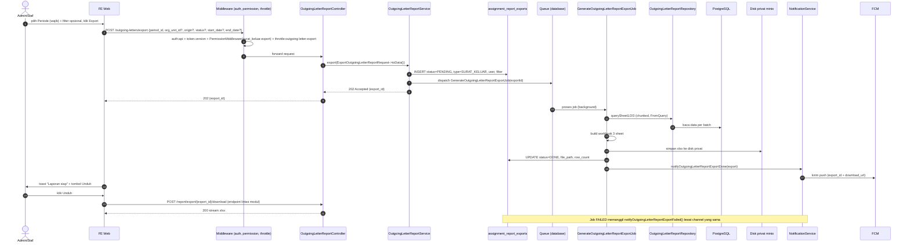
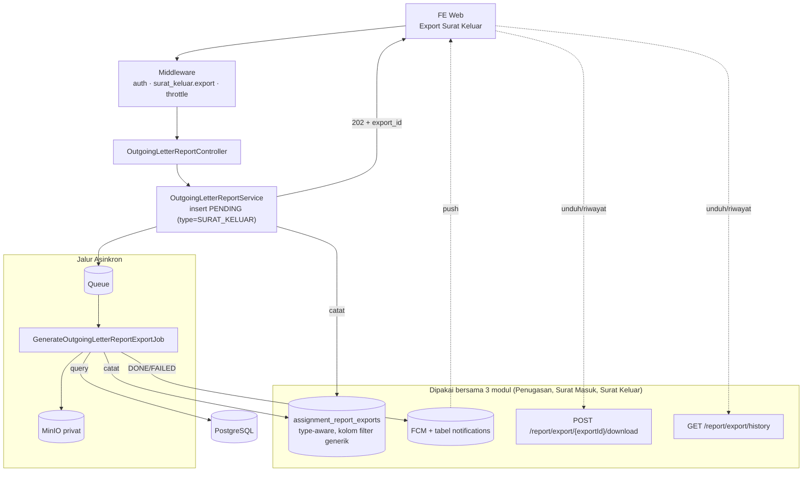

# Surat Keluar | Laporan Excel Surat Keluar

# Informasi Dokumen

**e-PARLEMEN DPRD KOTA MAGELANG — Modul Surat Keluar** Laporan Excel Surat Keluar (Filter Periode, Unit Tujuan, Asal & Status): Spesifikasi Fungsional, Rekomendasi TRD & API Contract

| Atribut      | Keterangan                                                                                                                                                            |
| ------------ | --------------------------------------------------------------------------------------------------------------------------------------------------------------------- |
| Nama Dokumen | OutgoingLetter_Report_Export_Spec_TRD_v0.1 — Laporan Excel Surat Keluar                                                                                               |
| Versi        | 0.1                                                                                                                                                                   |
| Tanggal      | 23 November 2026                                                                                                                                                      |
| Disusun oleh | Claude (atas permintaan Ayu Widya Inggit)                                                                                                                             |
| Isi Dokumen  | Bagian A – Spesifikasi Fungsional · Bagian B – Rekomendasi Analisa TRD · Bagian C – API Docs                                                                          |
| Acuan        | `docs/rekomendasi_teknis/report_penugasan.md` (arsitektur dasar) dan `docs/rekomendasi_teknis/report_surat_masuk.md` (modul ketiga yang memakai ulang pola yang sama) |

## Riwayat Revisi

| Versi | Tanggal     | Perubahan                                                                                                                                                                                                                                                                                                                                          |
| ----- | ----------- | -------------------------------------------------------------------------------------------------------------------------------------------------------------------------------------------------------------------------------------------------------------------------------------------------------------------------------------------------- |
| 0.1   | 23 Nov 2026 | Initial draft. Modul ketiga yang memakai arsitektur `report_penugasan.md`/`report_surat_masuk.md` (async-only, tabel `assignment_report_exports` lintas modul dengan `type = SURAT_KELUAR`). Diverifikasi terhadap data riil `e_parlemen_develop` tabel `outgoing_letters`, `outgoing_letter_signers`, `outgoing_letter_attachments` (lihat §7.4). |

# Bagian A — Spesifikasi Fungsional

## 1. Pendahuluan

### 1.1 Tujuan

Dokumen ini menjelaskan kebutuhan fungsional fitur **Export Laporan Excel** pada modul **Surat Keluar** (`OutgoingLetter`), modul ketiga yang memakai arsitektur export yang sudah disepakati untuk Penugasan dan diperluas untuk Surat Masuk.

Admin/staf yang berwenang dapat mengunduh workbook `.xlsx` berisi data surat keluar, riwayat penandatangan berjenjang, dan lampiran, difilter berdasarkan **Periode (wajib)**, **Unit Organisasi Tujuan (opsional)**, **Asal/Lajur (opsional)**, **Status (opsional)**, dan **rentang tanggal surat (opsional)**.

- **Bagian B** berisi rekomendasi teknis.
- **Bagian C** berisi rancangan API — endpoint trigger baru khusus modul ini; endpoint riwayat & download dipakai bersama lintas modul (`report_penugasan.md` §14.2–§14.3).

### 1.2 Ruang Lingkup

**Termasuk dalam lingkup:**

- Export laporan surat keluar dari tabel `outgoing_letters` dan relasinya (`outgoing_letter_signers`, `outgoing_letter_attachments` → `uploads`).
- Filter Periode wajib (`outgoing_letters.period_id`), filter Unit Organisasi Tujuan opsional (`outgoing_letters.target_org_unit_id`), filter Asal/Lajur opsional (`outgoing_letters.origin`: `REQUEST`/`DIRECT`), filter Status opsional (`outgoing_letters.status`), dan filter rentang tanggal opsional (`outgoing_letters.letter_date`) yang mempersempit periode terpilih.
- Workbook 3 sheet: Ringkasan Surat Keluar, Detail Penandatangan, Detail Lampiran.
- Jalur asinkron, notifikasi push, dan audit trail — infrastruktur dipakai bersama dengan modul Penugasan & Surat Masuk, bukan dibangun ulang.

**Di luar lingkup:**

| No  | Item                                                                                                                                                    | Keterangan & Usulan                                                                                                                                                                                   | Ref.             |
| --- | ------------------------------------------------------------------------------------------------------------------------------------------------------- | ----------------------------------------------------------------------------------------------------------------------------------------------------------------------------------------------------- | ---------------- |
| 1   | Keunikan `outgoing_letters.letter_number` bersifat global (meski sudah partial-unique, hanya aktif saat `letter_number IS NOT NULL`), bukan per periode | Sama dengan temuan `incoming_letters` di `report_surat_masuk.md` §7.4.b — risiko penomoran ulang antar periode. Saat ini dampaknya lebih kecil karena baru 1 periode terwakili di data riil (§7.4.a). | §7.4.b, IT-SK-02 |
| 2   | `outgoing_letters.related_user_assignment_id` murni fitur jalur `DIRECT` (prefill target), bukan representasi "pemohon" pada jalur `REQUEST`            | Berpotensi disalahartikan FE/analis sebagai "siapa yang meminta surat ini" — tidak demikian untuk `REQUEST`. Didokumentasikan sebagai temuan (§7.4.c), bukan diperbaiki di sini.                      | §7.4.c           |
| 3   | Kolom audit generik (`status`, `origin`) belum ditambahkan ke `assignment_report_exports` saat `report_surat_masuk.md` ditulis                          | Diperbaiki di dokumen ini (§7.2) — sekaligus dicatat sebagai isu susulan agar `report_surat_masuk.md` ikut disinkronkan.                                                                              | §7.2, IT-SK-01   |

### 1.3 Aktor & Kanal

| Aktor                                                         | Kanal                                             | Peran                                                                                                     |
| ------------------------------------------------------------- | ------------------------------------------------- | --------------------------------------------------------------------------------------------------------- |
| Admin / Staf (pemegang permission baru `surat_keluar.export`) | WEB – Daftar Surat Keluar › Export Laporan        | Memilih Periode, Unit, Asal, Status, rentang tanggal; memicu export; menerima notifikasi; mengunduh file. |
| Sistem — Queue worker                                         | Backend (`QUEUE_CONNECTION=database`)             | Menjalankan `GenerateOutgoingLetterReportExportJob`.                                                      |
| Sistem — Notifikasi                                           | Backend (sama dengan modul Penugasan/Surat Masuk) | Mengantarkan status selesai ke pengekspor.                                                                |
| Sistem — Scheduler                                            | Backend (dipakai bersama lintas modul)            | Menandai job macet jadi `FAILED` (sama dengan `report_penugasan.md` §9.3).                                |

### 1.4 Istilah

| Istilah                      | Arti                                                                                                                                                       |
| ---------------------------- | ---------------------------------------------------------------------------------------------------------------------------------------------------------- |
| Surat Keluar                 | Fitur `OutgoingLetter` (`OutgoingLetterController`, tabel `outgoing_letters`). Permission menu: `surat_keluar`.                                            |
| Lajur Permintaan (`REQUEST`) | Surat diajukan anggota lewat Mobile (`DRAFT` → `SUBMIT` → masuk kolam SEKWAN → `IN_PROGRESS` setelah diklaim → `COMPLETED` setelah berkas final diunggah). |
| Lajur Langsung (`DIRECT`)    | Surat dibuat langsung oleh Sekretariat, lengkap sejak awal, status langsung `DONE`.                                                                        |
| Periode                      | Baris `periods`. Surat keluar ter-tag ke satu periode lewat `outgoing_letters.period_id`, diisi otomatis dari periode aktif.                               |
| Unit Organisasi Tujuan       | `outgoing_letters.target_org_unit_id` — unit yang dituju surat (bukan unit pembuat).                                                                       |
| Jabatan Tujuan               | `outgoing_letters.target_position_id` — jabatan yang dituju surat.                                                                                         |
| Penandatangan (Signer)       | Satu baris `outgoing_letter_signers` — satu jenjang tanda tangan berjenjang (`level`), diarahkan ke satu `user_assignments` lewat `user_assignment_id`.    |
| Status Surat                 | `outgoing_letters.status`: `DRAFT` / `SUBMIT` / `IN_PROGRESS` / `COMPLETED` (lajur `REQUEST`) atau `DONE` (lajur `DIRECT`, terminal langsung).             |
| Lampiran Surat               | `outgoing_letter_attachments` → `uploads`, dibedakan `attachment_type`: `REQUEST` (lampiran permintaan dari pemohon) atau `FINAL` (berkas surat jadi).     |
| Jalur asinkron               | Mekanisme proses export — identik dengan modul Penugasan/Surat Masuk.                                                                                      |

## 2. Kebutuhan Fungsional

### 2.1 Form Filter & Tombol Export (WEB)

API: `POST /outgoing-letters/export` (§14.1). Export berjalan di background.

| Field                  | Tipe        | Wajib | Request Body  | Sumber Data / Validasi                                                                                                                                                                                                                   |
| ---------------------- | ----------- | ----- | ------------- | ---------------------------------------------------------------------------------------------------------------------------------------------------------------------------------------------------------------------------------------- |
| Periode                | Dropdown    | Ya    | `period_id`   | Data: `GET /periods`. Filter ke `outgoing_letters.period_id` (kesetaraan langsung — sudah jadi pola existing di `OutgoingLetterRepository::paginateWeb()`).                                                                              |
| Unit Organisasi Tujuan | Dropdown    | Tidak | `org_unit_id` | Data: `GET /org-units` (di-scope `period_id`). Filter ke `outgoing_letters.target_org_unit_id`. Harus milik `period_id` terpilih (BR-04).                                                                                                |
| Asal/Lajur             | Dropdown    | Tidak | `origin`      | `REQUEST` / `DIRECT`. Tanpa filter, kedua lajur disertakan (BR-05).                                                                                                                                                                      |
| Status                 | Dropdown    | Tidak | `status`      | `DRAFT` / `SUBMIT` / `IN_PROGRESS` / `COMPLETED` / `DONE`. Tanpa filter, seluruh status disertakan — **berbeda** dari kolam SEKWAN di WEB (`GET /outgoing-letters`) yang mewajibkan status dan tidak pernah menampilkan `DRAFT` (BR-06). |
| Tanggal Mulai          | Date picker | Tidak | `start_date`  | Mempersempit `outgoing_letters.letter_date >=` nilai ini; harus di dalam rentang periode terpilih (BR-07).                                                                                                                               |
| Tanggal Selesai        | Date picker | Tidak | `end_date`    | Harus `>= start_date` dan di dalam rentang periode terpilih (BR-07).                                                                                                                                                                     |
| Export Laporan         | Button      | —     | —             | Nonaktif sampai Periode dipilih. Respons selalu `202`.                                                                                                                                                                                   |

> **Catatan desain.** Pola filter opsional mengikuti keputusan yang sudah diambil di `report_penugasan.md` (BR-18/19) dan `report_surat_masuk.md` (BR-05/06): mempersempit periode yang sudah dipilih.

### 2.2 Struktur Workbook

| Sheet                     | Grain (1 baris =)                 | Query  |
| ------------------------- | --------------------------------- | ------ |
| 1. Ringkasan Surat Keluar | 1 surat                           | §9.4.1 |
| 2. Detail Penandatangan   | 1 surat × 1 jenjang penandatangan | §9.4.2 |
| 3. Detail Lampiran        | 1 surat × 1 lampiran              | §9.4.3 |

Urutan baris seluruh sheet: `letter_date ASC, letter_number ASC`, lalu kunci sekunder per sheet.

### 2.3 Sheet 1 — Ringkasan Surat Keluar

| Kolom Excel                          | Sumber Field                                                                | Logic                                                                                                                                                                                          |
| ------------------------------------ | --------------------------------------------------------------------------- | ---------------------------------------------------------------------------------------------------------------------------------------------------------------------------------------------- |
| No. Surat                            | `outgoing_letters.letter_number`                                            | `NULL` selama surat belum difinalisasi (lajur `REQUEST` yang masih `SUBMIT`/`IN_PROGRESS`) — konsisten dengan `outgoing_letters_letter_number_assigned_unique` yang hanya berlaku saat terisi. |
| Perihal / Judul                      | `outgoing_letters.title`                                                    | —                                                                                                                                                                                              |
| Jenis Surat                          | `outgoing_letters_type.name`                                                | Join `outgoing_letter_type_id`.                                                                                                                                                                |
| Sifat Surat                          | `outgoing_letters.nature`                                                   | Teks bebas (bukan enum terkontrol) — ditampilkan apa adanya.                                                                                                                                   |
| Asal/Lajur                           | `outgoing_letters.origin`                                                   | Label Indonesia (§3.2).                                                                                                                                                                        |
| Status Surat                         | `outgoing_letters.status`                                                   | Label Indonesia (§3.2).                                                                                                                                                                        |
| Tanggal Surat                        | `outgoing_letters.letter_date`                                              | —                                                                                                                                                                                              |
| Kota Surat                           | `outgoing_letters.letter_city`                                              | —                                                                                                                                                                                              |
| Deadline                             | `outgoing_letters.deadline`                                                 | —                                                                                                                                                                                              |
| Unit Organisasi Tujuan               | `org_units.name`                                                            | Join `target_org_unit_id`. Bisa kosong (§7.4.d).                                                                                                                                               |
| Jabatan Tujuan                       | `positions.name`                                                            | Join `target_position_id`.                                                                                                                                                                     |
| Perlu Cap/Stempel                    | `outgoing_letters.request_stamp`                                            | Ditampilkan "Ya"/"Tidak".                                                                                                                                                                      |
| Alamat Penerima                      | `outgoing_letters.recipient_address`                                        | —                                                                                                                                                                                              |
| Penempatan Terkait (khusus `DIRECT`) | `user_assignments` lewat `related_user_assignment_id` → nama, jabatan, unit | Selalu kosong untuk lajur `REQUEST` — bukan bug, lihat §7.4.c (BR-08).                                                                                                                         |
| Periode                              | `periods.name`                                                              | —                                                                                                                                                                                              |
| Dibuat Oleh / Tanggal Dibuat         | `users.name` (`created_by`) / `created_at`                                  | —                                                                                                                                                                                              |
| Tanggal Dikirim (Submit)             | `outgoing_letters.submitted_at`                                             | Hanya relevan untuk lajur `REQUEST`.                                                                                                                                                           |
| Diklaim Oleh / Tanggal Diklaim       | `users.name` (`claimed_by`) / `claimed_at`                                  | Hanya relevan untuk lajur `REQUEST`.                                                                                                                                                           |
| Diselesaikan Oleh / Tanggal Selesai  | `users.name` (`completed_by`) / `completed_at`                              | Terisi untuk `COMPLETED` (REQUEST) maupun `DONE` (DIRECT).                                                                                                                                     |
| Jumlah Penandatangan                 | count `outgoing_letter_signers`                                             | —                                                                                                                                                                                              |
| Jumlah Lampiran                      | count `outgoing_letter_attachments`                                         | —                                                                                                                                                                                              |
| Catatan                              | `outgoing_letters.notes`                                                    | —                                                                                                                                                                                              |

### 2.4 Sheet 2 — Detail Penandatangan

| Kolom Excel                      | Sumber Field                    | Logic                                                                                          |
| -------------------------------- | ------------------------------- | ---------------------------------------------------------------------------------------------- |
| No. Surat, Perihal, Status Surat | `outgoing_letters`              | Kolom konteks.                                                                                 |
| Level Tanda Tangan               | `outgoing_letter_signers.level` | Menaik dari 1, divalidasi tanpa lompatan saat surat dibuat (bukan tanggung jawab laporan ini). |
| Nama Penandatangan               | `users.name`                    | Lewat `outgoing_letter_signers.user_assignment_id` → `user_assignments.user_id`.               |
| Jabatan                          | `positions.name`                | Lewat `user_assignments.position_id` milik penandatangan.                                      |
| Unit/Fraksi                      | `org_units.name`                | Lewat `user_assignments.org_unit_id` milik penandatangan.                                      |

### 2.5 Sheet 3 — Detail Lampiran

| Kolom Excel        | Sumber Field                                  | Logic                                                                                                                                            |
| ------------------ | --------------------------------------------- | ------------------------------------------------------------------------------------------------------------------------------------------------ |
| No. Surat, Perihal | `outgoing_letters`                            | Kolom konteks.                                                                                                                                   |
| Jenis Lampiran     | `outgoing_letter_attachments.attachment_type` | Label Indonesia (§3.2).                                                                                                                          |
| Nama File          | `uploads.original_name`                       | Lewat `outgoing_letter_attachments.upload_id`.                                                                                                   |
| Tipe File          | `uploads.mime`                                | —                                                                                                                                                |
| Ukuran File (KB)   | `uploads.size`                                | `ROUND(size / 1024, 1)` lewat `WithMapping`.                                                                                                     |
| Diunggah Oleh      | `users.name`                                  | Lewat `outgoing_letter_attachments.uploaded_by` — **bukan** `uploads.user_id` (§7.4.e: dua kolom ini bisa berbeda orang untuk upload yang sama). |
| Tanggal Diunggah   | `outgoing_letter_attachments.created_at`      | Waktu berkas dilampirkan ke surat ini, bukan waktu upload pertama kali.                                                                          |

### 2.6 Penamaan File

- Tanpa filter unit: `Laporan-SuratKeluar_{nama_periode}.xlsx`
- Dengan filter unit: `Laporan-SuratKeluar_{nama_periode}_{nama_unit}.xlsx`

### 2.7 Pemberitahuan Selesai & Unduh

Identik dengan `report_penugasan.md` §2.7 dan `report_surat_masuk.md` §2.7 — tidak diulang di sini. Riwayat: `GET /report/export/history?filter[type]=SURAT_KELUAR`.

## 3. Status & Kamus Label

### 3.1 Status Proses Export

Sama dengan `report_penugasan.md` §3.1 — tidak diulang di sini.

### 3.2 Kamus Kode → Label di Excel

| Kolom                                                          | Kode BE       | Label Indonesia             |
| -------------------------------------------------------------- | ------------- | --------------------------- |
| Status Surat (`outgoing_letters.status`)                       | `DRAFT`       | Draf                        |
|                                                                | `SUBMIT`      | Dikirim ke Sekretariat      |
|                                                                | `IN_PROGRESS` | Sedang Diproses             |
|                                                                | `COMPLETED`   | Selesai (Permintaan)        |
|                                                                | `DONE`        | Selesai (Langsung)          |
| Asal/Lajur (`outgoing_letters.origin`)                         | `REQUEST`     | Permintaan Anggota          |
|                                                                | `DIRECT`      | Dibuat Langsung Sekretariat |
| Jenis Lampiran (`outgoing_letter_attachments.attachment_type`) | `REQUEST`     | Lampiran Permintaan         |
|                                                                | `FINAL`       | Berkas Final                |

## 4. Alur Proses

### 4.1 Alur Export (Asinkron)



_Gambar 1. Sequence – identik secara arsitektur dengan Penugasan & Surat Masuk, hanya beda entitas sumber data._

## 5. Aturan Bisnis

| Kode  | Aturan                                                                                                                                                                                                                                                                |
| ----- | --------------------------------------------------------------------------------------------------------------------------------------------------------------------------------------------------------------------------------------------------------------------- |
| BR-01 | Periode **wajib** dipilih; `period_id` harus UUID valid dan ada di `periods`.                                                                                                                                                                                         |
| BR-02 | Filter Periode memakai kesetaraan langsung `outgoing_letters.period_id = :period_id` — sudah pola existing di `OutgoingLetterRepository::paginateWeb()`, tidak ada risiko IT-01-style.                                                                                |
| BR-03 | Unit Organisasi Tujuan **opsional**; filter ke `outgoing_letters.target_org_unit_id`.                                                                                                                                                                                 |
| BR-04 | `org_unit_id` harus milik `period_id` yang dipilih (`org_units.period_id = period_id`) — divalidasi BE, sama pola dengan BR-04 `report_surat_masuk.md`.                                                                                                               |
| BR-05 | Asal/Lajur **opsional** (`REQUEST`/`DIRECT`); tanpa filter, kedua lajur disertakan.                                                                                                                                                                                   |
| BR-06 | Status **opsional**, mencakup `DRAFT`/`SUBMIT`/`IN_PROGRESS`/`COMPLETED`/`DONE`. Ini **sengaja berbeda** dari `GET /outgoing-letters` (kolam SEKWAN web) yang mewajibkan status dan menyembunyikan `DRAFT` — laporan ini untuk audit menyeluruh, bukan antrean kerja. |
| BR-07 | `start_date`/`end_date` **opsional**, mempersempit `outgoing_letters.letter_date` di dalam rentang periode terpilih; `end_date >= start_date` bila keduanya diisi.                                                                                                    |
| BR-08 | Kolom "Penempatan Terkait" (Sheet 1) hanya relevan untuk lajur `DIRECT`; selalu kosong untuk lajur `REQUEST` karena `related_user_assignment_id` tidak pernah diisi oleh alur Mobile (§7.4.c) — bukan bug laporan.                                                    |
| BR-09 | "Jumlah Penandatangan" dan "Jumlah Lampiran" (Sheet 1) menghitung seluruh baris terkait tanpa filter tambahan.                                                                                                                                                        |
| BR-10 | Sheet 3 memakai `outgoing_letter_attachments.uploaded_by` untuk "Diunggah Oleh", bukan `uploads.user_id` — keduanya bisa berbeda orang untuk upload yang sama (§7.4.e).                                                                                               |
| BR-11 | Seluruh kolom status/label (Status Surat, Asal, Jenis Lampiran) ditulis label Indonesia (§3.2), bukan kode mentah.                                                                                                                                                    |
| BR-12 | Seluruh export diproses **asinkron**, sama dengan BR-11 `report_penugasan.md`.                                                                                                                                                                                        |
| BR-13 | Export hanya oleh pemegang permission baru `surat_keluar.export`.                                                                                                                                                                                                     |
| BR-14 | File hasil export disimpan di disk privat, diunduh lewat endpoint lintas modul yang sama — tidak ada presigned URL.                                                                                                                                                   |
| BR-15 | Setiap export dicatat di `assignment_report_exports` dengan `type = SURAT_KELUAR`; `dapil_id` selalu `NULL` untuk tipe ini; `org_unit_id`, `origin`, `status`, `start_date`, `end_date` diisi sesuai filter yang dipakai (§7.2).                                      |
| BR-16 | Notifikasi hanya dikirim ke pengekspor, pola sama dengan modul lain.                                                                                                                                                                                                  |

# Bagian B — Rekomendasi Analisa untuk TRD

Sama seperti `report_surat_masuk.md`, seluruh isi Bagian B memakai ulang infrastruktur `assignment_report_exports` + job antrean + notifikasi yang sudah ada — modul ini adalah modul **ketiga**, sehingga titik ini menjadi uji nyata apakah desain tabel bersama itu benar-benar bisa menampung filter berbeda-beda per modul tanpa terus-menerus ditambal.

## 6. Asumsi Teknis & Arsitektur

### 6.1 Komponen & Pemetaan ke Struktur Existing

| Layer        | Komponen Baru                                                                                                    | Mengikuti Pola                                                  | Tanggung Jawab                                                                                                               |
| ------------ | ---------------------------------------------------------------------------------------------------------------- | --------------------------------------------------------------- | ---------------------------------------------------------------------------------------------------------------------------- |
| Route        | `POST /outgoing-letters/export`                                                                                  | Grup `outgoing-letters` di `routes/V1/api.php`                  | Trigger export. Download & riwayat dipakai bersama.                                                                          |
| Controller   | `App\Http\Controllers\V1\OutgoingLetterReportController`                                                         | `AssignmentReportController` / `IncomingLetterReportController` | Validasi auth, delegasi ke service.                                                                                          |
| FormRequest  | `App\Http\Requests\V1\ExportOutgoingLetterReportRequest`                                                         | `ExportIncomingLetterReportRequest`                             | `period_id` wajib; `org_unit_id`, `origin`, `status`, `start_date`, `end_date` opsional; validasi silang unit milik periode. |
| DTO          | `App\Data\V1\OutgoingLetterReportFilterData`                                                                     | `IncomingLetterReportFilterData`                                | `{ periodId, orgUnitId, origin, status, startDate, endDate }`.                                                               |
| Service      | `App\Contracts\V1\Services\OutgoingLetterReportServiceInterface` + `App\Services\V1\OutgoingLetterReportService` | `IncomingLetterReportService`                                   | Insert baris `PENDING` (`type = SURAT_KELUAR`), dispatch job.                                                                |
| Repository   | `App\Repositories\V1\OutgoingLetterReportRepository`                                                             | `IncomingLetterReportRepository`                                | 3 query read-only.                                                                                                           |
| Job          | `App\Jobs\V1\GenerateOutgoingLetterReportExportJob`                                                              | `GenerateIncomingLetterReportExportJob`                         | Build workbook, simpan, update status, kirim notifikasi.                                                                     |
| Notification | `App\Notifications\V1\OutgoingLetterReportExportDoneNotification` / `...FailedNotification`                      | Pola modul lain                                                 | `via()` → `['database', FcmChannel::class]`.                                                                                 |
| Status/audit | `assignment_report_exports` (perlu kolom tambahan, §7.2)                                                         | Dipakai bersama lintas 3 modul sekarang                         | Baris `type = SURAT_KELUAR` memakai `org_unit_id`, `origin`, `status`, `start_date`, `end_date`.                             |

### 6.2 Diagram Arsitektur Komponen



_Gambar 2. Dengan modul ketiga ini, bagian "Dipakai bersama" terbukti generik — tidak ada komponen baru di luar kolom tabel (§7.2)._

### 6.3 Pencegahan Duplikasi Export

Perbaikan index `uq_assignment_report_exports_in_flight` berbasis `COALESCE` sudah direkomendasikan di `report_surat_masuk.md` §6.3 untuk mengatasi gap NULL-safety pada `dapil_id`/`org_unit_id`. Modul ini **menambah dua kolom lagi** (`origin`, `status`) yang juga opsional/nullable — gap yang sama berlaku bila keduanya tidak diikutkan ke index.

**Perbaikan lanjutan** (menggantikan usulan `report_surat_masuk.md` §6.3, karena sekarang ada lebih banyak kolom filter opsional):

```sql
DROP INDEX IF EXISTS uq_assignment_report_exports_in_flight;

CREATE UNIQUE INDEX uq_assignment_report_exports_in_flight
  ON assignment_report_exports (
    user_id,
    type,
    period_id,
    COALESCE(dapil_id, '00000000-0000-0000-0000-000000000000'::uuid),
    COALESCE(org_unit_id, '00000000-0000-0000-0000-000000000000'::uuid),
    COALESCE(origin, ''),
    COALESCE(status_filter, ''),
    COALESCE(start_date, '0001-01-01'::date),
    COALESCE(end_date, '0001-01-01'::date)
  )
  WHERE status IN ('PENDING', 'PROCESSING');
```

> Kolom filter status disebut `status_filter` di index ini untuk membedakannya dari `assignment_report_exports.status` (status proses job: `PENDING`/`DONE`/dst) — lihat penamaan di §7.2.

**Catatan arsitektur.** Menambah kolom `COALESCE` setiap kali ada filter baru adalah gejala bahwa pendekatan "satu kolom nullable per filter per modul" sudah mulai terasa sempit setelah modul ketiga. Direkomendasikan sebagai langkah lanjutan (bukan syarat rilis modul ini): migrasikan kolom-kolom filter opsional (`dapil_id`, `org_unit_id`, `origin`, `status_filter`, `start_date`, `end_date`) menjadi satu kolom `filters JSONB`, dengan index berbasis hash dari representasi JSON yang dinormalisasi. Lihat IT-SK-04.

## 7. Model Data

### 7.1 Tabel Sumber (Existing)

| Tabel                                     | Dipakai di                         | Peran                                                                                                       |
| ----------------------------------------- | ---------------------------------- | ----------------------------------------------------------------------------------------------------------- |
| `outgoing_letters`                        | Sheet 1, 2, 3                      | Data utama surat keluar; kolom filter `period_id`, `target_org_unit_id`, `origin`, `status`, `letter_date`. |
| `outgoing_letters_type`                   | Sheet 1                            | Jenis surat keluar.                                                                                         |
| `periods`                                 | Semua                              | Nama periode & validasi filter.                                                                             |
| `org_units`, `positions`                  | Sheet 1, 2                         | Unit/jabatan tujuan surat, dan unit/jabatan penandatangan (lewat `user_assignments`).                       |
| `users`                                   | Sheet 1, 2, 3                      | Nama pembuat, klaimer, penyelesai, penandatangan, pengunggah.                                               |
| `user_assignments`                        | Sheet 1 (kondisional), Sheet 2     | Penempatan terkait (`DIRECT`) dan penempatan penandatangan.                                                 |
| `outgoing_letter_signers`                 | Sheet 2 (grain), Sheet 1 (agregat) | Rangkaian penandatangan berjenjang.                                                                         |
| `outgoing_letter_attachments` + `uploads` | Sheet 3 (grain), Sheet 1 (agregat) | Lampiran surat (permintaan & final).                                                                        |

### 7.2 Perubahan Tabel `assignment_report_exports` (melengkapi §7.2 `report_surat_masuk.md`)

| **Kolom**       | **Perubahan**                     | **Keterangan**                                                                                                                                                                                                                                                                                                                                                                                       |
| --------------- | --------------------------------- | ---------------------------------------------------------------------------------------------------------------------------------------------------------------------------------------------------------------------------------------------------------------------------------------------------------------------------------------------------------------------------------------------------- |
| `origin`        | **Baru.** `varchar(20)`, nullable | Nilai filter `REQUEST`/`DIRECT` yang dipakai saat export `type = SURAT_KELUAR`; `NULL` untuk tipe lain atau saat tidak difilter.                                                                                                                                                                                                                                                                     |
| `status_filter` | **Baru.** `varchar(20)`, nullable | Menyimpan nilai filter status (bukan status proses job) yang dipakai saat export, untuk **seluruh tipe** — dinamai `status_filter` agar tidak bertabrakan dengan kolom `status` (proses job) yang sudah ada. **Ini juga menutup gap yang terlewat di `report_surat_masuk.md` §7.2**, yang menyebut status sebagai filter (BR-05 dokumen itu) tapi tidak menambahkan kolom auditnya — lihat IT-SK-01. |

Kolom `org_unit_id`, `start_date`, `end_date` (ditambahkan di `report_surat_masuk.md` §7.2) dipakai ulang langsung, tanpa perubahan definisi. `target_org_unit_id` pada tabel sumber disimpan ke kolom generik `org_unit_id` yang sama.

### 7.3 Index

| Index                                                                                | Status                                  | Tujuan                                                                                                                              |
| ------------------------------------------------------------------------------------ | --------------------------------------- | ----------------------------------------------------------------------------------------------------------------------------------- |
| `outgoing_letters_period_id_index`                                                   | **Sudah ada**                           | Filter periode.                                                                                                                     |
| `outgoing_letters_letter_date_index`, `outgoing_letters_status_origin_index`         | **Sudah ada**                           | Filter tanggal, status, dan asal/lajur sudah tercakup index komposit ini (dicek `pg_indexes`, 23 Nov 2026).                         |
| `idx_outgoing_letters_target_org_unit_id` ON `outgoing_letters (target_org_unit_id)` | **Baru — direkomendasikan**             | Belum ada index pada `target_org_unit_id`, padahal jadi filter sekunder laporan ini.                                                |
| Perbaikan `uq_assignment_report_exports_in_flight` (§6.3)                            | **Perlu migrasi ulang (kedua kalinya)** | Menggantikan usulan `report_surat_masuk.md` §6.3 dengan versi yang mencakup kolom `origin`/`status_filter`/`start_date`/`end_date`. |

### 7.4 Temuan Data & Keterbatasan

Seluruh temuan diverifikasi langsung ke `e_parlemen_develop` pada 23 November 2026.

**a. Hanya 1 periode terwakili pada data riil**

`outgoing_letters` punya 28 baris, **seluruhnya** menunjuk ke periode aktif `PRD-2024` (`distinct_periods = 1`). Berbeda dari `incoming_letters` (2 periode) — filter periode pada laporan ini belum teruji lintas periode dengan data riil, meski secara desain query sudah benar (kesetaraan langsung, sama pola dengan `incoming_letters`).

**b. `letter_number` sudah partial-unique, tapi tetap global**

```sql
CREATE UNIQUE INDEX outgoing_letters_letter_number_assigned_unique
  ON outgoing_letters USING btree (letter_number) WHERE (letter_number IS NOT NULL)
```

Lebih baik dari `incoming_letters` (yang unique constraint-nya tidak punya predikat `WHERE`), tapi tetap **tidak** scoped per periode. Dengan hanya 1 periode di data riil (temuan a), risiko kolisi penomoran antar periode belum teruji — tapi secara desain tetap berlaku begitu periode kedua mulai memakai format nomor yang sama (9 dari 28 baris saat ini `letter_number IS NULL`, menunggu finalisasi).

**c. `related_user_assignment_id` selalu `NULL` pada lajur `REQUEST`**

```
origin   | total | related_user_assignment_id NULL
---------|-------|--------------------------------
REQUEST  |  16   |  16   (100%)
DIRECT   |  12   |   7   (58%)
```

Dikonfirmasi lewat kode: `MobileOutgoingLetterService::store()` (lajur `REQUEST`, dipakai anggota lewat Mobile) **tidak pernah** mengisi `related_user_assignment_id`; kolom ini hanya dipakai di `OutgoingLetterService::storeDirect()` (lajur `DIRECT`) sebagai cara cepat mem-prefill `target_position_id`/`target_org_unit_id` dari satu penempatan. Data riil mengonfirmasi: 100% baris `REQUEST` kosong, sebagian baris `DIRECT` terisi. Kolom "Penempatan Terkait" pada Sheet 1 (§2.3) karena itu **murni relevan untuk lajur `DIRECT`** — bukan representasi "siapa pemohon" (BR-08).

**d. `target_org_unit_id`/`target_position_id` kosong pada sepertiga data**

9 dari 28 baris (`32%`) berkolom `target_org_unit_id IS NULL` dan `target_position_id IS NULL` secara bersamaan — surat keluar tanpa tujuan unit/jabatan tersimpan (umumnya surat bersifat umum/pengumuman, dikonfirmasi lewat `nature` seperti "Penting"/"Segera" pada beberapa baris ini). Kolom "Unit Organisasi Tujuan"/"Jabatan Tujuan" pada Sheet 1 kosong untuk baris tersebut — bukan bug.

**e. `uploaded_by` pada lampiran bisa berbeda dari `uploads.user_id`**

Pada surat `SK-0001`, berkas `dprd.png` yang sama muncul dua kali di `outgoing_letter_attachments` dengan `attachment_type` berbeda (`FINAL` diunggah atas nama RUMIYATI, `REQUEST` diunggah atas nama INDAH DWIANTARI) — menegaskan `outgoing_letter_attachments.uploaded_by` adalah atribusi **pada level lampiran-ke-surat**, bukan sekadar menyalin `uploads.user_id`. Sheet 3 (§2.5) secara sengaja memakai kolom ini, bukan `uploads.user_id` (BR-10).

**f. Penandatangan berjenjang nyata hingga level 3**

23 baris `outgoing_letter_signers` tersebar di 16 surat (`57%` dari seluruh surat punya penandatang), dengan jenjang tertinggi `level = 3` pada data riil — mengonfirmasi Sheet 2 memang perlu grain "1 surat × 1 jenjang", bukan kolom tunggal "nama penandatangan" di Sheet 1.

## 8. Ringkasan Desain API

| No  | Method | Endpoint                             | Kanal / Aktor    | Fungsi                                                                   | Ref.  |
| --- | ------ | ------------------------------------ | ---------------- | ------------------------------------------------------------------------ | ----- |
| 1   | POST   | `/outgoing-letters/export`           | WEB – Admin/Staf | Memicu export laporan Surat Keluar. **Baru**, khusus modul ini.          | §14.1 |
| 2   | POST   | `/report/export/{exportId}/download` | WEB – Admin/Staf | Unduh file. **Dipakai bersama** — `report_penugasan.md` §14.3.           | —     |
| 3   | GET    | `/report/export/history`             | WEB – Admin/Staf | Riwayat export, filter `filter[type]=SURAT_KELUAR`. **Dipakai bersama**. | —     |

## 9. Logic Proses & Query

### 9.1 Validasi Request

1. `period_id` wajib, UUID valid, ada di `periods` → selain itu `422`.
2. `org_unit_id` opsional, UUID valid, ada di `org_units` → selain itu `422`.
3. Bila `org_unit_id` diisi: `org_units.period_id` harus sama dengan `period_id` → selain itu `422` (BR-04).
4. `origin` opsional, harus `REQUEST` atau `DIRECT` → selain itu `422` (BR-05).
5. `status` opsional, harus salah satu dari `DRAFT`/`SUBMIT`/`IN_PROGRESS`/`COMPLETED`/`DONE` → selain itu `422` (BR-06).
6. `start_date`/`end_date` opsional, format tanggal valid; `end_date >= start_date` bila keduanya diisi; keduanya harus di dalam rentang periode terpilih → selain itu `422` (BR-07).
7. Validasi format UUID sebelum query untuk mencegah error Postgres `22P02`.

### 9.2 Proses Export (Asinkron) & Notifikasi

Identik dengan `report_penugasan.md` §9.2 / `report_surat_masuk.md` §9.2, hanya beda nama job/kelas dan `type = SURAT_KELUAR` saat insert.

### 9.3 Cleanup Terjadwal

Dipakai bersama lintas modul — tidak diulang di sini.

### 9.4 Query Referensi

Query berikut sudah diuji terhadap `e_parlemen_develop` (23 Nov 2026, periode aktif `d0eefc99-e99f-5ba3-a818-6d5555d829f9` / `PRD-2024` — satu-satunya periode terwakili saat ini, lihat §7.4.a).

#### 9.4.1 Query Sheet 1 — Ringkasan Surat Keluar

```sql
WITH params AS (
    SELECT
        'd0eefc99-e99f-5ba3-a818-6d5555d829f9'::uuid AS period_id,  -- WAJIB
        NULL::uuid AS org_unit_id,                                  -- OPSIONAL
        NULL::varchar AS origin,                                    -- OPSIONAL: REQUEST/DIRECT
        NULL::varchar AS status,                                    -- OPSIONAL
        NULL::date AS start_date,                                   -- OPSIONAL
        NULL::date AS end_date                                      -- OPSIONAL
)
SELECT
    ol.letter_number                                    AS "No. Surat",
    ol.title                                             AS "Perihal",
    t.name                                                AS "Jenis Surat",
    ol.nature                                             AS "Sifat Surat",
    ol.origin                                             AS "Asal/Lajur",
    ol.status                                             AS "Status Surat",
    ol.letter_date                                        AS "Tanggal Surat",
    ol.letter_city                                         AS "Kota Surat",
    ol.deadline                                            AS "Deadline",
    tou.name                                               AS "Unit Organisasi Tujuan",
    tp.name                                                AS "Jabatan Tujuan",
    ol.request_stamp                                       AS "Perlu Cap/Stempel",
    ol.recipient_address                                   AS "Alamat Penerima",
    related_u.name                                         AS "Penempatan Terkait - Nama",
    related_pos.name                                       AS "Penempatan Terkait - Jabatan",
    related_ou.name                                        AS "Penempatan Terkait - Unit",
    p.name                                                 AS "Periode",
    creator.name                                           AS "Dibuat Oleh",
    ol.created_at                                          AS "Tanggal Dibuat",
    ol.submitted_at                                        AS "Tanggal Dikirim",
    claimer.name                                           AS "Diklaim Oleh",
    ol.claimed_at                                          AS "Tanggal Diklaim",
    completer.name                                         AS "Diselesaikan Oleh",
    ol.completed_at                                        AS "Tanggal Selesai",
    (SELECT count(*) FROM outgoing_letter_signers s
       WHERE s.outgoing_letter_id = ol.id)                 AS "Jumlah Penandatangan",
    (SELECT count(*) FROM outgoing_letter_attachments a
       WHERE a.outgoing_letter_id = ol.id)                 AS "Jumlah Lampiran",
    ol.notes                                               AS "Catatan"
FROM outgoing_letters ol
CROSS JOIN params
JOIN periods p                   ON p.id = params.period_id
LEFT JOIN outgoing_letters_type t ON t.id = ol.outgoing_letter_type_id
LEFT JOIN org_units tou           ON tou.id = ol.target_org_unit_id
LEFT JOIN positions tp            ON tp.id = ol.target_position_id
LEFT JOIN users creator           ON creator.id = ol.created_by
LEFT JOIN users claimer           ON claimer.id = ol.claimed_by
LEFT JOIN users completer         ON completer.id = ol.completed_by
LEFT JOIN user_assignments related_ua ON related_ua.id = ol.related_user_assignment_id
LEFT JOIN users related_u             ON related_u.id = related_ua.user_id
LEFT JOIN positions related_pos       ON related_pos.id = related_ua.position_id
LEFT JOIN org_units related_ou        ON related_ou.id = related_ua.org_unit_id
WHERE ol.period_id = params.period_id
  AND (params.org_unit_id IS NULL OR ol.target_org_unit_id = params.org_unit_id)
  AND (params.origin IS NULL OR ol.origin = params.origin)
  AND (params.status IS NULL OR ol.status = params.status)
  AND (params.start_date IS NULL OR ol.letter_date >= params.start_date)
  AND (params.end_date IS NULL OR ol.letter_date <= params.end_date)
ORDER BY ol.letter_date ASC, ol.letter_number ASC;
```

#### 9.4.2 Query Sheet 2 — Detail Penandatangan

```sql
WITH params AS (
    SELECT
        'd0eefc99-e99f-5ba3-a818-6d5555d829f9'::uuid AS period_id,
        NULL::uuid AS org_unit_id,
        NULL::varchar AS origin,
        NULL::varchar AS status,
        NULL::date AS start_date,
        NULL::date AS end_date
)
SELECT
    ol.letter_number                                    AS "No. Surat",
    ol.title                                             AS "Perihal",
    s.level                                               AS "Level Tanda Tangan",
    u.name                                                AS "Nama Penandatangan",
    pos.name                                              AS "Jabatan",
    ou.name                                               AS "Unit/Fraksi"
FROM outgoing_letters ol
CROSS JOIN params
JOIN periods p                     ON p.id = params.period_id
JOIN outgoing_letter_signers s     ON s.outgoing_letter_id = ol.id
JOIN user_assignments ua           ON ua.id = s.user_assignment_id
JOIN users u                       ON u.id = ua.user_id
LEFT JOIN positions pos            ON pos.id = ua.position_id
LEFT JOIN org_units ou             ON ou.id = ua.org_unit_id
WHERE ol.period_id = params.period_id
  AND (params.org_unit_id IS NULL OR ol.target_org_unit_id = params.org_unit_id)
  AND (params.origin IS NULL OR ol.origin = params.origin)
  AND (params.status IS NULL OR ol.status = params.status)
  AND (params.start_date IS NULL OR ol.letter_date >= params.start_date)
  AND (params.end_date IS NULL OR ol.letter_date <= params.end_date)
ORDER BY ol.letter_date ASC, ol.letter_number ASC, s.level ASC;
```

#### 9.4.3 Query Sheet 3 — Detail Lampiran

```sql
WITH params AS (
    SELECT
        'd0eefc99-e99f-5ba3-a818-6d5555d829f9'::uuid AS period_id,
        NULL::uuid AS org_unit_id,
        NULL::varchar AS origin,
        NULL::varchar AS status,
        NULL::date AS start_date,
        NULL::date AS end_date
)
SELECT
    ol.letter_number                                    AS "No. Surat",
    ol.title                                             AS "Perihal",
    a.attachment_type                                     AS "Jenis Lampiran",
    up.original_name                                      AS "Nama File",
    up.mime                                               AS "Tipe File",
    round(up.size / 1024.0, 1)                            AS "Ukuran File (KB)",
    uploader.name                                          AS "Diunggah Oleh",
    a.created_at                                           AS "Tanggal Diunggah"
FROM outgoing_letters ol
CROSS JOIN params
JOIN periods p                      ON p.id = params.period_id
JOIN outgoing_letter_attachments a  ON a.outgoing_letter_id = ol.id
JOIN uploads up                     ON up.id = a.upload_id
LEFT JOIN users uploader            ON uploader.id = a.uploaded_by
WHERE ol.period_id = params.period_id
  AND (params.org_unit_id IS NULL OR ol.target_org_unit_id = params.org_unit_id)
  AND (params.origin IS NULL OR ol.origin = params.origin)
  AND (params.status IS NULL OR ol.status = params.status)
  AND (params.start_date IS NULL OR ol.letter_date >= params.start_date)
  AND (params.end_date IS NULL OR ol.letter_date <= params.end_date)
ORDER BY ol.letter_date ASC, ol.letter_number ASC, a.created_at ASC;
```

> **Catatan:** Kolom status/asal/jenis lampiran masih kode mentah di query; label Indonesia diterapkan di `WithMapping` (§3.2, BR-11).

## 10. Rekomendasi Performa

1. **Index baru wajib sebelum rilis:** `CREATE INDEX idx_outgoing_letters_target_org_unit_id ON outgoing_letters (target_org_unit_id);` (§7.3).
2. **`FromQuery`, bukan `FromCollection`** — sama alasan dengan modul lain.
3. **Query via Repository dengan Query Builder berbinding** — menghindari N+1 pada dua subquery agregat Sheet 1.
4. **Perbaiki index anti-duplikasi (§6.3) sekali lagi** sebelum tipe `SURAT_KELUAR` dipakai — index yang diusulkan `report_surat_masuk.md` §6.3 belum mencakup `origin`/`status_filter`/tanggal.
5. Ukuran data saat ini (28 surat, 23 baris signer, 11 lampiran) terlalu kecil untuk kesimpulan performa empiris.

## 11. Rekomendasi Keamanan

1. **Permission granular baru** `surat_keluar.export`, terpisah dari `surat_keluar` (akses CRUD).
2. **Throttle khusus** `throttle:outgoing-letter-export`, terpisah dari `throttle:outgoing-letter`.
3. **Validasi silang** `org_unit_id` terhadap `period_id` (BR-04).
4. **File export tidak pernah di disk `public`** — identik dengan modul lain.
5. **Audit trail** harus menyimpan seluruh filter yang dipakai (`org_unit_id`, `origin`, `status_filter`, rentang tanggal) — bukan hanya `period_id`, supaya kolom baru di §7.2 benar-benar terisi, tidak hanya didefinisikan.
6. **Kebijakan retensi file** sama dengan IT-05 `report_penugasan.md` — berlaku lintas modul, bukan keputusan baru.

## 12. Dependency, Migration & Isu Terbuka

### 12.1 Dependency & Migration yang Perlu Approval

| Perubahan                                                                           | Jenis                                | Catatan                                                                                                                                                                 |
| ----------------------------------------------------------------------------------- | ------------------------------------ | ----------------------------------------------------------------------------------------------------------------------------------------------------------------------- |
| Migration: tambah kolom `origin`, `status_filter` ke `assignment_report_exports`    | Migration skema                      | Susulan dari kolom yang sudah ditambahkan di `report_surat_masuk.md` §7.2.                                                                                              |
| Migration: ganti ulang `uq_assignment_report_exports_in_flight` (§6.3, versi kedua) | Migration skema (index)              | Menggantikan versi yang diusulkan `report_surat_masuk.md` — pastikan kedua dokumen disinkronkan, jangan menjalankan migration versi lama bila versi ini sudah diadopsi. |
| Migration: index `idx_outgoing_letters_target_org_unit_id`                          | Migration skema (index saja)         | Risiko rendah, reversibel.                                                                                                                                              |
| Permission `surat_keluar.export`                                                    | Data seeder / konfigurasi permission | Sama pola dengan `penugasan.export`/`surat_masuk.export`.                                                                                                               |
| Kelas baru: Controller, Service, Repository, Job, 2 Notifikasi (§6.1)               | Kode baru                            | Tidak perlu dependency tambahan — `maatwebsite/excel` sudah ada sejak modul Penugasan.                                                                                  |

### 12.2 Pemetaan Isu ke Keputusan

| Kode     | Isu                                                                                                                                                                                                        | Rekomendasi                                                                                                                                                      | Pemilik Keputusan |
| -------- | ---------------------------------------------------------------------------------------------------------------------------------------------------------------------------------------------------------- | ---------------------------------------------------------------------------------------------------------------------------------------------------------------- | ----------------- |
| IT-SK-01 | `report_surat_masuk.md` §7.2 menyebut `status` sebagai filter (BR-05) tapi tidak menambahkan kolom audit untuknya — gap yang baru terlihat setelah modul ketiga ini didesain.                              | Tambahkan kolom `status_filter` (§7.2 dokumen ini) secara retroaktif berlaku untuk tipe `SURAT_MASUK` juga, dan perbarui `report_surat_masuk.md` agar konsisten. | Tim BE            |
| IT-SK-02 | `outgoing_letters.letter_number` partial-unique tapi tetap global, bukan per periode (§7.4.b) — risiko belum teruji karena data riil baru mencakup 1 periode.                                              | Sama rekomendasi dengan IT-SM-02 `report_surat_masuk.md`: evaluasi composite `(letter_number, period_id)` untuk kedua tabel surat sekaligus, bukan satu-satu.    | PO + Tim BE       |
| IT-SK-03 | Kolom "Penempatan Terkait" (Sheet 1) berpotensi disalahartikan sebagai "pemohon" pada lajur `REQUEST`, padahal selalu kosong di sana (§7.4.c).                                                             | Pastikan label kolom di Excel/FE menyebut eksplisit "khusus surat Langsung" agar tidak membingungkan pengguna laporan.                                           | Tim FE/BE         |
| IT-SK-04 | Pendekatan "satu kolom `COALESCE` baru per filter per modul" pada index anti-duplikasi (§6.3) sudah dua kali direvisi dalam tiga modul — tanda index ini akan terus butuh migrasi ulang setiap modul baru. | Pertimbangkan migrasi ke kolom `filters JSONB` tunggal + index berbasis hash, sebagai refactor terpisah sebelum modul keempat (mis. Laporan Rapat) dirancang.    | Tech Lead         |
| IT-SK-05 | Filter periode pada laporan ini belum teruji dengan data lintas-periode secara riil (§7.4.a), berbeda dari `incoming_letters` yang sudah punya 2 periode di data produksi.                                 | Tambahkan test regresi eksplisit untuk filter `period_id` dengan data multi-periode buatan (factory), jangan hanya mengandalkan data riil.                       | Tim BE/QA         |
| IT-SK-06 | Kebijakan retensi file export (sama dengan IT-05 `report_penugasan.md`) belum ditentukan, berlaku untuk 3 modul sekaligus sekarang.                                                                        | Satu keputusan retensi untuk seluruh `assignment_report_exports`, tidak perlu keputusan per modul.                                                               | PO + Keamanan     |

# Bagian C — API Docs

> **Status:** Seluruh endpoint di bagian ini adalah **rancangan** (belum diimplementasikan).

## 13. Konvensi Umum

Sama dengan `report_penugasan.md` §13. Yang berbeda hanya:

| Aspek        | Ketentuan Khusus Modul Ini                                                                                                            |
| ------------ | ------------------------------------------------------------------------------------------------------------------------------------- |
| Permission   | `surat_keluar.export` (baru)                                                                                                          |
| Throttle     | `throttle:outgoing-letter` (existing, CRUD) + `throttle:outgoing-letter-export` (baru)                                                |
| Format input | `POST /outgoing-letters/export`: `period_id`, `org_unit_id`, `origin`, `status`, `start_date`, `end_date` di **request body** (JSON). |

## 14. Endpoint WEB — Export Laporan Surat Keluar

### 14.1 POST /outgoing-letters/export — Export Laporan

| Atribut       | Keterangan                                                                           |
| ------------- | ------------------------------------------------------------------------------------ |
| Method & Path | `POST /outgoing-letters/export`                                                      |
| Aktor         | Admin / Staf (permission `surat_keluar.export`)                                      |
| Fungsi        | Memicu pembuatan workbook 3 sheet di background; balasan selalu `202` + `export_id`. |
| Referensi     | §2.1, §4.1, §9.1–§9.2                                                                |

**Request body**

| Field         | Tipe   | Wajib | Keterangan                                                         |
| ------------- | ------ | ----- | ------------------------------------------------------------------ |
| `period_id`   | uuid   | Ya    | Harus ada di `periods`.                                            |
| `org_unit_id` | uuid   | Tidak | Harus ada di `org_units` dan milik `period_id` terpilih (BR-04).   |
| `origin`      | string | Tidak | `REQUEST` atau `DIRECT` (BR-05).                                   |
| `status`      | string | Tidak | `DRAFT` / `SUBMIT` / `IN_PROGRESS` / `COMPLETED` / `DONE` (BR-06). |
| `start_date`  | date   | Tidak | Di dalam rentang periode terpilih (BR-07).                         |
| `end_date`    | date   | Tidak | `>= start_date`, di dalam rentang periode terpilih (BR-07).        |

**Contoh request — semua surat pada periode aktif**

```bash
curl 'https://api-dev-eparlemen.geekgarden.my.id/api/v1/outgoing-letters/export' \
  --request POST \
  --header 'Accept: application/json' \
  --header 'Content-Type: application/json' \
  --header 'Authorization: Bearer <token>' \
  --data '{"period_id": "d0eefc99-e99f-5ba3-a818-6d5555d829f9"}'
```

**Contoh request — lajur DIRECT, status DONE, rentang tanggal**

```bash
curl 'https://api-dev-eparlemen.geekgarden.my.id/api/v1/outgoing-letters/export' \
  --request POST \
  --header 'Accept: application/json' \
  --header 'Content-Type: application/json' \
  --header 'Authorization: Bearer <token>' \
  --data '{"period_id": "d0eefc99-e99f-5ba3-a818-6d5555d829f9", "origin": "DIRECT", "status": "DONE", "start_date": "2026-11-01", "end_date": "2026-11-30"}'
```

**Response 202 Accepted**

```json
{
  "statusCode": 202,
  "code": "ACCEPTED",
  "message": "Export Outgoing Letter Report Queued",
  "data": {
    "export_id": "01a1f000-0000-7000-8000-000000000003",
    "status": "PENDING"
  }
}
```

> Unduh dan riwayat export memakai endpoint lintas modul yang sama — lihat `report_penugasan.md` §14.2–§14.3, cukup filter `filter[type]=SURAT_KELUAR` pada riwayat.
