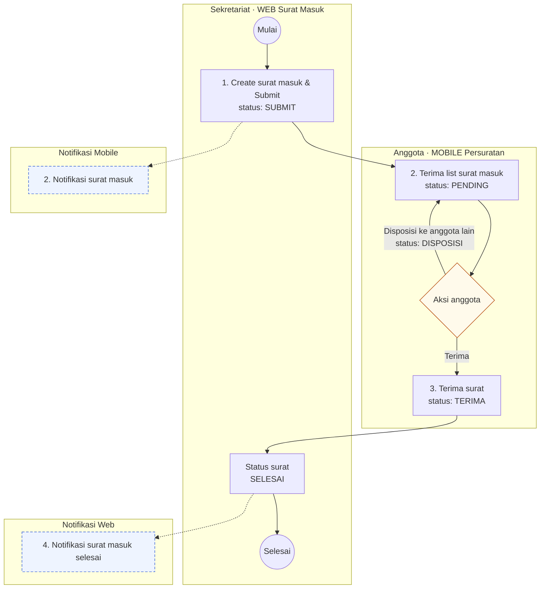
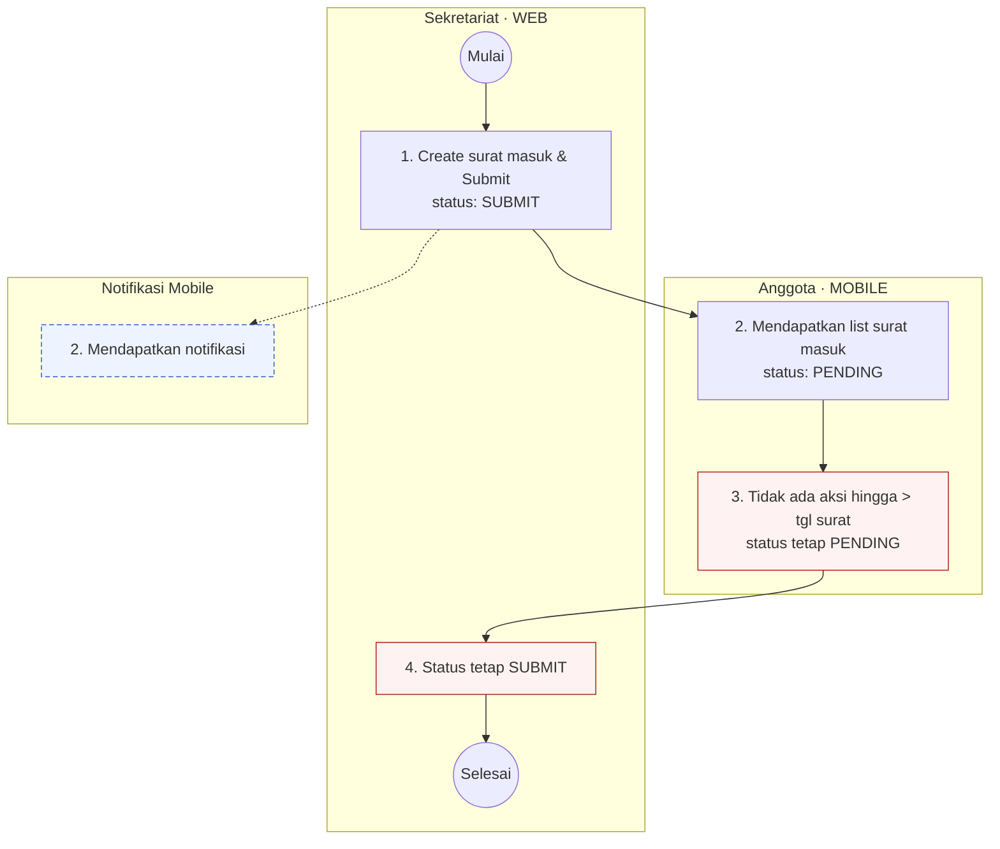
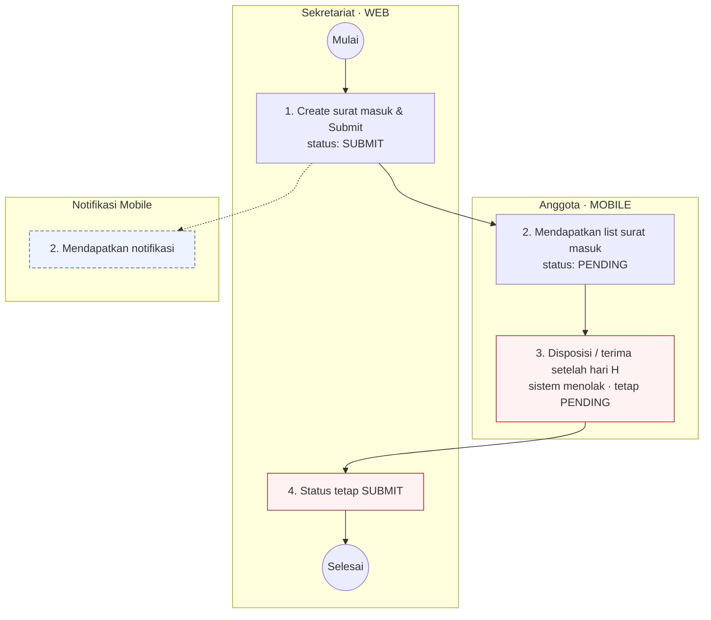
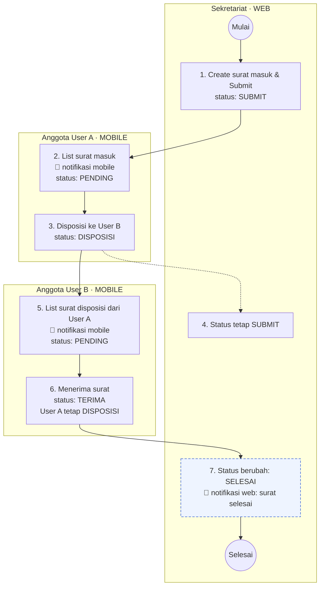
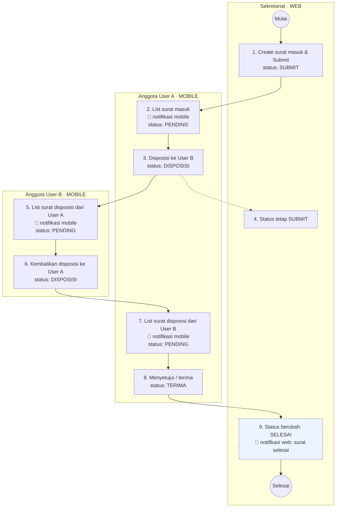
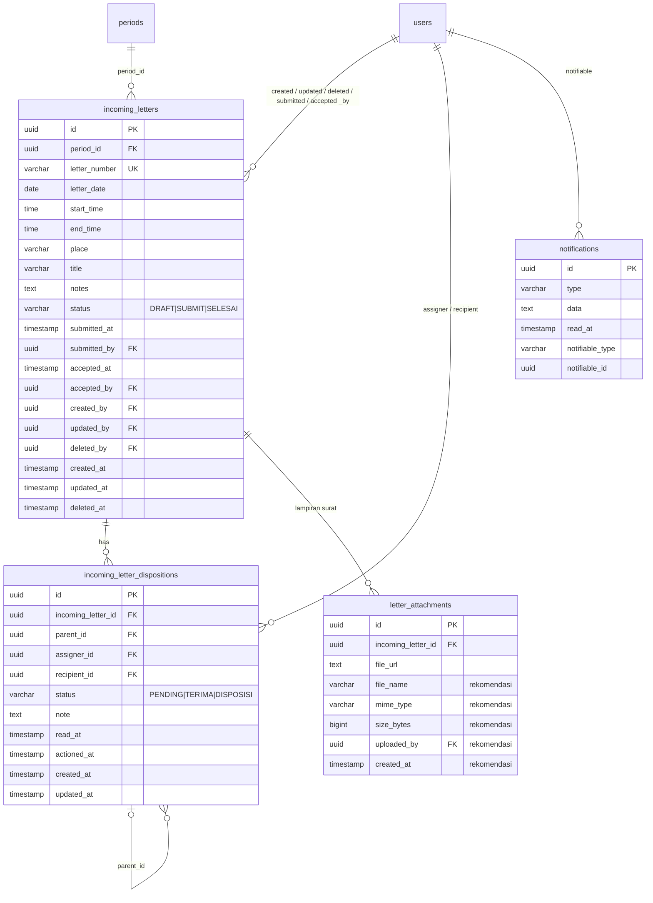

# Modul Persuratan — Surat Masuk

**Spesifikasi Fungsional, Rekomendasi TRD & API Contract** · Versi 0.6 · 5 November 2026

| Atribut | Keterangan |
|---|---|
| Dokumen | Bagian A – Spesifikasi Fungsional<br>Bagian B – Rekomendasi Analisa TRD<br>Bagian C – API Contract |
| Versi | 0.6 – Update status rekonsiliasi prototipe (filter Status & Periode) |
| Tanggal | 5 November 2026 |
| Disusun oleh | Ayu Widya Inggit – Solution Architect, GeekGarden |
| Sumber | PERSURATAN.xlsx dan hasil review draft v0.1 |
| Lampiran | `surat-masuk-openapi.yaml` (OpenAPI 3.0, sumber Bagian C)<br>`Surat_Masuk_Gap_Analysis_Prototipe.md` (audit kesesuaian prototipe WEB & MOBILE terhadap spec ini) |

## Riwayat Revisi

| Versi | Tanggal | Perubahan |
|---|---|---|
| 0.1 | 4 Nov 2026 | Draft awal. |
| 0.2 | 4 Nov 2026 | Menerapkan hasil review: field Unit Type, tanggal + waktu mulai/selesai, perubahan struktur tabel, dan keputusan atas pertanyaan terbuka. Merapikan konsistensi antar-bagian. Menambah Bagian C – API Contract. |
| 0.3 | 4 Nov 2026 | Menerapkan keputusan review kedua: judul maks 255 karakter, batas aksi 23:59:59 bila waktu selesai kosong, anggota tujuan disposisi dipilih lewat Unit Type, disposisi tanpa lampiran (hanya notes), serta kolom submit dan terima yang eksplisit (`submitted_at`, `submitted_by`, `accepted_at`, `accepted_by`). |
| 0.4 | 4 Nov 2026 | Hasil audit prototipe WEB (`eparlemen-web`) & MOBILE (`eparlemen-mobile`) terhadap spec v0.3 — lihat `Surat_Masuk_Gap_Analysis_Prototipe.md`. Prototipe sudah direkonsiliasi penuh (Unit Type → anggota di form create, split waktu mulai/selesai, validasi `end_time > start_time`, batas panjang field, batas tipe/ukuran/jumlah lampiran, hapus & lanjutkan draft, serta tampilan notes disposisi). Klarifikasi redaksional BR-01 & §2.1: karakter yang diizinkan pada No Surat dipertegas (bukan cuma "alfanumerik" literal) agar konsisten dengan contoh `005/123/DPRD` yang memakai `/`. |
| 0.5 | 5 Nov 2026 | Menambahkan kolom `period_id` (FK ke `periods`, periode DPRD yang aktif saat surat dibuat — diisi otomatis, bukan input Sekretariat) pada tabel `incoming_letters`, ERD (§7.1), §7.2, dan Index (§7.6). Menambahkan objek `PeriodRef` (§17.8), field `period`/`period_id` pada response list & detail (WEB §18.1–18.6, MOBILE §19.1–19.2 lewat `LetterSummary`), parameter filter `period_id` pada list WEB & MOBILE, dan endpoint baru `GET /periods` (§20.8) untuk sumber dropdown filter Periode. Menambahkan baris "Periode" pada tabel informasi list MOBILE (§2.2) dan catatan auto-assign pada §2.1 & §18.2. |
| 0.6 | 5 Nov 2026 | Memperbarui "Lampiran: Status Rekonsiliasi Prototipe" (sebelumnya masih berlabel v0.4, belum menyebut pekerjaan `period_id` v0.5) — menambahkan rangkuman kolom & filter Periode di WEB/MOBILE, filter Status WEB yang diganti dari tab menjadi **dropdown** dengan default **"Semua Status"** (selaras §18.1 yang tidak mewajibkan default status), serta catatan bahwa filter tanggal (`date_from`/`date_to`, §18.1) sengaja tidak diimplementasikan sebagai kontrol UI di `surat-masuk.html` namun tetap didokumentasikan sebagai parameter API. Tidak ada perubahan pada model data atau kontrak API — murni dokumentasi menyusul perubahan UI prototipe. |

### Penyesuaian saat merapikan

Selain menerapkan revisi, beberapa penyesuaian dilakukan supaya isi dokumen konsisten:

- `update_by` diganti menjadi `updated_by` (mengikuti `created_by` dan `deleted_by`).
- Nama tabel `letter_attachment` diseragamkan menjadi bentuk jamak `letter_attachments`, sama dengan tabel lain.
- Panjang `letter_number` di tabel disamakan dengan form, yaitu maks 20 karakter.
- Tabel `letter_histories` sudah dihapus dari model data, jadi semua rujukannya (logic transaksi, audit, index) ikut dihapus. History diambil dari rantai `incoming_letter_dispositions`.
- State diagram dihapus sesuai revisi; mapping status tetap dalam bentuk tabel.
- Tanda `*` dan `**` pada nama kolom diganti dengan kolom **Key** (PK / FK / UK).
- Pertanyaan terbuka yang sudah dijawab dipindah ke Bab 15 (Keputusan Review).

## Daftar Isi

- [Riwayat Revisi](#riwayat-revisi)
  - [Penyesuaian saat merapikan](#penyesuaian-saat-merapikan)
- [Bagian A — Spesifikasi Fungsional Surat Masuk](#bagian-a--spesifikasi-fungsional-surat-masuk)
  - [1. Pendahuluan](#1-pendahuluan)
    - [1.1 Tujuan](#11-tujuan)
    - [1.2 Ruang Lingkup](#12-ruang-lingkup)
    - [1.3 Aktor & Kanal](#13-aktor--kanal)
    - [1.4 Istilah](#14-istilah)
  - [2. Kebutuhan Fungsional](#2-kebutuhan-fungsional)
    - [2.1 Create Surat Masuk (Sekretariat – WEB)](#21-create-surat-masuk-sekretariat--web)
    - [2.2 List & Detail Surat Masuk (Anggota – MOBILE)](#22-list--detail-surat-masuk-anggota--mobile)
    - [2.3 Edit Draft](#23-edit-draft)
    - [2.4 Aksi Terima](#24-aksi-terima)
    - [2.5 Aksi Disposisi](#25-aksi-disposisi)
    - [2.6 History Disposisi](#26-history-disposisi)
    - [2.7 Notifikasi](#27-notifikasi)
  - [3. Status](#3-status)
    - [3.1 Status POV Penugas (Sekretariat)](#31-status-pov-penugas-sekretariat)
    - [3.2 Status POV Penerima (Anggota)](#32-status-pov-penerima-anggota)
  - [4. Alur Proses](#4-alur-proses)
    - [4.1 Flow Normal](#41-flow-normal)
    - [4.2 Negatif 1 – Anggota Idle Melewati Batas Aksi](#42-negatif-1--anggota-idle-melewati-batas-aksi)
    - [4.3 Negatif 2 – Aksi Setelah Batas Aksi Ditolak](#43-negatif-2--aksi-setelah-batas-aksi-ditolak)
    - [4.4 Negatif 3 – Disposisi Lalu Diterima](#44-negatif-3--disposisi-lalu-diterima)
    - [4.5 Negatif 4 – Disposisi Dikembalikan](#45-negatif-4--disposisi-dikembalikan)
  - [5. Aturan Bisnis](#5-aturan-bisnis)
- [Bagian B — Rekomendasi Analisa untuk TRD](#bagian-b--rekomendasi-analisa-untuk-trd)
  - [6. Asumsi Teknis & Arsitektur](#6-asumsi-teknis--arsitektur)
  - [7. Model Data](#7-model-data)
    - [7.1 ERD](#71-erd)
    - [7.2 Tabel incoming_letters](#72-tabel-incoming_letters)
    - [7.3 Tabel incoming_letter_dispositions](#73-tabel-incoming_letter_dispositions)
    - [7.4 Tabel letter_attachments](#74-tabel-letter_attachments)
    - [7.5 Tabel Pendukung](#75-tabel-pendukung)
    - [7.6 Index](#76-index)
  - [8. Ringkasan Desain API](#8-ringkasan-desain-api)
  - [9. Logic Transaksi & Konkurensi](#9-logic-transaksi--konkurensi)
    - [9.1 Submit](#91-submit)
    - [9.2 Aksi Terima](#92-aksi-terima)
    - [9.3 Aksi Disposisi](#93-aksi-disposisi)
    - [9.4 Pencegahan Aksi Ganda](#94-pencegahan-aksi-ganda)
    - [9.5 Perhitungan Batas Aksi](#95-perhitungan-batas-aksi)
  - [10. Desain Notifikasi](#10-desain-notifikasi)
  - [11. Keamanan & Otorisasi](#11-keamanan--otorisasi)
  - [12. Kebutuhan Non-Fungsional](#12-kebutuhan-non-fungsional)
  - [13. Skenario Uji](#13-skenario-uji)
  - [14. Risiko & Mitigasi](#14-risiko--mitigasi)
  - [15. Keputusan Review](#15-keputusan-review)
  - [16. Pertanyaan Terbuka](#16-pertanyaan-terbuka)
  - [Lampiran: Status Rekonsiliasi Prototipe (v0.4)](#lampiran-status-rekonsiliasi-prototipe-v04)
- [Bagian C — API Contract](#bagian-c--api-contract)
  - [17. Konvensi Umum](#17-konvensi-umum)
    - [17.1 Base URL & Versi](#171-base-url--versi)
    - [17.2 Autentikasi & Header](#172-autentikasi--header)
    - [17.3 Format Data](#173-format-data)
    - [17.4 Format Respons Sukses](#174-format-respons-sukses)
    - [17.5 Format Respons Error](#175-format-respons-error)
    - [17.6 Paginasi](#176-paginasi)
    - [17.7 Daftar Kode Error](#177-daftar-kode-error)
    - [17.8 Objek Data Umum](#178-objek-data-umum)
  - [18. Endpoint WEB – Sekretariat](#18-endpoint-web--sekretariat)
    - [18.1 List surat masuk](#181-list-surat-masuk)
    - [18.2 Create surat masuk (draft atau submit)](#182-create-surat-masuk-draft-atau-submit)
    - [18.3 Detail surat masuk](#183-detail-surat-masuk)
    - [18.4 Edit draft surat masuk](#184-edit-draft-surat-masuk)
    - [18.5 Hapus draft surat masuk](#185-hapus-draft-surat-masuk)
    - [18.6 Submit draft surat masuk](#186-submit-draft-surat-masuk)
    - [18.7 Tambah lampiran ke draft](#187-tambah-lampiran-ke-draft)
    - [18.8 Hapus lampiran dari draft](#188-hapus-lampiran-dari-draft)
  - [19. Endpoint MOBILE – Anggota](#19-endpoint-mobile--anggota)
    - [19.1 List surat masuk milik anggota](#191-list-surat-masuk-milik-anggota)
    - [19.2 Detail surat masuk (per penugasan)](#192-detail-surat-masuk-per-penugasan)
    - [19.3 Terima surat](#193-terima-surat)
    - [19.4 Disposisi surat](#194-disposisi-surat)
  - [20. Endpoint Bersama](#20-endpoint-bersama)
    - [20.1 Pilihan Unit Type (org unit periode aktif)](#201-pilihan-unit-type-org-unit-periode-aktif)
    - [20.2 Pilihan anggota tujuan per Unit Type](#202-pilihan-anggota-tujuan-per-unit-type)
    - [20.3 List notifikasi user](#203-list-notifikasi-user)
    - [20.4 Jumlah notifikasi belum dibaca](#204-jumlah-notifikasi-belum-dibaca)
    - [20.5 Tandai notifikasi dibaca](#205-tandai-notifikasi-dibaca)
    - [20.6 Tandai semua notifikasi dibaca](#206-tandai-semua-notifikasi-dibaca)
    - [20.7 URL unduh lampiran](#207-url-unduh-lampiran)
    - [20.8 Pilihan Periode](#208-pilihan-periode)

# Bagian A — Spesifikasi Fungsional Surat Masuk

## 1. Pendahuluan

### 1.1 Tujuan

Dokumen ini menjelaskan kebutuhan fungsional modul **Surat Masuk**: bagaimana Sekretariat mencatat surat masuk, bagaimana anggota menerima atau mendisposisikan surat, dan bagaimana status serta notifikasi berubah di setiap langkah. Bagian B berisi rekomendasi analisa teknis untuk TRD, dan Bagian C berisi API contract.

### 1.2 Ruang Lingkup

**Termasuk dalam lingkup:**

- Create, simpan draft, edit draft, dan submit surat masuk oleh Sekretariat (WEB).
- List dan detail surat masuk untuk anggota, termasuk flag read/unread (MOBILE).
- Aksi anggota: Terima dan Disposisi (termasuk mengembalikan disposisi ke pengirim sebelumnya).
- Notifikasi WEB dan MOBILE untuk setiap perubahan penting.
- History penugasan/disposisi per surat.

**Di luar lingkup:**

- Pembatalan otomatis surat masuk. Bila penerima idle melewati batas aksi, status tetap (SUBMIT/PENDING).
- Penugasan ke lebih dari satu anggota sekaligus. Satu surat ditujukan ke satu anggota, dan disposisi juga satu per satu.
- Edit atau tarik kembali surat yang sudah di-submit.
- Arsip, retensi, dan pencarian full-text isi lampiran.

### 1.3 Aktor & Kanal

| Aktor | Kanal | Peran |
|---|---|---|
| Sekretariat | WEB – menu Surat Masuk | Membuat dan submit surat masuk, memilih anggota tujuan, memantau status dan history. |
| Anggota (penerima) | MOBILE – Persuratan › Surat Masuk | Menerima surat, lalu klik Terima atau Disposisi ke anggota lain. |
| Sistem notifikasi | WEB – Notifikasi, MOBILE – Notifikasi | Mengirim notifikasi surat baru, disposisi, dan surat selesai. |

### 1.4 Istilah

| Istilah | Arti |
|---|---|
| Penugas | Pihak yang memberi tugas: Sekretariat (penugasan pertama) atau anggota yang mendisposisikan. |
| Penerima | Anggota yang menerima penugasan atau disposisi. |
| Disposisi | Meneruskan surat ke satu anggota lain (dipilih lewat Unit Type), opsional dengan notes. Disposisi tidak memiliki lampiran. |
| Unit Type | Org unit pada periode aktif (`period_id` = periode aktif). Dipakai untuk menyaring daftar anggota tujuan. |
| Batas aksi | Tanggal surat + waktu selesai. Bila waktu selesai kosong, sampai 23:59:59 pada tanggal surat. Setelah lewat, aksi Terima/Disposisi ditolak. |

## 2. Kebutuhan Fungsional

### 2.1 Create Surat Masuk (Sekretariat – WEB)

Hanya role yang memiliki akses Surat Masuk yang dapat membuat surat. Form berisi field berikut:

| Field | Tipe | Wajib | Validasi / Keterangan |
|---|---|---|---|
| Unit Type | Pilihan | Ya | Org unit dengan `period_id` = periode aktif. |
| Anggota yang dituju | Pilihan (1 user) | Ya | Tampil sebagai "Nama, Jabatan – Org Unit" (mis. Widya, Ketua – Komisi A), disaring berdasarkan Unit Type yang dipilih. Hanya satu anggota. |
| No surat | Teks bebas | Ya | Alfanumerik, boleh menyertakan tanda titik (`.`), garis miring (`/`), dan tanda hubung (`-`) sesuai format umum nomor surat dinas (mis. `005/123/DPRD`). Unik, maks 20 karakter. |
| Tanggal | Date | Ya | Tanggal surat. |
| Waktu mulai | Time | Tidak | Format HH:mm. |
| Waktu selesai | Time | Tidak | Format HH:mm, harus setelah waktu mulai. Menjadi batas aksi anggota. |
| Tempat | Teks | Tidak | Maks 255 karakter. |
| Judul surat | Teks bebas | Ya | Maks 255 karakter. |
| Notes | Textarea | Tidak | – |
| Lampiran | File (banyak) | Tidak | pdf, jpg, png, docx, xlsx; maks 10 MB per file, maks 10 file. |
| Tombol | Button | – | **Draft**: simpan tanpa dampak ke anggota.<br>**Submit**: kirim ke anggota tujuan. |

> **Periode.** `period_id` bukan field yang diisi di form ini — sistem otomatis mencatat periode DPRD yang sedang aktif saat surat dibuat/di-submit (baik status DRAFT maupun SUBMIT), sebagai snapshot. Lihat §7.2 dan §18.2.

### 2.2 List & Detail Surat Masuk (Anggota – MOBILE)

Setelah Sekretariat klik Submit, anggota tujuan mendapat notifikasi dan surat muncul di list surat masuk dengan informasi berikut:

| Informasi | Keterangan |
|---|---|
| Judul, no surat, tanggal, waktu mulai, waktu selesai, tempat, notes, lampiran | Diambil dari data surat masuk. |
| Periode | Periode saat surat dibuat (snapshot). Ditampilkan sebagai kolom di list dan bisa difilter lewat parameter `period_id`; default menampilkan periode aktif. |
| Flag read / unread | Berubah menjadi read saat anggota membuka detail. |
| User penugas | Sekretariat pembuat surat. |
| User penugas disposisi | Anggota yang mendisposisikan. Kosong (null) bila masih penugasan pertama. |
| Status | PENDING (ada tombol Terima / Disposisi), TERIMA, atau DISPOSISI. |
| History penugasan | Urutan penugasan dan disposisi untuk surat tersebut. |

### 2.3 Edit Draft

- Surat hanya bisa diedit atau dihapus selama berstatus **DRAFT**.
- Setelah SUBMIT, surat tidak bisa diedit, dihapus, atau ditarik kembali.

### 2.4 Aksi Terima

- Hanya tersedia bila status penugasan anggota = PENDING dan belum lewat batas aksi.
- Status penugasan anggota berubah menjadi **TERIMA**; status surat di Sekretariat berubah menjadi **SELESAI**.
- Sekretariat mendapat notifikasi WEB "surat masuk selesai".

### 2.5 Aksi Disposisi

- Hanya tersedia bila status penugasan = PENDING dan belum lewat batas aksi.
- Anggota memilih Unit Type, lalu memilih **satu** anggota tujuan dari Unit Type tersebut (sama seperti form create).
- Anggota boleh menambah notes. Disposisi **tidak** memiliki lampiran.
- Status penugasan anggota berubah menjadi **DISPOSISI**. Penerima baru mendapat penugasan berstatus **PENDING** dan notifikasi MOBILE.
- Disposisi boleh dikembalikan ke pengirim sebelumnya (Negatif 4). Pengirim akan menerima penugasan baru berstatus PENDING.
- Status surat di Sekretariat tetap **SUBMIT** selama belum ada yang menerima.

### 2.6 History Disposisi

Setiap surat menyimpan jejak penugasan secara berurutan, contohnya:

- 1 Des 2026 12:00 – Widya mendisposisikan kepada Kiki
- 2 Des 2026 12:00 – Kiki mendisposisikan kepada Azhar
- 3 Des 2026 12:00 – Azhar menerima penugasan

### 2.7 Notifikasi

| Pemicu | Penerima | Kanal | Isi |
|---|---|---|---|
| Sekretariat klik Submit | Anggota tujuan | MOBILE | Surat masuk baru: {judul} |
| Anggota klik Disposisi | Hanya anggota penerima disposisi | MOBILE | Disposisi surat dari {nama penugas}: {judul} |
| Anggota klik Terima | Sekretariat pembuat surat | WEB | Surat masuk {judul} selesai |
| Aksi ditolak (lewat batas aksi) | – | – | Tidak ada notifikasi; pesan error di layar. |

## 3. Status

### 3.1 Status POV Penugas (Sekretariat)

| Status | Kapan terjadi | Dampak |
|---|---|---|
| DRAFT | Penugas klik tombol Draft | Tidak ada dampak ke anggota. Masih bisa diedit/dihapus. |
| SUBMIT | Penugas klik tombol Submit | Surat masuk ke anggota tujuan. Tetap SUBMIT selamanya bila penerima idle melewati batas aksi. |
| SELESAI | Penerima klik tombol Terima (mobile) | Notifikasi WEB ke Sekretariat. |

### 3.2 Status POV Penerima (Anggota)

| Status | Kapan terjadi | Dampak |
|---|---|---|
| PENDING | Penugas klik Submit, atau anggota lain klik Disposisi ke penerima ini | Tombol Terima dan Disposisi aktif. Tetap PENDING selamanya bila idle melewati batas aksi. |
| TERIMA | Penerima klik tombol Terima | Berdampak ke penugas: status surat menjadi SELESAI. |
| DISPOSISI | Penerima klik tombol Disposisi | Berdampak ke anggota yang didisposisikan: mendapat penugasan PENDING. |

## 4. Alur Proses

Setiap kolom pada diagram adalah satu swimlane (aktor/kanal). Garis putus-putus berarti notifikasi atau status yang tidak berubah. Pada Negatif 3 dan 4, notifikasi ditulis langsung di dalam langkah (ikon lonceng) agar diagram tetap terbaca.

### 4.1 Flow Normal



*Gambar 1. Swimlane – Flow Normal*

| No | Aktor / Kanal | Aktivitas | Status sesudah |
|---|---|---|---|
| 1 | Sekretariat – WEB | Create surat masuk lalu klik Submit. | Surat: SUBMIT |
| 2 | Anggota – MOBILE | Menerima notifikasi dan surat muncul di list surat masuk. | Penugasan: PENDING |
| 3 | Anggota – MOBILE | Klik Terima. (Alternatif: klik Disposisi ke anggota lain, lalu langkah 2 berulang untuk penerima baru.) | Penugasan: TERIMA (atau DISPOSISI) |
| 4 | Sekretariat – WEB | Status surat berubah dan Sekretariat menerima notifikasi surat masuk selesai. | Surat: SELESAI |

### 4.2 Negatif 1 – Anggota Idle Melewati Batas Aksi



*Gambar 2. Swimlane – Negatif 1*

| No | Aktor / Kanal | Aktivitas | Status sesudah |
|---|---|---|---|
| 1 | Sekretariat – WEB | Create surat masuk lalu Submit. | Surat: SUBMIT |
| 2 | Anggota – MOBILE | Mendapat list surat masuk dan notifikasi. | Penugasan: PENDING |
| 3 | Anggota – MOBILE | Tidak melakukan aksi apa pun sampai melewati batas aksi. | Penugasan: tetap PENDING |
| 4 | Sekretariat – WEB | Tidak ada perubahan. | Surat: tetap SUBMIT |

### 4.3 Negatif 2 – Aksi Setelah Batas Aksi Ditolak



*Gambar 3. Swimlane – Negatif 2*

| No | Aktor / Kanal | Aktivitas | Status sesudah |
|---|---|---|---|
| 1 | Sekretariat – WEB | Create surat masuk lalu Submit. | Surat: SUBMIT |
| 2 | Anggota – MOBILE | Mendapat list surat masuk dan notifikasi. | Penugasan: PENDING |
| 3 | Anggota – MOBILE | Klik Disposisi atau Terima setelah batas aksi. Sistem menolak aksi. | Penugasan: tetap PENDING |
| 4 | Sekretariat – WEB | Tidak ada perubahan. | Surat: tetap SUBMIT |

### 4.4 Negatif 3 – Disposisi Lalu Diterima



*Gambar 4. Swimlane – Negatif 3*

| No | Aktor / Kanal | Aktivitas | Status sesudah |
|---|---|---|---|
| 1 | Sekretariat – WEB | Create surat masuk lalu Submit ke User A. | Surat: SUBMIT |
| 2 | User A – MOBILE | Mendapat list surat masuk dan notifikasi. | User A: PENDING |
| 3 | User A – MOBILE | Disposisi ke User B. | User A: DISPOSISI |
| 4 | Sekretariat – WEB | Tidak ada perubahan. | Surat: tetap SUBMIT |
| 5 | User B – MOBILE | Mendapat list surat masuk disposisi dari User A dan notifikasi. | User B: PENDING |
| 6 | User B – MOBILE | Klik Terima. | User B: TERIMA; User A tetap DISPOSISI |
| 7 | Sekretariat – WEB | Status berubah dan mendapat notifikasi surat masuk selesai. | Surat: SELESAI |

### 4.5 Negatif 4 – Disposisi Dikembalikan



*Gambar 5. Swimlane – Negatif 4*

| No | Aktor / Kanal | Aktivitas | Status sesudah |
|---|---|---|---|
| 1 | Sekretariat – WEB | Create surat masuk lalu Submit ke User A. | Surat: SUBMIT |
| 2 | User A – MOBILE | Mendapat list surat masuk dan notifikasi. | User A: PENDING |
| 3 | User A – MOBILE | Disposisi ke User B. | User A: DISPOSISI |
| 4 | Sekretariat – WEB | Tidak ada perubahan. | Surat: tetap SUBMIT |
| 5 | User B – MOBILE | Mendapat list surat masuk disposisi dari User A dan notifikasi. | User B: PENDING |
| 6 | User B – MOBILE | Mengembalikan disposisi ke User A. | User B: DISPOSISI; User A: PENDING |
| 7 | User A – MOBILE | Mendapat list surat masuk disposisi dari User B dan notifikasi. | User A: PENDING |
| 8 | User A – MOBILE | Klik Terima / menyetujui. | User A: TERIMA |
| 9 | Sekretariat – WEB | Status berubah dan mendapat notifikasi surat masuk selesai. | Surat: SELESAI |

> Istilah status **TERIMA** sudah dikonfirmasi saat review. Penulisan "MENERIMA" / "DITERIMA" di sheet sumber dianggap sama dengan TERIMA.

## 5. Aturan Bisnis

| Kode | Aturan |
|---|---|
| BR-01 | No surat wajib diisi, alfanumerik (boleh menyertakan `.`, `/`, `-` sesuai format umum nomor surat dinas, mis. `005/123/DPRD`), maks 20 karakter, dan unik di antara surat yang belum dihapus. |
| BR-02 | Surat berstatus DRAFT tidak terlihat oleh anggota dan tidak memicu notifikasi. |
| BR-03 | Surat hanya bisa diedit atau dihapus selama berstatus DRAFT. |
| BR-04 | Satu surat ditujukan ke satu anggota, dipilih dari anggota pada Unit Type (org unit periode aktif) yang dipilih. |
| BR-05 | Aksi Terima dan Disposisi hanya boleh dilakukan oleh penerima pada penugasan berstatus PENDING. |
| BR-06 | Batas aksi = tanggal surat + waktu selesai (atau 23:59:59 bila waktu selesai kosong). Aksi setelah batas ini ditolak. |
| BR-07 | Bila penerima idle melewati batas aksi, status tidak berubah: surat tetap SUBMIT, penugasan tetap PENDING. |
| BR-08 | Saat penerima klik Terima, status surat menjadi SELESAI, waktu dan pelakunya dicatat (`accepted_at`, `accepted_by`), dan Sekretariat mendapat notifikasi WEB. |
| BR-09 | Disposisi dilakukan ke satu anggota per aksi, dipilih lewat Unit Type; penugasan pendisposisi menjadi DISPOSISI dan penerima mendapat penugasan baru PENDING. |
| BR-10 | Disposisi boleh dikirim kembali ke pengirim sebelumnya (mengembalikan disposisi), tetapi tidak ke diri sendiri. |
| BR-11 | Disposisi hanya boleh menyertakan notes (opsional); tidak ada lampiran. |
| BR-12 | Notifikasi disposisi hanya dikirim ke anggota yang didisposisikan. |

# Bagian B — Rekomendasi Analisa untuk TRD

Bagian ini berisi rekomendasi teknis sebagai titik awal TRD. Hal yang belum tertulis di sheet atau belum diputuskan ditandai sebagai **rekomendasi**.

## 6. Asumsi Teknis & Arsitektur

| Komponen | Rekomendasi |
|---|---|
| Backend | REST API Laravel. Diasumsikan dari struktur tabel `notifications` (pola polymorphic `notifiable_type`/`notifiable_id`). |
| Database | PostgreSQL. ID memakai UUID, kolom waktu `timestamp(0)`, mengikuti tabel eksisting. |
| Web Sekretariat | Mengakses API prefix `/api/v1/web`. |
| Mobile Anggota | Mengakses API prefix `/api/v1/mobile`. Push notification via FCM. |
| Notifikasi | Laravel Notification dengan channel `database` (tabel `notifications`) + channel push untuk mobile. Dikirim lewat queue. |
| File storage | Object storage (S3-compatible) atau disk lokal; unduhan memakai signed URL berbatas waktu. |
| Queue | Redis/database queue untuk notifikasi dan push, supaya request Terima/Disposisi tetap cepat. |

## 7. Model Data

### 7.1 ERD



*Gambar 6. ERD modul Surat Masuk*

### 7.2 Tabel incoming_letters

| Kolom | Key | Tipe | Null | Keterangan |
|---|---|---|---|---|
| id | PK | uuid | NO | Primary key |
| period_id | FK | uuid | NO | periods.id – periode DPRD yang aktif saat surat dibuat. Diisi **otomatis oleh sistem** (bukan input Sekretariat), snapshot saat create/submit sehingga surat lama tetap tercatat pada periode saat dibuat meski periode aktif berganti kemudian. |
| letter_number | UK | varchar(20) | NO | No surat; unik (partial index `WHERE deleted_at IS NULL`); CHECK alfanumerik + `.`/`/`/`-` (lihat BR-01) |
| letter_date |  | date | NO | Tanggal surat |
| start_time |  | time | YES | Waktu mulai |
| end_time |  | time | YES | Waktu selesai; dasar batas aksi |
| place |  | varchar(255) | YES | Tempat |
| title |  | varchar(255) | NO | Judul surat |
| notes |  | text | YES | Catatan |
| status |  | varchar(20) | NO | DRAFT / SUBMIT / SELESAI (CHECK constraint) |
| submitted_at |  | timestamp(0) | YES | Waktu submit; NULL selama DRAFT |
| submitted_by | FK | uuid | YES | users.id – Sekretariat yang submit |
| accepted_at |  | timestamp(0) | YES | Waktu surat diterima (status SELESAI) |
| accepted_by | FK | uuid | YES | users.id – anggota yang menerima |
| created_by | FK | uuid | NO | users.id – Sekretariat pembuat |
| created_at |  | timestamp(0) | YES | Waktu dibuat |
| updated_by | FK | uuid | YES | users.id – pengubah terakhir |
| updated_at |  | timestamp(0) | YES | Waktu terakhir diubah |
| deleted_by | FK | uuid | YES | users.id – penghapus (soft delete) |
| deleted_at |  | timestamp(0) | YES | Waktu dihapus (soft delete) |

### 7.3 Tabel incoming_letter_dispositions

Satu baris = satu penugasan ke satu anggota. Penugasan pertama dari Sekretariat memiliki `parent_id = NULL`; setiap disposisi membuat baris baru yang menunjuk ke baris pendisposisi. Rantai `parent_id` inilah history disposisi. Jabatan dan org unit ditampilkan dari data master saat ini (tidak disimpan sebagai snapshot).

| Kolom | Key | Tipe | Null | Keterangan |
|---|---|---|---|---|
| id | PK | uuid | NO | Primary key |
| incoming_letter_id | FK | uuid | NO | incoming_letters.id (ON DELETE CASCADE) |
| parent_id | FK | uuid | YES | Baris disposisi sebelumnya; NULL = penugasan pertama |
| assigner_id | FK | uuid | NO | users.id – Sekretariat atau anggota pendisposisi |
| recipient_id | FK | uuid | NO | users.id – penerima |
| status |  | varchar(20) | NO | PENDING / TERIMA / DISPOSISI; default PENDING |
| note |  | text | YES | Notes disposisi |
| read_at |  | timestamp(0) | YES | Flag read/unread |
| actioned_at |  | timestamp(0) | YES | Waktu klik Terima/Disposisi |
| created_at, updated_at |  | timestamp(0) | YES |  |

### 7.4 Tabel letter_attachments

Hanya untuk lampiran surat. Disposisi tidak memiliki lampiran.

| Kolom | Key | Tipe | Null | Keterangan |
|---|---|---|---|---|
| id | PK | uuid | NO | Primary key |
| incoming_letter_id | FK | uuid | NO | incoming_letters.id (ON DELETE CASCADE) |
| file_url |  | text | NO | Path/URL file di storage |
| file_name |  | varchar(255) | YES | **Rekomendasi.** Nama file asli untuk ditampilkan. |
| mime_type |  | varchar(100) | YES | **Rekomendasi.** Tipe file. |
| size_bytes |  | bigint | YES | **Rekomendasi.** Ukuran file. |
| uploaded_by | FK | uuid | YES | **Rekomendasi.** users.id pengunggah. |
| created_at |  | timestamp(0) | YES | **Rekomendasi.** Waktu unggah. |

### 7.5 Tabel Pendukung

| Tabel | Fungsi | Kolom kunci |
|---|---|---|
| notifications (eksisting) | Notifikasi WEB & MOBILE (Laravel). | type, data (JSON dalam text), read_at, notifiable_type, notifiable_id |

### 7.6 Index

| Index | Tujuan |
|---|---|
| incoming_letters (letter_number) UNIQUE WHERE deleted_at IS NULL | Menjamin no surat unik tanpa bentrok dengan data yang di-soft-delete. |
| incoming_letters (status, letter_date) | List dan filter di WEB Sekretariat. |
| incoming_letters (period_id, status) | Filter periode pada list WEB & MOBILE. |
| incoming_letter_dispositions (recipient_id, status) | List surat masuk milik anggota di MOBILE. |
| incoming_letter_dispositions (incoming_letter_id, created_at) | Menampilkan history disposisi per surat. |
| letter_attachments (incoming_letter_id) | Mengambil lampiran surat. |
| notifications (notifiable_id, created_at) WHERE read_at IS NULL | Badge jumlah notifikasi belum dibaca (opsional). |

## 8. Ringkasan Desain API

Detail request, response, dan error setiap endpoint ada di **Bagian C – API Contract**. Ringkasan endpoint:

| Method | Endpoint | Pengguna | Fungsi |
|---|---|---|---|
| GET | /web/incoming-letters | Sekretariat | List surat masuk |
| POST | /web/incoming-letters | Sekretariat | Create surat masuk (draft atau submit) |
| GET | /web/incoming-letters/{id} | Sekretariat | Detail surat masuk |
| PUT | /web/incoming-letters/{id} | Sekretariat | Edit draft surat masuk |
| DELETE | /web/incoming-letters/{id} | Sekretariat | Hapus draft surat masuk |
| POST | /web/incoming-letters/{id}/submit | Sekretariat | Submit draft surat masuk |
| POST | /web/incoming-letters/{id}/attachments | Sekretariat | Tambah lampiran ke draft |
| DELETE | /web/incoming-letters/{id}/attachments/{attachmentId} | Sekretariat | Hapus lampiran dari draft |
| GET | /mobile/incoming-letters | Anggota | List surat masuk milik anggota |
| GET | /mobile/incoming-letters/{dispositionId} | Anggota | Detail surat masuk (per penugasan) |
| POST | /mobile/incoming-letters/{dispositionId}/accept | Anggota | Terima surat |
| POST | /mobile/incoming-letters/{dispositionId}/dispose | Anggota | Disposisi surat |
| GET | /org-units | Sekretariat, Anggota | Pilihan Unit Type (org unit periode aktif) |
| GET | /org-units/{orgUnitId}/members | Sekretariat, Anggota | Pilihan anggota tujuan per Unit Type |
| GET | /periods | Sekretariat, Anggota | Pilihan Periode untuk filter list surat masuk |
| GET | /notifications | Semua user login | List notifikasi user |
| GET | /notifications/unread-count | Semua user login | Jumlah notifikasi belum dibaca |
| POST | /notifications/{notificationId}/read | Pemilik notifikasi | Tandai notifikasi dibaca |
| POST | /notifications/read-all | Semua user login | Tandai semua notifikasi dibaca |
| GET | /attachments/{attachmentId}/download | User yang berhak melihat surat | URL unduh lampiran |

Keputusan desain utama:

- Di mobile, identitas yang dipakai adalah **id penugasan** (`dispositionId`), bukan id surat, karena satu anggota bisa punya lebih dari satu penugasan untuk surat yang sama (Negatif 4).
- API mengembalikan `action_deadline` dan `can_act` agar mobile bisa menyembunyikan tombol aksi; validasi tetap dilakukan di server.
- Pilihan Unit Type dan anggota diambil dari endpoint bersama `/org-units` dan `/org-units/{orgUnitId}/members`, dipakai di form create dan disposisi.

## 9. Logic Transaksi & Konkurensi

### 9.1 Submit

- Update surat: `status = SUBMIT`, `submitted_at = now()`, `submitted_by` = user login (hanya dari DRAFT).
- Insert penugasan pertama: `parent_id = NULL`, `assigner_id` = user login, `recipient_id` = anggota tujuan, `status = PENDING`.
- Commit, lalu kirim notifikasi MOBILE ke anggota tujuan.

### 9.2 Aksi Terima

1. Mulai transaksi database.
1. Ambil penugasan dengan `SELECT ... FOR UPDATE`; pastikan `recipient_id` = user login, status = PENDING, dan belum lewat batas aksi.
1. Update penugasan: `status = TERIMA`, `actioned_at = now()`.
1. Update surat: `status = SELESAI`, `accepted_at = now()`, `accepted_by` = user login (hanya bila masih SUBMIT).
1. Commit, lalu kirim notifikasi WEB ke Sekretariat lewat queue (`afterCommit`).

### 9.3 Aksi Disposisi

1. Mulai transaksi; kunci penugasan dengan `SELECT ... FOR UPDATE` dan validasi seperti Terima.
1. Validasi penerima tujuan: anggota aktif pada Unit Type yang dipilih dan bukan diri sendiri.
1. Update penugasan lama: `status = DISPOSISI`, `actioned_at = now()`.
1. Insert penugasan baru: `parent_id` = penugasan lama, `assigner_id` = user login, `status = PENDING`.
1. Commit, lalu kirim notifikasi push + database hanya ke penerima disposisi.

### 9.4 Pencegahan Aksi Ganda

- Row lock (`FOR UPDATE`) mencegah dua request bersamaan memproses penugasan yang sama.
- Request kedua (mis. tombol ditekan dua kali) mendapat **409 STATUS_CONFLICT**; aplikasi mobile cukup me-refresh data.
- Rekomendasi: tombol di mobile dinonaktifkan selama request berjalan.

### 9.5 Perhitungan Batas Aksi

Sesuai keputusan review, aksi diizinkan sampai **jam akhir pada tanggal surat**:

```sql
action_deadline = letter_date + end_time            -- bila end_time diisi
action_deadline = letter_date + 23:59:59            -- bila end_time kosong
can_act = (status = PENDING) AND (now() <= action_deadline)
```

> Kolom `timestamp(0)` tidak menyimpan zona waktu. Pastikan timezone aplikasi dan database konsisten (Asia/Jakarta), atau simpan dalam UTC dan konversi saat ditampilkan.

## 10. Desain Notifikasi

| Event | Class (rekomendasi) | Penerima | Channel |
|---|---|---|---|
| Surat di-submit | IncomingLetterSubmitted | Anggota tujuan | database + push |
| Surat didisposisi | IncomingLetterDisposed | Hanya penerima disposisi | database + push |
| Surat diterima | IncomingLetterCompleted | Sekretariat pembuat surat | database (web) |

Contoh isi kolom `data` di tabel `notifications`:

```json
{
  "module": "incoming_letter",
  "event": "DISPOSED",
  "letter_id": "<uuid>",
  "disposition_id": "<uuid penugasan penerima>",
  "title": "Undangan Rapat",
  "letter_number": "005/123/DPRD",
  "actor_name": "Kiki"
}
```

- `disposition_id` dipakai mobile untuk deep link langsung ke detail penugasan.
- Kegagalan push tidak boleh membatalkan transaksi; gunakan retry di queue.

## 11. Keamanan & Otorisasi

| Permission (rekomendasi) | Diberikan ke | Mengizinkan |
|---|---|---|
| incoming_letter.view_all | Sekretariat | Melihat semua surat masuk di WEB |
| incoming_letter.create | Sekretariat | Create, edit draft, submit, hapus draft, kelola lampiran draft |
| incoming_letter.receive | Anggota | Melihat penugasan sendiri, Terima, Disposisi |

- **Policy data:** anggota hanya bisa membuka penugasan dengan `recipient_id` = dirinya, serta surat yang pernah ditugaskan kepadanya.
- **Lampiran:** unduh hanya untuk user yang berhak melihat surat; memakai signed URL berumur pendek.
- **Upload:** batasi tipe (pdf, jpg, png, docx, xlsx) dan ukuran (10 MB per file); nama file disimpan sebagai UUID di storage.
- **Audit:** `created_by`, `updated_by`, `deleted_by`, `submitted_by`, `accepted_by` pada surat dan rantai `incoming_letter_dispositions` menjadi jejak audit. Tabel log terpisah tidak dipakai.

## 12. Kebutuhan Non-Fungsional

| Aspek | Rekomendasi |
|---|---|
| Performa | List memakai paginasi (default 20 item); respons API list &lt; 500 ms pada 10.000 surat. |
| Ketersediaan notifikasi | Notifikasi dikirim lewat queue dengan retry; target terkirim &lt; 1 menit. |
| Konsistensi | Aksi Terima/Disposisi dalam satu transaksi database dengan row lock. |
| Zona waktu | Seragamkan timezone aplikasi dan database; tampilkan waktu dalam WIB. |
| Logging | Log error API dan kegagalan push; jangan log isi lampiran. |
| Retensi | Soft delete untuk surat; rantai penugasan tidak dihapus. |

## 13. Skenario Uji

| ID | Skenario | Hasil yang diharapkan |
|---|---|---|
| TC-SM-01 | Flow normal: Submit lalu penerima klik Terima | Penugasan TERIMA, surat SELESAI, `submitted_at` dan `accepted_at` terisi, notifikasi web ke Sekretariat |
| TC-SM-02 | Simpan sebagai Draft | Surat tidak muncul di mobile, tidak ada notifikasi |
| TC-SM-03 | No surat duplikat / lebih dari 20 karakter | 422 VALIDATION_ERROR |
| TC-SM-04 | Pilih Unit Type lalu anggota | Hanya anggota org unit tersebut (periode aktif) yang tampil |
| TC-SM-05 | Waktu selesai lebih awal dari waktu mulai | 422 VALIDATION_ERROR |
| TC-SM-06 | Negatif 1: penerima idle melewati batas aksi | Surat tetap SUBMIT, penugasan tetap PENDING |
| TC-SM-07 | Negatif 2: Terima/Disposisi setelah jam selesai pada tanggal surat | 422 LETTER_EXPIRED, status tidak berubah |
| TC-SM-08 | Aksi tepat sebelum jam selesai | Berhasil |
| TC-SM-08b | Waktu selesai kosong: aksi pukul 23:59 lalu 00:00 hari berikutnya | 23:59 berhasil; 00:00 ditolak 422 LETTER_EXPIRED |
| TC-SM-09 | Negatif 3: A disposisi ke B, B terima | A DISPOSISI, B TERIMA, surat SELESAI; notifikasi disposisi hanya ke B |
| TC-SM-10 | Negatif 4: B kembalikan ke A, A terima | Penugasan baru A PENDING lalu TERIMA; history 3 baris penugasan |
| TC-SM-11 | Tombol Terima ditekan dua kali | Request kedua 409 STATUS_CONFLICT |
| TC-SM-12 | Disposisi ke diri sendiri atau ke anggota di luar Unit Type yang dipilih | 422 INVALID_RECIPIENT |
| TC-SM-13 | User lain membuka penugasan orang lain | 403 FORBIDDEN |
| TC-SM-14 | Buka detail penugasan | `read_at` terisi, flag berubah menjadi read |
| TC-SM-15 | Edit atau hapus surat yang sudah SUBMIT | 409 NOT_EDITABLE |

## 14. Risiko & Mitigasi

| Risiko | Dampak | Mitigasi |
|---|---|---|
| Disposisi bolak-balik tanpa batas (A → B → A → …) | Surat tidak pernah selesai | Dibatasi alami oleh batas aksi; pertimbangkan batas jumlah disposisi |
| Penerima dinonaktifkan saat masih PENDING | Surat tertahan | Sekretariat dapat melihat penugasan tertahan; siapkan fitur re-assign di fase berikut |
| Push notification gagal | Anggota tidak tahu ada surat | Notifikasi database tetap tersimpan; retry queue; badge unread di aplikasi |
| Timezone tidak konsisten | Validasi batas aksi salah | Seragamkan timezone dan uji di sekitar jam selesai |

## 15. Keputusan Review

| No | Pertanyaan (v0.1) | Keputusan |
|---|---|---|
| 1 | Apakah satu surat masuk bisa ditujukan ke lebih dari satu anggota? | Tidak. Satu surat untuk satu anggota. |
| 2 | Batas aksi dihitung sampai jam pada tanggal surat, atau akhir hari? | Sampai jam akhir (waktu selesai) pada tanggal surat. |
| 3 | Apakah Sekretariat boleh mengedit surat setelah SUBMIT? | Tidak. Edit hanya untuk DRAFT. |
| 4 | Apakah disposisi bisa ke beberapa anggota sekaligus? | Tidak. Satu per satu. |
| 5 | Apakah pendisposisi perlu notifikasi saat surat diterima? | Tidak. Notifikasi disposisi hanya ke anggota yang didisposisikan. |
| 6 | Konfirmasi istilah status TERIMA. | Ya, TERIMA. |
| 7 | Panjang judul surat (v0.2) | Maks 255 karakter. |
| 8 | Batas aksi bila waktu selesai kosong (v0.2) | 23:59:59 pada tanggal surat. |
| 9 | Pemilihan anggota saat disposisi (v0.2) | Lewat Unit Type, sama seperti form create. |
| 10 | Lampiran disposisi (v0.2) | Tidak perlu. Disposisi tidak memiliki lampiran, hanya notes. |
| 11 | Waktu submit dan terima (v0.2) | Dibuat eksplisit: `submitted_at`, `submitted_by`, `accepted_at`, `accepted_by` di `incoming_letters`. |
| 12 | Karakter apa saja yang diizinkan pada No Surat? BR-01 menyebut "alfanumerik" literal, tapi contoh di seluruh dokumen (`005/123/DPRD`) memakai `/` (v0.4, hasil audit prototipe) | Alfanumerik + `.`, `/`, `-` (format umum nomor surat dinas). BR-01, §2.1, dan §7.2 diperjelas agar konsisten dengan contoh. |

## 16. Pertanyaan Terbuka

Tidak ada pertanyaan terbuka pada versi ini. Semua pertanyaan sudah diputuskan (lihat Bab 15).

## Lampiran: Status Rekonsiliasi Prototipe

Prototipe WEB (`eparlemen-web/surat-masuk.html`, `surat-masuk-buat.html`, `surat-masuk-detail.html`) dan MOBILE (`eparlemen-mobile/persuratan.html`, `surat-masuk-detail.html`) telah diaudit terhadap spec ini. Seluruh gap yang ditemukan (G-01 s/d G-09, lihat `Surat_Masuk_Gap_Analysis_Prototipe.md`) sudah diperbaiki pada sisi prototipe — bukan perubahan pada spec, kecuali klarifikasi BR-01 (v0.4) dan penambahan `period_id` (v0.5) di atas. Ringkasan area yang direkonsiliasi:

- Form create (WEB): dropdown Unit Type → anggota (cascading), field Waktu Mulai/Waktu Selesai terpisah & opsional dengan validasi `end_time > start_time`, `maxlength` No Surat/Judul/Tempat, serta validasi tipe/ukuran/jumlah lampiran (pdf/jpg/jpeg/png/docx/xlsx, maks 10 MB, maks 10 file). Kolom Periode ditampilkan read-only (diisi otomatis dari periode aktif, lihat v0.5).
- List surat masuk (WEB): tombol Hapus untuk baris Draft, "Lanjutkan" draft yang memuat ulang (prefill) data yang pernah diisi, kolom & filter Periode (default periode aktif), dan filter Status berupa **dropdown** (bukan tab) dengan default **"Semua Status"** — selaras dengan §18.1 yang memang tidak mewajibkan default status tertentu.
- Detail surat masuk (WEB): riwayat disposisi menampilkan notes dari pendisposisi.
- Wording status MOBILE disamakan ("Pending"/"Disposisi") di halaman list & detail; MOBILE juga mendapat kolom & filter Periode (default periode aktif).

Catatan implementasi prototipe (bukan bagian dari API contract):
- Penyimpanan draft di WEB memakai `localStorage` semata-mata untuk mendemonstrasikan alur Edit Draft (§2.3, §18.4) tanpa backend.
- Filter **tanggal surat (date_from/date_to)** pada §18.1 saat ini **tidak diimplementasikan sebagai kontrol UI** di `surat-masuk.html` (dihapus atas permintaan eksplisit agar toolbar lebih sederhana) — parameter API tetap didokumentasikan apa adanya untuk klien lain yang membutuhkannya, tidak dihapus dari kontrak.

# Bagian C — API Contract

Bagian ini dirender dari file `surat-masuk-openapi.yaml` (OpenAPI 3.0). Bila ada perbedaan, file YAML menjadi acuan utama dan bisa langsung dibuka di Swagger UI / Postman.

## 17. Konvensi Umum

### 17.1 Base URL & Versi

| Lingkungan | Base URL |
|---|---|
| Production | `https://{host}/api/v1` |
| Prefix WEB | `/api/v1/web/...` – dipakai aplikasi web Sekretariat |
| Prefix MOBILE | `/api/v1/mobile/...` – dipakai aplikasi mobile Anggota |
| Tanpa prefix | `/api/v1/org-units`, `/notifications`, `/attachments` – dipakai keduanya |

### 17.2 Autentikasi & Header

| Header | Nilai | Keterangan |
|---|---|---|
| Authorization | Bearer {token} | Wajib untuk semua endpoint (token login, Laravel Sanctum). |
| Accept | application/json | Wajib, agar error dikembalikan dalam format JSON. |
| Content-Type | application/json atau multipart/form-data | multipart/form-data untuk endpoint yang mengirim file. |

### 17.3 Format Data

| Jenis | Format | Contoh |
|---|---|---|
| ID | UUID v4 | 9b1c2f0e-0a51-4f3c-9a51-2c7e0d1a1111 |
| Tanggal | YYYY-MM-DD | 2026-12-01 |
| Jam | HH:mm (24 jam) | 09:00 |
| Datetime | ISO 8601 dengan offset WIB | 2026-12-01T09:00:00+07:00 |
| Nama field | snake_case | letter_number |
| Enum status | UPPERCASE | PENDING, TERIMA, DISPOSISI |

### 17.4 Format Respons Sukses

```json
{
  "success": true,
  "message": "OK",
  "data": { ... },
  "meta": { "current_page": 1, "per_page": 20, "total": 57, "last_page": 3 }
}
```

`meta` hanya ada pada endpoint list (berpaginasi). `data` bisa berupa objek, array, atau null.

### 17.5 Format Respons Error

```json
{
  "success": false,
  "error": {
    "code": "VALIDATION_ERROR",
    "message": "Data tidak valid",
    "details": { "letter_number": ["No surat sudah digunakan"] }
  }
}
```

`details` hanya ada untuk `VALIDATION_ERROR`, berisi pesan per field.

### 17.6 Paginasi

| Parameter | Default | Keterangan |
|---|---|---|
| page | 1 | Nomor halaman, mulai dari 1. |
| per_page | 20 | Jumlah item per halaman, maks 100. |

### 17.7 Daftar Kode Error

| HTTP | Kode | Arti |
|---|---|---|
| 401 | UNAUTHENTICATED | Token tidak ada, tidak valid, atau kedaluwarsa. |
| 403 | FORBIDDEN | User tidak punya izin atau bukan pemilik data. |
| 404 | NOT_FOUND | Data tidak ditemukan atau sudah dihapus. |
| 409 | STATUS_CONFLICT | Status data sudah berubah (mis. penugasan sudah diproses). |
| 409 | NOT_EDITABLE | Data tidak bisa diubah/dihapus karena bukan DRAFT. |
| 422 | VALIDATION_ERROR | Input tidak valid; detail per field di `details`. |
| 422 | LETTER_EXPIRED | Aksi dilakukan setelah batas aksi. |
| 422 | INVALID_RECIPIENT | Penerima tidak valid (tidak aktif, bukan anggota org unit, atau diri sendiri). |
| 500 | INTERNAL_ERROR | Kesalahan server. |

### 17.8 Objek Data Umum

Objek berikut dipakai berulang di beberapa endpoint.

#### UserRef

| Field | Tipe | Keterangan |
|---|---|---|
| `id` | string (uuid) | ID user. |
| `name` | string | Nama. |
| `position` | string | Jabatan (data master saat ini). |
| `org_unit` | string | Nama org unit (data master saat ini). |

#### OrgUnit

| Field | Tipe | Keterangan |
|---|---|---|
| `id` | string (uuid) | ID org unit. |
| `name` | string | Nama org unit. |

#### PeriodRef

| Field | Tipe | Keterangan |
|---|---|---|
| `id` | string (uuid) | ID periode. |
| `name` | string | Nama periode, mis. "Periode 2024 - 2029". |

#### Attachment

| Field | Tipe | Keterangan |
|---|---|---|
| `id` | string (uuid) | ID lampiran. |
| `file_name` | string | Nama file asli. |
| `mime_type` | string | Tipe file. |
| `size_bytes` | integer | Ukuran file (byte). |

#### LetterSummary

| Field | Tipe | Keterangan |
|---|---|---|
| `id` | string (uuid) | ID surat. |
| `period` | PeriodRef | Periode saat surat dibuat (snapshot, lihat §7.2). |
| `letter_number` | string | No surat. |
| `title` | string | Judul. |
| `letter_date` | string (date) | Tanggal surat. |
| `start_time` | string | Waktu mulai. Boleh null |
| `end_time` | string | Waktu selesai. Boleh null |
| `place` | string | Tempat. Boleh null |

#### DispositionItem

| Field | Tipe | Keterangan |
|---|---|---|
| `id` | string (uuid) | ID penugasan. |
| `parent_id` | string (uuid) | Penugasan sebelumnya; null = penugasan pertama. Boleh null |
| `assigner` | UserRef | – |
| `recipient` | UserRef | – |
| `status` | string | Status penugasan. Nilai: PENDING \| TERIMA \| DISPOSISI |
| `note` | string | Notes disposisi. Boleh null |
| `read_at` | string (date-time) | Waktu dibaca. Boleh null |
| `actioned_at` | string (date-time) | Waktu Terima/Disposisi. Boleh null |
| `created_at` | string (date-time) | Waktu penugasan dibuat. |

## 18. Endpoint WEB – Sekretariat

### 18.1 List surat masuk

**GET** `/api/v1/web/incoming-letters`

Daftar surat masuk untuk Sekretariat, terbaru di atas.

| Atribut | Nilai |
|---|---|
| Akses | Sekretariat (incoming_letter.view_all) |
| Auth | Bearer token |
| Content-Type request | – |
| Respons sukses | HTTP 200 |

#### Parameter

| Nama | Lokasi | Tipe | Wajib | Keterangan |
|---|---|---|---|---|
| `page` | query | integer | Tidak | Nomor halaman, mulai 1. Default 1 |
| `per_page` | query | integer | Tidak | Jumlah item per halaman. Rentang 1–100. Default 20 |
| `status` | query | string | Tidak | Filter status surat. Nilai: DRAFT \| SUBMIT \| SELESAI |
| `period_id` | query | string (uuid) | Tidak | Filter periode surat dibuat. Default: periode aktif bila parameter tidak dikirim. |
| `search` | query | string | Tidak | Cari berdasarkan no surat atau judul. |
| `date_from` | query | string (date) | Tidak | Tanggal surat mulai (inklusif). |
| `date_to` | query | string (date) | Tidak | Tanggal surat sampai (inklusif). |

#### Respons 200 – field data

| Field | Tipe | Keterangan |
|---|---|---|
| `data[].id` | string (uuid) | ID surat. |
| `data[].period` | PeriodRef | Periode saat surat dibuat (snapshot). |
| `data[].letter_number` | string | No surat. |
| `data[].title` | string | Judul. |
| `data[].letter_date` | string (date) | Tanggal surat. |
| `data[].start_time` | string | Waktu mulai. Boleh null |
| `data[].end_time` | string | Waktu selesai. Boleh null |
| `data[].place` | string | Tempat. Boleh null |
| `data[].status` | string | Status surat. Nilai: DRAFT \| SUBMIT \| SELESAI |
| `data[].recipient` | UserRef | – |
| `data[].current_holder` | UserRef | – |
| `data[].submitted_at` | string (date-time) | Waktu submit. Boleh null |
| `data[].accepted_at` | string (date-time) | Waktu surat diterima. Boleh null |
| `data[].created_at` | string (date-time) | Waktu dibuat. |

#### Contoh respons 200

```json
{
  "success": true,
  "message": "OK",
  "data": [
    {
      "id": "9b1c2f0e-0a51-4f3c-9a51-2c7e0d1a1111",
      "period": { "id": "prd-2024...", "name": "Periode 2024 - 2029" },
      "letter_number": "005/123/DPRD",
      "title": "Undangan Rapat",
      "letter_date": "2026-12-01",
      "start_time": "09:00",
      "end_time": "12:00",
      "place": "Ruang Paripurna",
      "status": "SUBMIT",
      "recipient": {
        "id": "5d3e...",
        "name": "Widya",
        "position": "Ketua",
        "org_unit": "Komisi A"
      },
      "current_holder": {
        "id": "7a8f...",
        "name": "Kiki",
        "position": "Anggota",
        "org_unit": "Komisi A"
      },
      "submitted_at": "2026-11-28T10:15:00+07:00",
      "accepted_at": null,
      "created_at": "2026-11-28T10:15:00+07:00"
    }
  ],
  "meta": {
    "current_page": 1,
    "per_page": 20,
    "total": 1,
    "last_page": 1
  }
}
```

#### Error

| HTTP | Kode | Kapan |
|---|---|---|
| 401 | UNAUTHENTICATED | Token tidak ada atau tidak valid. |
| 403 | FORBIDDEN | Tidak punya akses ke endpoint/data ini. |

### 18.2 Create surat masuk (draft atau submit)

**POST** `/api/v1/web/incoming-letters`

Membuat surat masuk baru. `action = submit` langsung mengirim ke anggota tujuan.

| Atribut | Nilai |
|---|---|
| Akses | Sekretariat (incoming_letter.create) |
| Auth | Bearer token |
| Content-Type request | multipart/form-data |
| Respons sukses | HTTP 201 |

#### Aturan

- `letter_number` unik di antara surat yang belum dihapus, alfanumerik (boleh `.`/`/`/`-`, lihat BR-01), maks 20 karakter.
- `recipient_id` harus anggota aktif di `org_unit_id` yang dipilih (periode aktif).
- `end_time` harus lebih besar dari `start_time` bila keduanya diisi.
- `period_id` **diisi otomatis oleh sistem** dari periode yang sedang aktif saat request diterima — bukan field input dari Sekretariat, dan tidak dikirim di request body.
- Jika `action = submit`: dibuat penugasan PENDING untuk penerima dan notifikasi MOBILE dikirim.
- Jika `action = draft`: tidak ada dampak ke anggota.

#### Request body

| Field | Tipe | Wajib | Keterangan |
|---|---|---|---|
| `action` | string | Ya | draft = simpan; submit = kirim ke anggota. Nilai: draft \| submit |
| `org_unit_id` | string (uuid) | Ya | Unit Type (org unit periode aktif). |
| `recipient_id` | string (uuid) | Ya | Anggota yang dituju (satu orang). |
| `letter_number` | string | Ya | No surat; alfanumerik (boleh `.`/`/`/`-`), unik. Maks 20 karakter |
| `letter_date` | string (date) | Ya | Tanggal surat. |
| `start_time` | string | Tidak | Waktu mulai (HH:mm). Boleh null |
| `end_time` | string | Tidak | Waktu selesai (HH:mm); &gt; start_time. Boleh null |
| `place` | string | Tidak | Tempat. Maks 255 karakter. Boleh null |
| `title` | string | Ya | Judul surat. Maks 255 karakter |
| `notes` | string | Tidak | Catatan (textarea). Boleh null |
| `attachments[]` | file[] | Tidak | File lampiran (opsional): pdf/jpg/png/docx/xlsx, maks 10 MB per file. |

#### Contoh request

```json
{
  "action": "submit",
  "org_unit_id": "3f2a...",
  "recipient_id": "5d3e...",
  "letter_number": "005/123/DPRD",
  "letter_date": "2026-12-01",
  "start_time": "09:00",
  "end_time": "12:00",
  "place": "Ruang Paripurna",
  "title": "Undangan Rapat",
  "notes": "Mohon hadir tepat waktu",
  "attachments[]": "(file) undangan.pdf"
}
```

#### Respons 201 – field data

| Field | Tipe | Keterangan |
|---|---|---|
| `data.id` | string (uuid) | ID surat. |
| `data.period` | PeriodRef | Periode saat surat dibuat (snapshot). |
| `data.letter_number` | string | No surat. |
| `data.title` | string | Judul. |
| `data.letter_date` | string (date) | Tanggal surat. |
| `data.start_time` | string | Waktu mulai. Boleh null |
| `data.end_time` | string | Waktu selesai. Boleh null |
| `data.place` | string | Tempat. Boleh null |
| `data.notes` | string | Catatan. Boleh null |
| `data.status` | string | Status surat. Nilai: DRAFT \| SUBMIT \| SELESAI |
| `data.action_deadline` | string (date-time) | Batas aksi = letter_date + end_time (atau 23:59:59 bila end_time kosong). |
| `data.submitted_at` | string (date-time) | Waktu submit; null bila masih DRAFT. Boleh null |
| `data.submitted_by` | UserRef | Sekretariat yang submit. Boleh null |
| `data.accepted_at` | string (date-time) | Waktu surat diterima (status SELESAI). Boleh null |
| `data.accepted_by` | UserRef | Anggota yang menerima surat. Boleh null |
| `data.attachments` | array&lt;Attachment&gt; | Lampiran surat. |
| `data.dispositions` | array&lt;DispositionItem&gt; | Rantai penugasan/disposisi, urut waktu (history). |
| `data.created_by` | object | Pembuat surat. |
| `data.created_by.id` | string (uuid) | – |
| `data.created_by.name` | string | – |
| `data.created_at` | string (date-time) | Waktu dibuat. |
| `data.updated_at` | string (date-time) | Waktu terakhir diubah. |

#### Contoh respons 201

```json
{
  "success": true,
  "message": "Surat masuk berhasil dikirim",
  "data": {
    "id": "9b1c2f0e-0a51-4f3c-9a51-2c7e0d1a1111",
    "period": { "id": "prd-2024...", "name": "Periode 2024 - 2029" },
    "letter_number": "005/123/DPRD",
    "title": "Undangan Rapat",
    "letter_date": "2026-12-01",
    "start_time": "09:00",
    "end_time": "12:00",
    "place": "Ruang Paripurna",
    "notes": "Mohon hadir tepat waktu",
    "status": "SUBMIT",
    "action_deadline": "2026-12-01T12:00:00+07:00",
    "submitted_at": "2026-11-28T10:15:00+07:00",
    "submitted_by": {
      "id": "1c9e...",
      "name": "Sekretariat DPRD",
      "position": "Staf",
      "org_unit": "Sekretariat"
    },
    "accepted_at": null,
    "accepted_by": null,
    "attachments": [
      {
        "id": "a1b2...",
        "file_name": "undangan.pdf",
        "mime_type": "application/pdf",
        "size_bytes": 284112
      }
    ],
    "dispositions": [
      {
        "id": "d001...",
        "parent_id": null,
        "assigner": {
          "id": "1c9e...",
          "name": "Sekretariat DPRD",
          "position": "Staf",
          "org_unit": "Sekretariat"
        },
        "recipient": {
          "id": "5d3e...",
          "name": "Widya",
          "position": "Ketua",
          "org_unit": "Komisi A"
        },
        "status": "PENDING",
        "note": null,
        "read_at": null,
        "actioned_at": null,
        "created_at": "2026-11-28T10:15:00+07:00"
      }
    ],
    "created_by": {
      "id": "1c9e...",
      "name": "Sekretariat DPRD"
    },
    "created_at": "2026-11-28T10:15:00+07:00",
    "updated_at": "2026-11-28T10:15:00+07:00"
  }
}
```

#### Error

| HTTP | Kode | Kapan |
|---|---|---|
| 401 | UNAUTHENTICATED | Token tidak ada atau tidak valid. |
| 403 | FORBIDDEN | Tidak punya akses ke endpoint/data ini. |
| 422 | VALIDATION_ERROR | Field wajib kosong, format salah, no surat duplikat, file tidak valid. |
| 422 | INVALID_RECIPIENT | Penerima tidak aktif atau bukan anggota org unit yang dipilih. |

### 18.3 Detail surat masuk

**GET** `/api/v1/web/incoming-letters/{id}`

Detail surat beserta lampiran dan seluruh rantai penugasan/disposisi (history).

| Atribut | Nilai |
|---|---|
| Akses | Sekretariat (incoming_letter.view_all) |
| Auth | Bearer token |
| Content-Type request | – |
| Respons sukses | HTTP 200 |

#### Parameter

| Nama | Lokasi | Tipe | Wajib | Keterangan |
|---|---|---|---|---|
| `id` | path | string (uuid) | Ya | ID surat masuk. |

#### Respons 200 – field data

| Field | Tipe | Keterangan |
|---|---|---|
| `data.id` | string (uuid) | ID surat. |
| `data.period` | PeriodRef | Periode saat surat dibuat (snapshot). |
| `data.letter_number` | string | No surat. |
| `data.title` | string | Judul. |
| `data.letter_date` | string (date) | Tanggal surat. |
| `data.start_time` | string | Waktu mulai. Boleh null |
| `data.end_time` | string | Waktu selesai. Boleh null |
| `data.place` | string | Tempat. Boleh null |
| `data.notes` | string | Catatan. Boleh null |
| `data.status` | string | Status surat. Nilai: DRAFT \| SUBMIT \| SELESAI |
| `data.action_deadline` | string (date-time) | Batas aksi = letter_date + end_time (atau 23:59:59 bila end_time kosong). |
| `data.submitted_at` | string (date-time) | Waktu submit; null bila masih DRAFT. Boleh null |
| `data.submitted_by` | UserRef | Sekretariat yang submit. Boleh null |
| `data.accepted_at` | string (date-time) | Waktu surat diterima (status SELESAI). Boleh null |
| `data.accepted_by` | UserRef | Anggota yang menerima surat. Boleh null |
| `data.attachments` | array&lt;Attachment&gt; | Lampiran surat. |
| `data.dispositions` | array&lt;DispositionItem&gt; | Rantai penugasan/disposisi, urut waktu (history). |
| `data.created_by` | object | Pembuat surat. |
| `data.created_by.id` | string (uuid) | – |
| `data.created_by.name` | string | – |
| `data.created_at` | string (date-time) | Waktu dibuat. |
| `data.updated_at` | string (date-time) | Waktu terakhir diubah. |

#### Contoh respons 200

```json
{
  "success": true,
  "message": "OK",
  "data": {
    "id": "9b1c2f0e-0a51-4f3c-9a51-2c7e0d1a1111",
    "period": { "id": "prd-2024...", "name": "Periode 2024 - 2029" },
    "letter_number": "005/123/DPRD",
    "title": "Undangan Rapat",
    "letter_date": "2026-12-01",
    "start_time": "09:00",
    "end_time": "12:00",
    "place": "Ruang Paripurna",
    "notes": "Mohon hadir tepat waktu",
    "status": "SELESAI",
    "action_deadline": "2026-12-01T12:00:00+07:00",
    "submitted_at": "2026-11-28T10:15:00+07:00",
    "submitted_by": {
      "id": "1c9e...",
      "name": "Sekretariat DPRD",
      "position": "Staf",
      "org_unit": "Sekretariat"
    },
    "accepted_at": "2026-11-28T13:02:00+07:00",
    "accepted_by": {
      "id": "7a8f...",
      "name": "Kiki",
      "position": "Anggota",
      "org_unit": "Komisi A"
    },
    "attachments": [],
    "dispositions": [
      {
        "id": "d001...",
        "parent_id": null,
        "assigner": {
          "id": "1c9e...",
          "name": "Sekretariat DPRD",
          "position": "Staf",
          "org_unit": "Sekretariat"
        },
        "recipient": {
          "id": "5d3e...",
          "name": "Widya",
          "position": "Ketua",
          "org_unit": "Komisi A"
        },
        "status": "DISPOSISI",
        "note": null,
        "read_at": "2026-11-28T11:00:00+07:00",
        "actioned_at": "2026-11-28T11:05:00+07:00",
        "created_at": "2026-11-28T10:15:00+07:00"
      },
      {
        "id": "d002...",
        "parent_id": "d001...",
        "assigner": {
          "id": "5d3e...",
          "name": "Widya",
          "position": "Ketua",
          "org_unit": "Komisi A"
        },
        "recipient": {
          "id": "7a8f...",
          "name": "Kiki",
          "position": "Anggota",
          "org_unit": "Komisi A"
        },
        "status": "TERIMA",
        "note": "Mohon diwakili",
        "read_at": "2026-11-28T13:00:00+07:00",
        "actioned_at": "2026-11-28T13:02:00+07:00",
        "created_at": "2026-11-28T11:05:00+07:00"
      }
    ],
    "created_by": {
      "id": "1c9e...",
      "name": "Sekretariat DPRD"
    },
    "created_at": "2026-11-28T10:15:00+07:00",
    "updated_at": "2026-11-28T13:02:00+07:00"
  }
}
```

#### Error

| HTTP | Kode | Kapan |
|---|---|---|
| 401 | UNAUTHENTICATED | Token tidak ada atau tidak valid. |
| 403 | FORBIDDEN | Tidak punya akses ke endpoint/data ini. |
| 404 | NOT_FOUND | Data tidak ditemukan atau sudah dihapus. |

### 18.4 Edit draft surat masuk

**PUT** `/api/v1/web/incoming-letters/{id}`

Mengubah data surat. Hanya untuk surat berstatus DRAFT. Lampiran dikelola lewat endpoint lampiran.

| Atribut | Nilai |
|---|---|
| Akses | Sekretariat (incoming_letter.create) |
| Auth | Bearer token |
| Content-Type request | application/json |
| Respons sukses | HTTP 200 |

#### Aturan

- Hanya surat berstatus DRAFT yang bisa diedit; selain itu 409 NOT_EDITABLE.
- Validasi field sama dengan create.

#### Parameter

| Nama | Lokasi | Tipe | Wajib | Keterangan |
|---|---|---|---|---|
| `id` | path | string (uuid) | Ya | ID surat masuk. |

#### Request body

| Field | Tipe | Wajib | Keterangan |
|---|---|---|---|
| `org_unit_id` | string (uuid) | Ya | Unit Type. |
| `recipient_id` | string (uuid) | Ya | Anggota yang dituju. |
| `letter_number` | string | Ya | No surat. Maks 20 karakter |
| `letter_date` | string (date) | Ya | Tanggal surat. |
| `start_time` | string | Tidak | Waktu mulai (HH:mm). Boleh null |
| `end_time` | string | Tidak | Waktu selesai (HH:mm). Boleh null |
| `place` | string | Tidak | Tempat. Boleh null |
| `title` | string | Ya | Judul surat. Maks 255 karakter |
| `notes` | string | Tidak | Catatan. Boleh null |

#### Contoh request

```json
{
  "org_unit_id": "3f2a...",
  "recipient_id": "5d3e...",
  "letter_number": "005/123/DPRD",
  "letter_date": "2026-12-02",
  "start_time": "13:00",
  "end_time": "15:00",
  "place": "Ruang Komisi A",
  "title": "Undangan Rapat",
  "notes": null
}
```

#### Respons 200 – field data

| Field | Tipe | Keterangan |
|---|---|---|
| `data.id` | string (uuid) | ID surat. |
| `data.period` | PeriodRef | Periode saat surat dibuat (snapshot). |
| `data.letter_number` | string | No surat. |
| `data.title` | string | Judul. |
| `data.letter_date` | string (date) | Tanggal surat. |
| `data.start_time` | string | Waktu mulai. Boleh null |
| `data.end_time` | string | Waktu selesai. Boleh null |
| `data.place` | string | Tempat. Boleh null |
| `data.notes` | string | Catatan. Boleh null |
| `data.status` | string | Status surat. Nilai: DRAFT \| SUBMIT \| SELESAI |
| `data.action_deadline` | string (date-time) | Batas aksi = letter_date + end_time (atau 23:59:59 bila end_time kosong). |
| `data.submitted_at` | string (date-time) | Waktu submit; null bila masih DRAFT. Boleh null |
| `data.submitted_by` | UserRef | Sekretariat yang submit. Boleh null |
| `data.accepted_at` | string (date-time) | Waktu surat diterima (status SELESAI). Boleh null |
| `data.accepted_by` | UserRef | Anggota yang menerima surat. Boleh null |
| `data.attachments` | array&lt;Attachment&gt; | Lampiran surat. |
| `data.dispositions` | array&lt;DispositionItem&gt; | Rantai penugasan/disposisi, urut waktu (history). |
| `data.created_by` | object | Pembuat surat. |
| `data.created_by.id` | string (uuid) | – |
| `data.created_by.name` | string | – |
| `data.created_at` | string (date-time) | Waktu dibuat. |
| `data.updated_at` | string (date-time) | Waktu terakhir diubah. |

#### Contoh respons 200

```json
{
  "success": true,
  "message": "Draft berhasil disimpan",
  "data": {
    "id": "9b1c2f0e-0a51-4f3c-9a51-2c7e0d1a1111",
    "status": "DRAFT",
    "...": "(struktur sama dengan detail)"
  }
}
```

#### Error

| HTTP | Kode | Kapan |
|---|---|---|
| 401 | UNAUTHENTICATED | Token tidak ada atau tidak valid. |
| 403 | FORBIDDEN | Tidak punya akses ke endpoint/data ini. |
| 404 | NOT_FOUND | Data tidak ditemukan atau sudah dihapus. |
| 409 | NOT_EDITABLE | Surat sudah SUBMIT/SELESAI. |
| 422 | VALIDATION_ERROR | Field tidak valid. |

### 18.5 Hapus draft surat masuk

**DELETE** `/api/v1/web/incoming-letters/{id}`

Soft delete (`deleted_at`, `deleted_by`). Hanya untuk DRAFT.

| Atribut | Nilai |
|---|---|
| Akses | Sekretariat (incoming_letter.create) |
| Auth | Bearer token |
| Content-Type request | – |
| Respons sukses | HTTP 200 |

#### Parameter

| Nama | Lokasi | Tipe | Wajib | Keterangan |
|---|---|---|---|---|
| `id` | path | string (uuid) | Ya | ID surat masuk. |

#### Contoh respons 200

```json
{
  "success": true,
  "message": "Draft berhasil dihapus",
  "data": null
}
```

#### Error

| HTTP | Kode | Kapan |
|---|---|---|
| 401 | UNAUTHENTICATED | Token tidak ada atau tidak valid. |
| 403 | FORBIDDEN | Tidak punya akses ke endpoint/data ini. |
| 404 | NOT_FOUND | Data tidak ditemukan atau sudah dihapus. |
| 409 | NOT_EDITABLE | Surat sudah SUBMIT/SELESAI, tidak bisa dihapus. |

### 18.6 Submit draft surat masuk

**POST** `/api/v1/web/incoming-letters/{id}/submit`

Mengubah DRAFT menjadi SUBMIT, membuat penugasan PENDING, dan mengirim notifikasi ke penerima.

| Atribut | Nilai |
|---|---|
| Akses | Sekretariat (incoming_letter.create) |
| Auth | Bearer token |
| Content-Type request | – |
| Respons sukses | HTTP 200 |

#### Aturan

- Hanya dari status DRAFT.
- Field wajib divalidasi ulang saat submit (draft boleh belum lengkap hanya jika disepakati; default: validasi sama dengan create).

#### Parameter

| Nama | Lokasi | Tipe | Wajib | Keterangan |
|---|---|---|---|---|
| `id` | path | string (uuid) | Ya | ID surat masuk. |

#### Respons 200 – field data

| Field | Tipe | Keterangan |
|---|---|---|
| `data.id` | string (uuid) | ID surat. |
| `data.period` | PeriodRef | Periode saat surat dibuat (snapshot). |
| `data.letter_number` | string | No surat. |
| `data.title` | string | Judul. |
| `data.letter_date` | string (date) | Tanggal surat. |
| `data.start_time` | string | Waktu mulai. Boleh null |
| `data.end_time` | string | Waktu selesai. Boleh null |
| `data.place` | string | Tempat. Boleh null |
| `data.notes` | string | Catatan. Boleh null |
| `data.status` | string | Status surat. Nilai: DRAFT \| SUBMIT \| SELESAI |
| `data.action_deadline` | string (date-time) | Batas aksi = letter_date + end_time (atau 23:59:59 bila end_time kosong). |
| `data.submitted_at` | string (date-time) | Waktu submit; null bila masih DRAFT. Boleh null |
| `data.submitted_by` | UserRef | Sekretariat yang submit. Boleh null |
| `data.accepted_at` | string (date-time) | Waktu surat diterima (status SELESAI). Boleh null |
| `data.accepted_by` | UserRef | Anggota yang menerima surat. Boleh null |
| `data.attachments` | array&lt;Attachment&gt; | Lampiran surat. |
| `data.dispositions` | array&lt;DispositionItem&gt; | Rantai penugasan/disposisi, urut waktu (history). |
| `data.created_by` | object | Pembuat surat. |
| `data.created_by.id` | string (uuid) | – |
| `data.created_by.name` | string | – |
| `data.created_at` | string (date-time) | Waktu dibuat. |
| `data.updated_at` | string (date-time) | Waktu terakhir diubah. |

#### Contoh respons 200

```json
{
  "success": true,
  "message": "Surat masuk berhasil dikirim",
  "data": {
    "id": "9b1c2f0e-0a51-4f3c-9a51-2c7e0d1a1111",
    "status": "SUBMIT",
    "...": "(struktur sama dengan detail)"
  }
}
```

#### Error

| HTTP | Kode | Kapan |
|---|---|---|
| 401 | UNAUTHENTICATED | Token tidak ada atau tidak valid. |
| 403 | FORBIDDEN | Tidak punya akses ke endpoint/data ini. |
| 404 | NOT_FOUND | Data tidak ditemukan atau sudah dihapus. |
| 409 | STATUS_CONFLICT | Surat bukan DRAFT (sudah pernah di-submit). |

### 18.7 Tambah lampiran ke draft

**POST** `/api/v1/web/incoming-letters/{id}/attachments`

| Atribut | Nilai |
|---|---|
| Akses | Sekretariat (incoming_letter.create) |
| Auth | Bearer token |
| Content-Type request | multipart/form-data |
| Respons sukses | HTTP 201 |

#### Aturan

- Hanya untuk surat DRAFT.
- Tipe file: pdf, jpg, jpeg, png, docx, xlsx. Maks 10 MB per file, maks 10 file per surat.

#### Parameter

| Nama | Lokasi | Tipe | Wajib | Keterangan |
|---|---|---|---|---|
| `id` | path | string (uuid) | Ya | ID surat masuk. |

#### Request body

| Field | Tipe | Wajib | Keterangan |
|---|---|---|---|
| `attachments[]` | file[] | Ya | File lampiran. |

#### Contoh request

```json
{
  "attachments[]": "(file) undangan.pdf"
}
```

#### Respons 201 – field data

| Field | Tipe | Keterangan |
|---|---|---|
| `data[].id` | string (uuid) | ID lampiran. |
| `data[].file_name` | string | Nama file asli. |
| `data[].mime_type` | string | Tipe file. |
| `data[].size_bytes` | integer | Ukuran file (byte). |

#### Contoh respons 201

```json
{
  "success": true,
  "message": "Lampiran berhasil ditambahkan",
  "data": [
    {
      "id": "a1b2...",
      "file_name": "undangan.pdf",
      "mime_type": "application/pdf",
      "size_bytes": 284112
    }
  ]
}
```

#### Error

| HTTP | Kode | Kapan |
|---|---|---|
| 401 | UNAUTHENTICATED | Token tidak ada atau tidak valid. |
| 409 | NOT_EDITABLE | Surat bukan DRAFT. |
| 422 | VALIDATION_ERROR | Tipe/ukuran/jumlah file tidak sesuai. |

### 18.8 Hapus lampiran dari draft

**DELETE** `/api/v1/web/incoming-letters/{id}/attachments/{attachmentId}`

| Atribut | Nilai |
|---|---|
| Akses | Sekretariat (incoming_letter.create) |
| Auth | Bearer token |
| Content-Type request | – |
| Respons sukses | HTTP 200 |

#### Parameter

| Nama | Lokasi | Tipe | Wajib | Keterangan |
|---|---|---|---|---|
| `id` | path | string (uuid) | Ya | ID surat masuk. |
| `attachmentId` | path | string (uuid) | Ya | ID lampiran. |

#### Contoh respons 200

```json
{
  "success": true,
  "message": "Lampiran berhasil dihapus",
  "data": null
}
```

#### Error

| HTTP | Kode | Kapan |
|---|---|---|
| 401 | UNAUTHENTICATED | Token tidak ada atau tidak valid. |
| 404 | NOT_FOUND | Data tidak ditemukan atau sudah dihapus. |
| 409 | NOT_EDITABLE | Surat bukan DRAFT. |

## 19. Endpoint MOBILE – Anggota

### 19.1 List surat masuk milik anggota

**GET** `/api/v1/mobile/incoming-letters`

Daftar penugasan milik user login. Satu item = satu penugasan (`disposition_id`), sehingga satu surat bisa muncul lebih dari sekali bila disposisi dikembalikan ke user yang sama.

| Atribut | Nilai |
|---|---|
| Akses | Anggota (incoming_letter.receive) |
| Auth | Bearer token |
| Content-Type request | – |
| Respons sukses | HTTP 200 |

#### Parameter

| Nama | Lokasi | Tipe | Wajib | Keterangan |
|---|---|---|---|---|
| `page` | query | integer | Tidak | Nomor halaman, mulai 1. Default 1 |
| `per_page` | query | integer | Tidak | Jumlah item per halaman. Rentang 1–100. Default 20 |
| `status` | query | string | Tidak | Filter status penugasan. Nilai: PENDING \| TERIMA \| DISPOSISI |
| `period_id` | query | string (uuid) | Tidak | Filter periode surat dibuat (lihat `letter.period`). Default: periode aktif bila parameter tidak dikirim. |
| `is_read` | query | boolean | Tidak | Filter sudah/belum dibaca. |
| `search` | query | string | Tidak | Cari berdasarkan no surat atau judul. |

#### Respons 200 – field data

| Field | Tipe | Keterangan |
|---|---|---|
| `data[].disposition_id` | string (uuid) | ID penugasan (dipakai untuk detail & aksi). |
| `data[].status` | string | Status penugasan. Nilai: PENDING \| TERIMA \| DISPOSISI |
| `data[].is_read` | boolean | Flag read/unread. |
| `data[].can_act` | boolean | Tombol Terima/Disposisi boleh tampil. |
| `data[].action_deadline` | string (date-time) | Batas aksi. |
| `data[].letter` | LetterSummary | – |
| `data[].assigner` | UserRef | – |
| `data[].disposed_by` | UserRef | Pendisposisi; null bila penugasan pertama dari Sekretariat. Boleh null |
| `data[].received_at` | string (date-time) | Waktu penugasan diterima. |

#### Contoh respons 200

```json
{
  "success": true,
  "message": "OK",
  "data": [
    {
      "disposition_id": "d002...",
      "status": "PENDING",
      "is_read": false,
      "can_act": true,
      "action_deadline": "2026-12-01T12:00:00+07:00",
      "letter": {
        "id": "9b1c2f0e-0a51-4f3c-9a51-2c7e0d1a1111",
        "period": { "id": "prd-2024...", "name": "Periode 2024 - 2029" },
        "letter_number": "005/123/DPRD",
        "title": "Undangan Rapat",
        "letter_date": "2026-12-01",
        "start_time": "09:00",
        "end_time": "12:00",
        "place": "Ruang Paripurna"
      },
      "assigner": {
        "id": "1c9e...",
        "name": "Sekretariat DPRD",
        "position": "Staf",
        "org_unit": "Sekretariat"
      },
      "disposed_by": {
        "id": "5d3e...",
        "name": "Widya",
        "position": "Ketua",
        "org_unit": "Komisi A"
      },
      "received_at": "2026-11-28T11:05:00+07:00"
    }
  ],
  "meta": {
    "current_page": 1,
    "per_page": 20,
    "total": 1,
    "last_page": 1
  }
}
```

#### Error

| HTTP | Kode | Kapan |
|---|---|---|
| 401 | UNAUTHENTICATED | Token tidak ada atau tidak valid. |

### 19.2 Detail surat masuk (per penugasan)

**GET** `/api/v1/mobile/incoming-letters/{dispositionId}`

Detail surat, lampiran, dan history penugasan. Pemanggilan pertama mengisi `read_at`.

| Atribut | Nilai |
|---|---|
| Akses | Anggota – hanya penerima penugasan tersebut |
| Auth | Bearer token |
| Content-Type request | – |
| Respons sukses | HTTP 200 |

#### Aturan

- Jika `read_at` masih kosong, sistem mengisi `read_at = now()`.
- `can_act = true` hanya jika status PENDING dan waktu sekarang belum melewati `action_deadline`.

#### Parameter

| Nama | Lokasi | Tipe | Wajib | Keterangan |
|---|---|---|---|---|
| `dispositionId` | path | string (uuid) | Ya | ID penugasan (incoming_letter_dispositions.id) milik user login. |

#### Respons 200 – field data

| Field | Tipe | Keterangan |
|---|---|---|
| `data.disposition_id` | string (uuid) | ID penugasan. |
| `data.status` | string | Status penugasan. Nilai: PENDING \| TERIMA \| DISPOSISI |
| `data.is_read` | boolean | Selalu true setelah detail dibuka. |
| `data.can_act` | boolean | Tombol aksi boleh tampil. |
| `data.action_deadline` | string (date-time) | Batas aksi. |
| `data.note` | string | Notes dari pendisposisi. Boleh null |
| `data.letter` | any | – |
| `data.letter.id` | string (uuid) | ID surat. |
| `data.letter.letter_number` | string | No surat. |
| `data.letter.title` | string | Judul. |
| `data.letter.letter_date` | string (date) | Tanggal surat. |
| `data.letter.start_time` | string | Waktu mulai. Boleh null |
| `data.letter.end_time` | string | Waktu selesai. Boleh null |
| `data.letter.place` | string | Tempat. Boleh null |
| `data.letter.notes` | string | Catatan surat. Boleh null |
| `data.letter.attachments` | array&lt;Attachment&gt; | – |
| `data.assigner` | UserRef | – |
| `data.disposed_by` | UserRef | Pendisposisi; null bila penugasan pertama. Boleh null |
| `data.history` | array&lt;object&gt; | History penugasan surat, urut waktu. |
| `data.history[].at` | string (date-time) | Waktu kejadian. |
| `data.history[].actor` | string | Nama pelaku. |
| `data.history[].action` | string | Aksi. Nilai: SUBMIT \| DISPOSISI \| TERIMA |
| `data.history[].target` | string | Nama penerima aksi. Boleh null |

#### Contoh respons 200

```json
{
  "success": true,
  "message": "OK",
  "data": {
    "disposition_id": "d002...",
    "status": "PENDING",
    "is_read": true,
    "can_act": true,
    "action_deadline": "2026-12-01T12:00:00+07:00",
    "note": "Mohon diwakili",
    "letter": {
      "id": "9b1c2f0e-0a51-4f3c-9a51-2c7e0d1a1111",
      "period": { "id": "prd-2024...", "name": "Periode 2024 - 2029" },
      "letter_number": "005/123/DPRD",
      "title": "Undangan Rapat",
      "letter_date": "2026-12-01",
      "start_time": "09:00",
      "end_time": "12:00",
      "place": "Ruang Paripurna",
      "notes": "Mohon hadir tepat waktu",
      "attachments": [
        {
          "id": "a1b2...",
          "file_name": "undangan.pdf",
          "mime_type": "application/pdf",
          "size_bytes": 284112
        }
      ]
    },
    "assigner": {
      "id": "5d3e...",
      "name": "Widya",
      "position": "Ketua",
      "org_unit": "Komisi A"
    },
    "disposed_by": {
      "id": "5d3e...",
      "name": "Widya",
      "position": "Ketua",
      "org_unit": "Komisi A"
    },
    "history": [
      {
        "at": "2026-11-28T10:15:00+07:00",
        "actor": "Sekretariat DPRD",
        "action": "SUBMIT",
        "target": "Widya"
      },
      {
        "at": "2026-11-28T11:05:00+07:00",
        "actor": "Widya",
        "action": "DISPOSISI",
        "target": "Kiki"
      }
    ]
  }
}
```

#### Error

| HTTP | Kode | Kapan |
|---|---|---|
| 401 | UNAUTHENTICATED | Token tidak ada atau tidak valid. |
| 403 | FORBIDDEN | Tidak punya akses ke endpoint/data ini. |
| 404 | NOT_FOUND | Data tidak ditemukan atau sudah dihapus. |

### 19.3 Terima surat

**POST** `/api/v1/mobile/incoming-letters/{dispositionId}/accept`

Penerima menerima penugasan. Status penugasan menjadi TERIMA dan status surat menjadi SELESAI.

| Atribut | Nilai |
|---|---|
| Akses | Anggota – hanya penerima penugasan tersebut |
| Auth | Bearer token |
| Content-Type request | application/json |
| Respons sukses | HTTP 200 |

#### Aturan

- Penugasan harus PENDING (row lock `SELECT ... FOR UPDATE`).
- Waktu sekarang ≤ `action_deadline`; jika lewat → 422 LETTER_EXPIRED.
- Setelah commit: notifikasi WEB ke Sekretariat pembuat surat.

#### Parameter

| Nama | Lokasi | Tipe | Wajib | Keterangan |
|---|---|---|---|---|
| `dispositionId` | path | string (uuid) | Ya | ID penugasan (incoming_letter_dispositions.id) milik user login. |

#### Respons 200 – field data

| Field | Tipe | Keterangan |
|---|---|---|
| `data.disposition_id` | string (uuid) | ID penugasan. |
| `data.status` | string | Status penugasan. Nilai: TERIMA |
| `data.actioned_at` | string (date-time) | Waktu terima. |
| `data.letter_status` | string | Status surat setelah diterima. Nilai: SELESAI |
| `data.accepted_at` | string (date-time) | Waktu surat diterima (incoming_letters.accepted_at). |

#### Contoh respons 200

```json
{
  "success": true,
  "message": "Surat berhasil diterima",
  "data": {
    "disposition_id": "d002...",
    "status": "TERIMA",
    "actioned_at": "2026-11-28T13:02:00+07:00",
    "letter_status": "SELESAI",
    "accepted_at": "2026-11-28T13:02:00+07:00"
  }
}
```

#### Error

| HTTP | Kode | Kapan |
|---|---|---|
| 401 | UNAUTHENTICATED | Token tidak ada atau tidak valid. |
| 403 | FORBIDDEN | User bukan penerima penugasan. |
| 404 | NOT_FOUND | Data tidak ditemukan atau sudah dihapus. |
| 409 | STATUS_CONFLICT | Penugasan sudah TERIMA/DISPOSISI (termasuk tombol ditekan dua kali). |
| 422 | LETTER_EXPIRED | Sudah melewati batas aksi (`action_deadline`). |

### 19.4 Disposisi surat

**POST** `/api/v1/mobile/incoming-letters/{dispositionId}/dispose`

Meneruskan surat ke satu anggota lain. Penugasan saat ini menjadi DISPOSISI dan penugasan baru (PENDING) dibuat untuk penerima. Boleh dikembalikan ke pengirim sebelumnya.

| Atribut | Nilai |
|---|---|
| Akses | Anggota – hanya penerima penugasan tersebut |
| Auth | Bearer token |
| Content-Type request | application/json |
| Respons sukses | HTTP 200 |

#### Aturan

- Penugasan harus PENDING dan belum melewati `action_deadline`.
- Satu penerima per disposisi (tidak bisa ke beberapa anggota sekaligus).
- `recipient_id` dipilih lewat Unit Type: harus anggota aktif pada `org_unit_id` (periode aktif) dan bukan diri sendiri.
- Disposisi hanya berisi notes (opsional), tidak ada lampiran.
- Setelah commit: notifikasi MOBILE hanya ke penerima disposisi.

#### Parameter

| Nama | Lokasi | Tipe | Wajib | Keterangan |
|---|---|---|---|---|
| `dispositionId` | path | string (uuid) | Ya | ID penugasan (incoming_letter_dispositions.id) milik user login. |

#### Request body

| Field | Tipe | Wajib | Keterangan |
|---|---|---|---|
| `org_unit_id` | string (uuid) | Ya | Unit Type tujuan (org unit periode aktif). |
| `recipient_id` | string (uuid) | Ya | Anggota tujuan pada Unit Type tersebut (satu orang, bukan diri sendiri). |
| `note` | string | Tidak | Notes disposisi (opsional). Maks 1000 karakter. Boleh null |

#### Contoh request

```json
{
  "org_unit_id": "3f2a...",
  "recipient_id": "7a8f...",
  "note": "Mohon diwakili"
}
```

#### Respons 200 – field data

| Field | Tipe | Keterangan |
|---|---|---|
| `data.disposition_id` | string (uuid) | ID penugasan lama. |
| `data.status` | string | Status penugasan lama. Nilai: DISPOSISI |
| `data.actioned_at` | string (date-time) | Waktu disposisi. |
| `data.new_disposition` | object | Penugasan baru untuk penerima. |
| `data.new_disposition.id` | string (uuid) | ID penugasan baru. |
| `data.new_disposition.recipient` | UserRef | – |
| `data.new_disposition.status` | string | Status awal. Nilai: PENDING |

#### Contoh respons 200

```json
{
  "success": true,
  "message": "Surat berhasil didisposisikan",
  "data": {
    "disposition_id": "d001...",
    "status": "DISPOSISI",
    "actioned_at": "2026-11-28T11:05:00+07:00",
    "new_disposition": {
      "id": "d002...",
      "recipient": {
        "id": "7a8f...",
        "name": "Kiki",
        "position": "Anggota",
        "org_unit": "Komisi A"
      },
      "status": "PENDING"
    }
  }
}
```

#### Error

| HTTP | Kode | Kapan |
|---|---|---|
| 401 | UNAUTHENTICATED | Token tidak ada atau tidak valid. |
| 403 | FORBIDDEN | Tidak punya akses ke endpoint/data ini. |
| 404 | NOT_FOUND | Data tidak ditemukan atau sudah dihapus. |
| 409 | STATUS_CONFLICT | Penugasan sudah TERIMA/DISPOSISI. |
| 422 | LETTER_EXPIRED | Sudah melewati batas aksi. |
| 422 | INVALID_RECIPIENT | Penerima tidak aktif, bukan anggota org unit yang dipilih, atau diri sendiri. |
| 422 | VALIDATION_ERROR | org_unit_id / recipient_id kosong, note terlalu panjang. |

## 20. Endpoint Bersama

### 20.1 Pilihan Unit Type (org unit periode aktif)

**GET** `/api/v1/org-units`

Sumber dropdown Unit Type pada form create surat dan disposisi.

| Atribut | Nilai |
|---|---|
| Akses | Sekretariat, Anggota |
| Auth | Bearer token |
| Content-Type request | – |
| Respons sukses | HTTP 200 |

#### Aturan

- Hanya org unit dengan `period_id` = periode aktif.

#### Parameter

| Nama | Lokasi | Tipe | Wajib | Keterangan |
|---|---|---|---|---|
| `search` | query | string | Tidak | Cari nama org unit. |

#### Respons 200 – field data

| Field | Tipe | Keterangan |
|---|---|---|
| `data[].id` | string (uuid) | ID org unit. |
| `data[].name` | string | Nama org unit. |

#### Contoh respons 200

```json
{
  "success": true,
  "message": "OK",
  "data": [
    {
      "id": "3f2a...",
      "name": "Komisi A"
    },
    {
      "id": "4b7c...",
      "name": "Komisi B"
    }
  ]
}
```

#### Error

| HTTP | Kode | Kapan |
|---|---|---|
| 401 | UNAUTHENTICATED | Token tidak ada atau tidak valid. |

### 20.2 Pilihan anggota tujuan per Unit Type

**GET** `/api/v1/org-units/{orgUnitId}/members`

Daftar anggota aktif pada org unit, ditampilkan sebagai "Nama, Jabatan – Org Unit".

| Atribut | Nilai |
|---|---|
| Akses | Sekretariat, Anggota |
| Auth | Bearer token |
| Content-Type request | – |
| Respons sukses | HTTP 200 |

#### Aturan

- Untuk disposisi, user login dikecualikan dari daftar.

#### Parameter

| Nama | Lokasi | Tipe | Wajib | Keterangan |
|---|---|---|---|---|
| `orgUnitId` | path | string (uuid) | Ya | ID org unit. |
| `search` | query | string | Tidak | Cari nama anggota. |

#### Respons 200 – field data

| Field | Tipe | Keterangan |
|---|---|---|
| `data[].id` | string (uuid) | ID user. |
| `data[].name` | string | Nama. |
| `data[].position` | string | Jabatan (data master saat ini). |
| `data[].org_unit` | string | Nama org unit (data master saat ini). |

#### Contoh respons 200

```json
{
  "success": true,
  "message": "OK",
  "data": [
    {
      "id": "5d3e...",
      "name": "Widya",
      "position": "Ketua",
      "org_unit": "Komisi A"
    },
    {
      "id": "7a8f...",
      "name": "Kiki",
      "position": "Anggota",
      "org_unit": "Komisi A"
    }
  ]
}
```

#### Error

| HTTP | Kode | Kapan |
|---|---|---|
| 401 | UNAUTHENTICATED | Token tidak ada atau tidak valid. |
| 404 | NOT_FOUND | Data tidak ditemukan atau sudah dihapus. |

### 20.3 List notifikasi user

**GET** `/api/v1/notifications`

| Atribut | Nilai |
|---|---|
| Akses | Semua user login |
| Auth | Bearer token |
| Content-Type request | – |
| Respons sukses | HTTP 200 |

#### Parameter

| Nama | Lokasi | Tipe | Wajib | Keterangan |
|---|---|---|---|---|
| `page` | query | integer | Tidak | Nomor halaman, mulai 1. Default 1 |
| `per_page` | query | integer | Tidak | Jumlah item per halaman. Rentang 1–100. Default 20 |
| `is_read` | query | boolean | Tidak | Filter sudah/belum dibaca. |

#### Respons 200 – field data

| Field | Tipe | Keterangan |
|---|---|---|
| `data[].id` | string (uuid) | ID notifikasi. |
| `data[].event` | string | Jenis kejadian. Nilai: SUBMITTED \| DISPOSED \| COMPLETED |
| `data[].title` | string | Judul notifikasi. |
| `data[].body` | string | Isi notifikasi. |
| `data[].data` | object | Payload untuk deep link. |
| `data[].data.module` | string | incoming_letter |
| `data[].data.letter_id` | string (uuid) | – |
| `data[].data.disposition_id` | string (uuid) | Boleh null |
| `data[].read_at` | string (date-time) | Waktu dibaca. Boleh null |
| `data[].created_at` | string (date-time) | Waktu dibuat. |

#### Contoh respons 200

```json
{
  "success": true,
  "message": "OK",
  "data": [
    {
      "id": "n001...",
      "event": "DISPOSED",
      "title": "Disposisi surat masuk",
      "body": "Widya mendisposisikan: Undangan Rapat",
      "data": {
        "module": "incoming_letter",
        "letter_id": "9b1c...",
        "disposition_id": "d002..."
      },
      "read_at": null,
      "created_at": "2026-11-28T11:05:00+07:00"
    }
  ],
  "meta": {
    "current_page": 1,
    "per_page": 20,
    "total": 1,
    "last_page": 1
  }
}
```

#### Error

| HTTP | Kode | Kapan |
|---|---|---|
| 401 | UNAUTHENTICATED | Token tidak ada atau tidak valid. |

### 20.4 Jumlah notifikasi belum dibaca

**GET** `/api/v1/notifications/unread-count`

| Atribut | Nilai |
|---|---|
| Akses | Semua user login |
| Auth | Bearer token |
| Content-Type request | – |
| Respons sukses | HTTP 200 |

#### Respons 200 – field data

| Field | Tipe | Keterangan |
|---|---|---|
| `data.count` | integer | Jumlah notifikasi belum dibaca. |

#### Contoh respons 200

```json
{
  "success": true,
  "message": "OK",
  "data": {
    "count": 3
  }
}
```

#### Error

| HTTP | Kode | Kapan |
|---|---|---|
| 401 | UNAUTHENTICATED | Token tidak ada atau tidak valid. |

### 20.5 Tandai notifikasi dibaca

**POST** `/api/v1/notifications/{notificationId}/read`

| Atribut | Nilai |
|---|---|
| Akses | Pemilik notifikasi |
| Auth | Bearer token |
| Content-Type request | – |
| Respons sukses | HTTP 200 |

#### Parameter

| Nama | Lokasi | Tipe | Wajib | Keterangan |
|---|---|---|---|---|
| `notificationId` | path | string (uuid) | Ya | ID notifikasi. |

#### Contoh respons 200

```json
{
  "success": true,
  "message": "OK",
  "data": {
    "id": "n001...",
    "read_at": "2026-11-28T11:10:00+07:00"
  }
}
```

#### Error

| HTTP | Kode | Kapan |
|---|---|---|
| 401 | UNAUTHENTICATED | Token tidak ada atau tidak valid. |
| 404 | NOT_FOUND | Data tidak ditemukan atau sudah dihapus. |

### 20.6 Tandai semua notifikasi dibaca

**POST** `/api/v1/notifications/read-all`

| Atribut | Nilai |
|---|---|
| Akses | Semua user login |
| Auth | Bearer token |
| Content-Type request | – |
| Respons sukses | HTTP 200 |

#### Contoh respons 200

```json
{
  "success": true,
  "message": "OK",
  "data": {
    "updated": 3
  }
}
```

#### Error

| HTTP | Kode | Kapan |
|---|---|---|
| 401 | UNAUTHENTICATED | Token tidak ada atau tidak valid. |

### 20.7 URL unduh lampiran

**GET** `/api/v1/attachments/{attachmentId}/download`

Mengembalikan signed URL berumur pendek (mis. 5 menit).

| Atribut | Nilai |
|---|---|
| Akses | User yang berhak melihat surat (Sekretariat atau penerima dalam rantai penugasan) |
| Auth | Bearer token |
| Content-Type request | – |
| Respons sukses | HTTP 200 |

#### Parameter

| Nama | Lokasi | Tipe | Wajib | Keterangan |
|---|---|---|---|---|
| `attachmentId` | path | string (uuid) | Ya | ID lampiran. |

#### Respons 200 – field data

| Field | Tipe | Keterangan |
|---|---|---|
| `data.url` | string | Signed URL file. |
| `data.expires_at` | string (date-time) | Waktu kedaluwarsa URL. |

#### Contoh respons 200

```json
{
  "success": true,
  "message": "OK",
  "data": {
    "url": "https://storage.example.go.id/...signature=...",
    "expires_at": "2026-11-28T11:15:00+07:00"
  }
}
```

#### Error

| HTTP | Kode | Kapan |
|---|---|---|
| 401 | UNAUTHENTICATED | Token tidak ada atau tidak valid. |
| 403 | FORBIDDEN | Tidak punya akses ke endpoint/data ini. |
| 404 | NOT_FOUND | Data tidak ditemukan atau sudah dihapus. |

### 20.8 Pilihan Periode

**GET** `/api/v1/periods`

Sumber dropdown filter Periode pada list surat masuk (WEB & MOBILE). Berbeda dari `/org-units`, endpoint ini mengembalikan **semua** periode (bukan hanya yang aktif) supaya Sekretariat/Anggota tetap bisa memfilter surat dari periode lampau.

| Atribut | Nilai |
|---|---|
| Akses | Sekretariat, Anggota |
| Auth | Bearer token |
| Content-Type request | – |
| Respons sukses | HTTP 200 |

#### Respons 200 – field data

| Field | Tipe | Keterangan |
|---|---|---|
| `data[].id` | string (uuid) | ID periode. |
| `data[].name` | string | Nama periode, mis. "Periode 2024 - 2029". |
| `data[].is_active` | boolean | `true` untuk periode yang sedang aktif (hanya satu periode aktif pada satu waktu). |

#### Contoh respons 200

```json
{
  "success": true,
  "message": "OK",
  "data": [
    { "id": "prd-2024...", "name": "Periode 2024 - 2029", "is_active": true },
    { "id": "prd-2019...", "name": "Periode 2019 - 2024", "is_active": false }
  ]
}
```

#### Error

| HTTP | Kode | Kapan |
|---|---|---|
| 401 | UNAUTHENTICATED | Token tidak ada atau tidak valid. |
