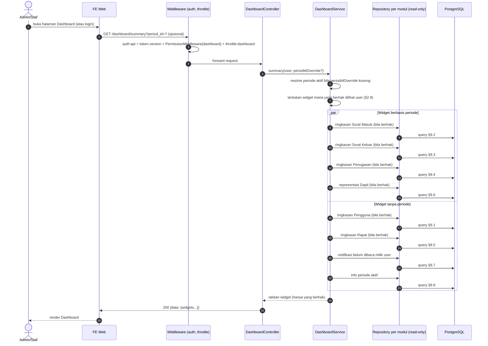
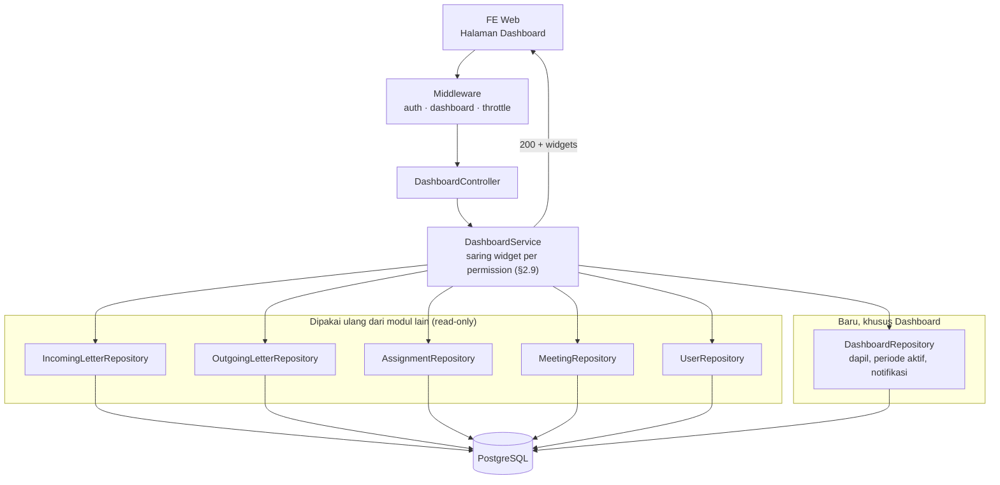

# Dashboard Web | Rekomendasi Teknis

# Informasi Dokumen

**e-PARLEMEN DPRD KOTA MAGELANG — Modul Dashboard** Ringkasan Data Lintas Modul (Web Admin): Spesifikasi Fungsional, Rekomendasi TRD & API Contract

| Atribut | Keterangan |
| --- | --- |
| Nama Dokumen | Dashboard_Web_Spec_TRD_v0.1 — Rekomendasi Teknis Dashboard |
| Versi | 0.1 |
| Tanggal | 26 November 2026 |
| Disusun oleh | Ayu Widya Inggit |
| Isi Dokumen | Bagian A – Spesifikasi Fungsional · Bagian B – Rekomendasi Analisa TRD · Bagian C – API Docs |
| Acuan | `docs/rekomendasi_teknis/report_penugasan.md`, `docs/rekomendasi_teknis/report_surat_masuk.md`, `docs/rekomendasi_teknis/report_surat_keluar.md` (pola dokumen sejenis) |
| Status | Rekomendasi, belum diimplementasikan. Tidak ditemukan `DashboardController`, route, atau service terkait di repositori per tanggal dokumen ini. Permission menu `dashboard` (`PermissionType::Dashboard`) sudah ada di seeder, menandakan menu ini sudah direncanakan tapi backend-nya belum dibangun. |

## Riwayat Revisi

| Versi | Tanggal | Perubahan |
| --- | --- | --- |
| 0.1 | 26 Nov 2026 | Draf awal. Rekomendasi widget dan kontrak API Dashboard Web, disusun dari peninjauan langsung terhadap skema dan data riil `e_parlemen_develop` (lihat §7.4) serta modul yang sudah berjalan (Surat Masuk, Surat Keluar, Penugasan, Rapat, Manajemen Akun Pengguna, Notifikasi). |

# Bagian A — Spesifikasi Fungsional

## 1. Pendahuluan

### 1.1 Tujuan

Dokumen ini merekomendasikan kebutuhan fungsional dan rancangan teknis untuk **Dashboard** pada Web Admin e-PARLEMEN: satu layar ringkasan yang menampilkan kondisi terkini lintas modul (Surat Masuk, Surat Keluar, Penugasan, Rapat, Pengguna, Notifikasi) begitu admin/staf login, tanpa harus membuka satu per satu menu untuk tahu apa yang perlu ditindaklanjuti hari ini.

Dashboard bersifat **baca saja** (tidak ada aksi tulis), bersifat **ringkasan** (bukan daftar lengkap — setiap angka di Dashboard tetap menaut ke halaman daftar modul terkait untuk detail), dan **sadar permission** (widget yang tampil menyesuaikan hak akses pengguna yang login, bukan satu set widget yang sama untuk semua orang).

- **Bagian B** berisi rekomendasi teknis.
- **Bagian C** berisi rancangan API — satu endpoint ringkasan baru, tidak memakai ulang endpoint modul lain yang sudah berorientasi daftar/paginasi.

### 1.2 Ruang Lingkup

**Termasuk dalam lingkup:**

- Satu endpoint ringkasan (`GET /dashboard/summary`) yang mengembalikan sekumpulan blok widget dalam satu respons.
- Widget: Ringkasan Pengguna, Ringkasan Surat Masuk, Ringkasan Surat Keluar, Ringkasan Penugasan, Ringkasan Rapat, Representasi Dapil, Notifikasi Belum Dibaca, Info Periode Aktif.
- Penyaringan widget berdasarkan permission pengguna yang login (§2.9, BR-09).
- Filter Periode opsional untuk widget yang memang berbasis periode (default periode aktif).

**Di luar lingkup:**

| No | Item | Keterangan & Usulan | Ref. |
| --- | --- | --- | --- |
| 1 | Personalisasi tata letak widget per pengguna (drag-and-drop, sembunyikan widget tertentu) | Di luar lingkup rilis pertama; seluruh pengguna dengan permission yang sama melihat susunan widget yang sama. | — |
| 2 | Grafik tren historis multi-bulan yang kaya (line chart, perbandingan antar periode) | Data riil saat ini hanya mencakup dua bulan kalender dengan data (§7.4.a), terlalu tipis untuk tren bermakna. Query dasar tetap direkomendasikan (§9.9) agar FE bisa menampilkannya begitu data lebih kaya, tapi visualisasi kaya ditunda. | §7.4.a |
| 3 | Widget khusus modul Reses | Tabel `reses` masih kosong (0 baris) di data riil (§7.4.b) — tidak ada yang bisa dirangkum. Ditunda sampai modul Reses punya data operasional. | §7.4.b |
| 4 | Widget Laporan Ekspor (`report_exports`) | Riwayat ekspor laporan sudah punya halaman sendiri (`GET /report/export/history`, `report_penugasan.md` §14.2); tidak dirangkum ulang di Dashboard pada rilis pertama. | — |

### 1.3 Aktor & Kanal

| Aktor | Kanal | Peran |
| --- | --- | --- |
| Admin / Staf (pemegang permission menu `dashboard`) | WEB – Halaman Dashboard (biasanya halaman pertama setelah login) | Melihat ringkasan lintas modul sesuai hak aksesnya masing-masing. |
| Sistem — Backend | API `GET /dashboard/summary` | Menghitung dan merangkai setiap blok widget sesuai permission pemanggil. |

### 1.4 Istilah

| Istilah | Arti |
| --- | --- |
| Widget | Satu blok ringkasan mandiri di dalam respons Dashboard, misal "Ringkasan Surat Masuk". |
| Periode Aktif | Baris `periods` dengan `status = ACTIVE`. Dipakai sebagai default filter untuk widget yang berbasis periode. |
| Widget Berbasis Periode | Widget yang sumber datanya punya kolom `period_id` (Surat Masuk, Surat Keluar, Penugasan, Representasi Dapil) — bisa dipersempit ke periode tertentu. |
| Widget Tanpa Periode | Widget yang sumber datanya tidak terikat satu periode (Pengguna, Rapat, Notifikasi) — filter Periode tidak berlaku untuknya (BR-10). |
| Sadar Permission | Pola di mana isi respons menyesuaikan hak akses pemanggil, bukan ditolak seluruhnya atau ditampilkan seluruhnya tanpa penyaringan. |

## 2. Kebutuhan Fungsional

API: `GET /dashboard/summary` (§14.1). Satu permintaan mengembalikan seluruh widget yang berhak dilihat pemanggil.

### 2.1 Ringkasan Pengguna

| Kolom Widget | Sumber Field | Logic |
| --- | --- | --- |
| Total Pengguna | count `users` | Tanpa filter periode (BR-10). |
| Jumlah per Status | count `users` group by `status` | `ACTIVE` / `INACTIVE` / `PENDING`. |
| Jumlah per Jenis Orang | count `users` group by `person_type` | `DEWAN` / `SEKWAN`. |

Gerbang permission: `pegawai` (`PermissionType::Employee`) — sama dengan gerbang Manajemen Akun Pengguna (BR-09).

### 2.2 Ringkasan Surat Masuk

| Kolom Widget | Sumber Field | Logic |
| --- | --- | --- |
| Jumlah per Status | count `incoming_letters` group by `status`, difilter `period_id` | `DRAFT` / `SUBMIT` / `SELESAI` (§3.2). |
| Disposisi Menunggu | count `incoming_letter_dispositions` berstatus `PENDING` | Lewat surat pada periode yang difilter — butuh perhatian segera staf penerima disposisi. |

Gerbang permission: `surat_masuk` (`PermissionType::IncomingLetter`).

### 2.3 Ringkasan Surat Keluar

| Kolom Widget | Sumber Field | Logic |
| --- | --- | --- |
| Jumlah per Status & Asal | count `outgoing_letters` group by `status`, `origin`, difilter `period_id` | Label Indonesia sesuai kamus modul Surat Keluar (`report_surat_keluar.md` §3.2). |

Gerbang permission: `surat_keluar` (`PermissionType::OutgoingLetter`).

### 2.4 Ringkasan Penugasan

| Kolom Widget | Sumber Field | Logic |
| --- | --- | --- |
| Jumlah per Status | count `duty_assignments` group by `status`, difilter `period_id` | §3.2 untuk kamus label. |
| Akan Datang / Berlangsung / Selesai | count `duty_assignments` dari `start_date`/`end_date` dibanding tanggal hari ini, difilter `period_id` | Dipisah dari status mentah karena satu status (`APPROVED`) bisa berarti "akan datang" maupun "sedang berlangsung" tergantung tanggal. |
| Persetujuan Menunggu | count `duty_assignment_approvals` berstatus `PENDING` | Lewat penugasan pada periode yang difilter — menunjukkan antrian approval yang perlu ditindaklanjuti. |

Gerbang permission: `penugasan.lihat` (`PermissionType::AssignmentView`).

### 2.5 Ringkasan Rapat

| Kolom Widget | Sumber Field | Logic |
| --- | --- | --- |
| Jumlah per Status | count `meetings` group by `status` | Tanpa filter periode (BR-10) — jadwal rapat tidak terikat `period_id`. |
| Akan Datang (30 Hari) | count `meetings` berstatus `SCHEDULED` dengan `meeting_date` dalam 30 hari ke depan | Jendela tetap 30 hari, bukan berbasis periode. |
| Rapat Bentrok Belum Selesai | count `meetings` berstatus `SCHEDULED` dengan `conflict_count > 0` | Menandakan masih ada peserta yang jadwalnya bentrok, perlu ditinjau staf sebelum rapat berlangsung. |

Gerbang permission: `meetings.view` (`PermissionType::MeetingView`).

### 2.6 Representasi Dapil

| Kolom Widget | Sumber Field | Logic |
| --- | --- | --- |
| Jumlah Anggota per Dapil | count `dapil_assignments` group by `dapil_id`, difilter `period_id`, `LEFT JOIN` dari `dapils` | `LEFT JOIN` dipertahankan supaya dapil yang belum punya anggota pada periode terpilih tetap tampil dengan angka 0, bukan hilang dari daftar. |

Gerbang permission: `pegawai` **atau** `penugasan.lihat` (data ini dipakai kedua modul; disamakan dengan pola `GET /user-assignments` yang dipakai bersama lintas modul, lihat AGENTS.md konvensi proyek).

### 2.7 Notifikasi Belum Dibaca

| Kolom Widget | Sumber Field | Logic |
| --- | --- | --- |
| Jumlah Belum Dibaca | count `notifications` milik pengguna yang sedang login, `read_at IS NULL` | Selalu personal (`notifiable_id` = id pengguna login), tidak pernah agregat lintas pengguna. |

Gerbang permission: tidak ada gerbang tambahan — selalu tampil untuk siapa pun yang berhasil membuka Dashboard (gerbang `dashboard` saja sudah cukup, BR-09).

### 2.8 Info Periode Aktif

| Kolom Widget | Sumber Field | Logic |
| --- | --- | --- |
| Nama Periode Aktif | `periods.name` berstatus `ACTIVE` | — |
| Rentang Tanggal | `periods.start_date`, `periods.end_date` | — |
| Sisa Hari | `end_date - CURRENT_DATE` | Bisa negatif bila periode sudah lewat tapi belum diganti statusnya — ditampilkan apa adanya, bukan dianggap error (lihat IT-DB-03). |

Gerbang permission: tidak ada gerbang tambahan, sama seperti §2.7.

### 2.9 Penyaringan Widget Berdasarkan Permission

Dashboard **tidak** menolak seluruh permintaan hanya karena pemanggil tak punya satu permission tertentu. Selama pemanggil punya permission menu `dashboard`, endpoint tetap merespons `200`, tapi hanya menyertakan blok widget yang permission domainnya dimiliki pemanggil (§2.1–§2.6). Widget §2.7–§2.8 selalu disertakan. Super Admin selalu menerima seluruh widget (BR-09).

## 3. Status & Kamus Label

### 3.1 Prinsip Kamus

Dashboard **memakai ulang** kamus label Indonesia yang sudah ditetapkan di dokumen rekomendasi masing-masing modul sumber, tidak mendefinisikan kamus baru:

| Widget | Rujukan Kamus |
| --- | --- |
| Surat Masuk | `report_surat_masuk.md` §3.2 (atau TRD modul tsb. bila sudah ada) |
| Surat Keluar | `report_surat_keluar.md` §3.2 |
| Penugasan | `AssignmentStatusType::label()` di kode (`app/Enums/AssignmentStatusType.php`) |
| Rapat | `MeetingStatus::label()` di kode (`app/Enums/MeetingStatus.php`) |

### 3.2 Kamus Status yang Dipakai Widget Dashboard (untuk referensi cepat)

| Kolom | Kode BE | Label Indonesia |
| --- | --- | --- |
| Status Surat Masuk | `DRAFT` | Draf |
|  | `SUBMIT` | Dikirim |
|  | `SELESAI` | Selesai |
| Status Surat Keluar | `DRAFT`/`SUBMIT`/`IN_PROGRESS`/`COMPLETED`/`DONE` | Lihat `report_surat_keluar.md` §3.2 |
| Status Penugasan (`AssignmentStatusType`) | `DRAFT` | Draf |
|  | `WAITING_APPROVAL` | Menunggu Persetujuan |
|  | `APPROVED` | Disetujui |
|  | `REJECTED` | Ditolak |
|  | `FINISHED` | Selesai |
|  | `CANCEL_BY_ADMIN` | Dibatalkan Admin |
|  | `CANCEL_BY_SYSTEM` | Dibatalkan Sistem |
| Status Rapat (`MeetingStatus`) | `DRAFT` | Draft |
|  | `SCHEDULED` | Dijadwalkan |
|  | `ONGOING` | Sedang Berlangsung (dihitung saat baca, tidak pernah tersimpan — lihat catatan di `MeetingStatus`) |
|  | `COMPLETED` | Selesai |
|  | `CANCELLED` | Dibatalkan |
| Status Persetujuan Penugasan (`duty_assignment_approvals.status`) | `PENDING` | Menunggu |
|  | `APPROVED` | Disetujui |
|  | `REJECTED` | Ditolak |
| Status Disposisi Surat Masuk | `PENDING` | Menunggu |
|  | `DISPOSISI` | Didisposisikan |
|  | `TERIMA` | Diterima |

## 4. Alur Proses

### 4.1 Memuat Dashboard



_Gambar 1. Alur permintaan Dashboard, seluruhnya sinkron (tanpa antrean) karena harus tampil begitu halaman dibuka._

## 5. Aturan Bisnis

| Kode | Aturan |
| --- | --- |
| BR-01 | `GET /dashboard/summary` adalah satu-satunya endpoint baru pada modul ini; tidak ada endpoint tulis. |
| BR-02 | Widget Surat Masuk, Surat Keluar, Penugasan, dan Representasi Dapil difilter ke satu periode (default periode aktif), karena sumber datanya punya kolom `period_id`. |
| BR-03 | Widget Pengguna dan Rapat **tidak** difilter periode, karena sumber datanya (`users`, `meetings`) tidak punya kolom `period_id` (BR-10). |
| BR-04 | Widget Notifikasi Belum Dibaca selalu personal milik pengguna yang sedang login, tidak pernah agregat lintas pengguna. |
| BR-05 | "Akan Datang/Berlangsung/Selesai" pada Ringkasan Penugasan dihitung dari `start_date`/`end_date` dibanding tanggal hari ini, bukan dari field `status` mentah, karena satu nilai status bisa mencakup dua kondisi tanggal berbeda. |
| BR-06 | "Akan Datang" pada Ringkasan Rapat memakai jendela tetap 30 hari ke depan sejak tanggal permintaan dikirim, bukan berbasis periode. |
| BR-07 | "Rapat Bentrok Belum Selesai" hanya menghitung rapat berstatus `SCHEDULED` dengan `conflict_count > 0`; rapat yang sudah `COMPLETED`/`CANCELLED` tidak dihitung meski riwayatnya pernah bentrok. |
| BR-08 | Representasi Dapil memakai `LEFT JOIN` dari `dapils`, bukan `INNER JOIN` dari `dapil_assignments`, supaya dapil tanpa anggota pada periode terpilih tetap muncul dengan angka 0. |
| BR-09 | Akses ke endpoint memerlukan permission menu `dashboard`. Setiap blok widget di dalamnya disaring lagi sesuai permission domain masing-masing (§2.9); Super Admin melewati seluruh penyaringan ini. |
| BR-10 | Filter `period_id` pada permintaan diabaikan untuk widget yang memang tidak berbasis periode (Pengguna, Rapat, Notifikasi, Info Periode Aktif) — bukan dianggap galat, supaya FE bisa mengirim satu `period_id` global untuk seluruh Dashboard tanpa perlu tahu widget mana yang peduli. |

# Bagian B — Rekomendasi Analisa untuk TRD

Berbeda dengan modul Surat Masuk/Surat Keluar/Penugasan yang berorientasi ekspor asinkron, Dashboard bersifat **baca sinkron**: harus merespons cepat saat halaman dibuka, tidak memakai pola antrean `assignment_report_exports`. Seluruh isi Bagian B berikut adalah agregasi atas tabel yang sudah ada — tidak ada tabel baru yang diusulkan.

## 6. Asumsi Teknis & Arsitektur

### 6.1 Komponen & Pemetaan ke Struktur Existing

| Layer | Komponen Baru | Mengikuti Pola | Tanggung Jawab |
| --- | --- | --- | --- |
| Route | `GET /dashboard/summary` | Grup route lain di `routes/V1/api.php` | Trigger ringkasan. |
| Controller | `App\Http\Controllers\V1\DashboardController` | Controller modul lain (`implements HasMiddleware`) | Validasi auth, delegasi ke service. |
| FormRequest | `App\Http\Requests\V1\DashboardSummaryRequest` | Pola FormRequest modul lain | `period_id` opsional, UUID, harus ada di `periods` bila diisi. |
| Service | `App\Contracts\V1\Services\DashboardServiceInterface` + `App\Services\V1\DashboardService` | Pola Service modul lain | Menentukan widget yang berhak dilihat (§2.9), memanggil repository tiap modul, merakit respons. |
| Repository | **Tidak ada repository baru** | — | Dashboard memakai ulang repository read-only modul lain (`IncomingLetterRepository`, `OutgoingLetterRepository`, `AssignmentRepository`, `MeetingRepository`, `UserRepository`) ditambah satu kelas tipis `DashboardRepository` khusus untuk query yang tidak dimiliki modul mana pun (Representasi Dapil, Info Periode Aktif, Notifikasi Belum Dibaca). |
| Middleware | `auth:api`, `token.version`, `PermissionMiddleware(dashboard)`, `throttle:dashboard` | Pola middleware modul lain | Gerbang akses dasar (§2.9 menambah penyaringan di level service, bukan middleware). |

### 6.2 Diagram Arsitektur Komponen



_Gambar 2. Dashboard tidak membawa logika bisnis sendiri untuk tiap modul — ia murni agregator yang memanggil ulang repository yang sudah ada, kecuali untuk tiga query kecil yang belum dimiliki modul mana pun._

### 6.3 Pertimbangan Caching

Seluruh widget adalah hasil `COUNT`/`GROUP BY` atas tabel yang baris-nya masih berorde ratusan (§7.4), sehingga **belum** direkomendasikan memakai cache (Redis/`cache` table) pada rilis pertama — latensi query langsung diperkirakan tetap singkat (lihat §10). Rekomendasikan caching per-periode (TTL pendek, 30–60 detik) hanya bila volume data bertumbuh signifikan, dipantau lewat ambang di IT-DB-02.

## 7. Model Data

Tidak ada tabel baru. Dashboard murni membaca tabel yang sudah ada.

### 7.1 Tabel Sumber per Widget

| Tabel | Dipakai di Widget | Kolom Kunci |
| --- | --- | --- |
| `users` | Ringkasan Pengguna (§2.1) | `status`, `person_type` |
| `incoming_letters`, `incoming_letter_dispositions` | Ringkasan Surat Masuk (§2.2) | `period_id`, `status` |
| `outgoing_letters` | Ringkasan Surat Keluar (§2.3) | `period_id`, `status`, `origin` |
| `duty_assignments`, `duty_assignment_approvals` | Ringkasan Penugasan (§2.4) | `period_id`, `status`, `start_date`, `end_date` |
| `meetings` | Ringkasan Rapat (§2.5) | `status`, `meeting_date`, `conflict_count` |
| `dapils`, `dapil_assignments` | Representasi Dapil (§2.6) | `period_id`, `dapil_id` |
| `notifications` | Notifikasi Belum Dibaca (§2.7) | `notifiable_id`, `notifiable_type`, `read_at` |
| `periods` | Info Periode Aktif (§2.8), serta default filter seluruh widget berbasis periode | `status`, `start_date`, `end_date` |

### 7.2 Index

Seluruh kolom yang dipakai widget Dashboard untuk `WHERE`/`GROUP BY` **sudah terindex** oleh modul sumbernya masing-masing (diverifikasi lewat `pg_indexes`, 26 Nov 2026):

| Tabel | Index Relevan | Status |
| --- | --- | --- |
| `incoming_letters` | `incoming_letters_status_index`, `incoming_letters_period_id_index` | Sudah ada |
| `outgoing_letters` | `outgoing_letters_status_origin_index`, `outgoing_letters_period_id_index` | Sudah ada |
| `duty_assignments` | `idx_duty_assignments_status_start_date`, `idx_duty_assignments_period_id_dapil_id` | Sudah ada |
| `meetings` | `idx_meetings_status_date` | Sudah ada |
| `incoming_letter_dispositions` | `incoming_letter_dispositions_incoming_letter_id_status_index` | Sudah ada |
| `notifications` | `notifications_notifiable_type_notifiable_id_index` | Sudah ada, **tanpa** `read_at` (lihat IT-DB-01) |
| `duty_assignment_approvals` | — | **Belum ada** index pada `status` (lihat IT-DB-01) |
| `users` | — | **Belum ada** index pada `status`/`person_type` (lihat IT-DB-01) |

### 7.3 Tidak Ada Perubahan Skema

Berbeda dengan modul Penugasan/Surat Masuk/Surat Keluar yang menambah kolom ke `assignment_report_exports`, Dashboard **tidak mengusulkan migrasi apa pun** pada rilis pertama — lihat §7.2 untuk dua index kecil yang direkomendasikan sebagai perbaikan lanjutan, bukan syarat rilis (IT-DB-01).

### 7.4 Temuan Data Riil

Seluruh temuan diverifikasi langsung ke `e_parlemen_develop` pada 26 November 2026, periode aktif `d0eefc99-e99f-5ba3-a818-6d5555d829f9` / "Periode Sekarang" (rentang 31 Des 2025 – 30 Des 2027, sisa 400 hari dari tanggal verifikasi).

**a. Volume data saat ini kecil di seluruh tabel sumber**

| Tabel | Jumlah Baris |
| --- | --- |
| `users` | 103 (103 `ACTIVE`, 0 `INACTIVE`, 0 `PENDING`; 39 `DEWAN`, 64 `SEKWAN`) |
| `incoming_letters` | 28 (periode aktif: 5 `DRAFT`, 10 `SUBMIT`, 12 `SELESAI`; 1 baris lain menunjuk periode non-aktif) |
| `outgoing_letters` | 32, seluruhnya periode aktif (9 `COMPLETED`/`REQUEST`, 9 `SUBMIT`/`REQUEST`, 14 `DONE`/`DIRECT`) |
| `duty_assignments` | 148, seluruhnya periode aktif (19 `APPROVED`, 63 `CANCEL_BY_SYSTEM`, 8 `DRAFT`, 27 `FINISHED`, 31 `REJECTED`) |
| `meetings` | 16 (1 `DRAFT`, 9 `SCHEDULED`, 2 `COMPLETED`, 4 `CANCELLED`) |
| `reses` | 0 |
| `notifications` | 755, tersebar ke banyak pengguna (contoh: satu pengguna punya 27 belum dibaca) |

Query untuk tabel di atas tidak dicetak berulang di §9 karena identik dengan query yang dijalankan untuk memverifikasi temuan ini.

**b. 42% penugasan periode aktif berstatus `CANCEL_BY_SYSTEM`**

63 dari 148 baris `duty_assignments` (42%) berstatus `CANCEL_BY_SYSTEM` — jauh lebih banyak dari `APPROVED` (19) atau `FINISHED` (27). Widget Ringkasan Penugasan (§2.4) karena itu **sengaja** menampilkan rincian per status, bukan hanya "total penugasan", supaya proporsi pembatalan otomatis yang besar ini tidak tersembunyi di balik satu angka agregat.

**c. Satu rapat terjadwal masih punya bentrok peserta yang belum diselesaikan**

Dari 9 rapat berstatus `SCHEDULED`, 1 di antaranya punya `conflict_count > 0` — mengonfirmasi widget "Rapat Bentrok Belum Selesai" (§2.5) relevan dengan kondisi data riil saat ini, bukan kasus hipotetis.

**d. Seluruh dapil sudah punya anggota pada periode aktif**

Dapil 1 (20 anggota), Dapil 2 (10 anggota), Dapil 3 (8 anggota) — tidak ada dapil kosong di data riil saat ini, tapi query widget (§9.6) tetap memakai `LEFT JOIN` (BR-08) karena kekosongan tetap mungkin terjadi di periode mendatang atau bila ada dapil baru ditambahkan.

**e. Dua periode lain tumpang tindih tanggal dengan periode aktif**

Periode "baru bgt 1 update 1" (10 Nov–30 Des 2026) tumpang tindih penuh dengan periode aktif "Periode Sekarang" (31 Des 2025–30 Des 2027) — temuan yang sama persis dengan R1 pada tinjauan `report_penugasan.md` §12.4. Dashboard tidak memperbaiki isu ini (di luar lingkup), tapi mewarisi dampaknya: bila Dashboard suatu saat menambah filter periode manual ke periode yang tumpang tindih ini, hasilnya berpotensi membingungkan dengan cara yang sama seperti laporan Excel. Dicatat sebagai IT-DB-03.

## 8. Ringkasan Desain API

| No | Method | Endpoint | Kanal / Aktor | Fungsi | Ref. |
| --- | --- | --- | --- | --- | --- |
| 1 | GET | `/dashboard/summary` | WEB – Admin/Staf | Ringkasan widget lintas modul sesuai permission pemanggil. **Baru**. | §14.1 |

## 9. Logic Proses & Query

Seluruh query berikut sudah diuji terhadap `e_parlemen_develop` (26 Nov 2026, periode aktif `d0eefc99-e99f-5ba3-a818-6d5555d829f9`).

### 9.1 Ringkasan Pengguna

```sql
SELECT status, count(*) FROM users GROUP BY status ORDER BY status;

SELECT person_type, count(*) FROM users GROUP BY person_type ORDER BY person_type;
```

### 9.2 Ringkasan Surat Masuk

```sql
WITH params AS (
    SELECT 'd0eefc99-e99f-5ba3-a818-6d5555d829f9'::uuid AS period_id
)
SELECT il.status, count(*)
FROM incoming_letters il
CROSS JOIN params
WHERE il.period_id = params.period_id
GROUP BY il.status
ORDER BY il.status;

WITH params AS (
    SELECT 'd0eefc99-e99f-5ba3-a818-6d5555d829f9'::uuid AS period_id
)
SELECT count(*) AS disposisi_pending
FROM incoming_letter_dispositions d
JOIN incoming_letters l ON l.id = d.incoming_letter_id
CROSS JOIN params
WHERE l.period_id = params.period_id
  AND d.status = 'PENDING';
```

### 9.3 Ringkasan Surat Keluar

```sql
WITH params AS (
    SELECT 'd0eefc99-e99f-5ba3-a818-6d5555d829f9'::uuid AS period_id
)
SELECT ol.status, ol.origin, count(*)
FROM outgoing_letters ol
CROSS JOIN params
WHERE ol.period_id = params.period_id
GROUP BY ol.status, ol.origin
ORDER BY ol.status, ol.origin;
```

### 9.4 Ringkasan Penugasan

```sql
WITH params AS (
    SELECT 'd0eefc99-e99f-5ba3-a818-6d5555d829f9'::uuid AS period_id
)
SELECT da.status, count(*)
FROM duty_assignments da
CROSS JOIN params
WHERE da.period_id = params.period_id
GROUP BY da.status
ORDER BY da.status;

WITH params AS (
    SELECT 'd0eefc99-e99f-5ba3-a818-6d5555d829f9'::uuid AS period_id
)
SELECT
    count(*) FILTER (
        WHERE da.start_date >= current_date
          AND da.status NOT IN ('CANCEL_BY_SYSTEM', 'CANCEL_BY_ADMIN')
    ) AS akan_datang,
    count(*) FILTER (
        WHERE da.start_date < current_date AND da.end_date >= current_date
    ) AS berlangsung,
    count(*) FILTER (WHERE da.end_date < current_date) AS selesai
FROM duty_assignments da
CROSS JOIN params
WHERE da.period_id = params.period_id;

WITH params AS (
    SELECT 'd0eefc99-e99f-5ba3-a818-6d5555d829f9'::uuid AS period_id
)
SELECT count(*) AS approval_pending
FROM duty_assignment_approvals a
JOIN duty_assignments da ON da.id = a.duty_assignment_id
CROSS JOIN params
WHERE da.period_id = params.period_id
  AND a.status = 'PENDING';
```

> **Catatan BR-05.** Klausa `start_date >= current_date` dan `status NOT IN (...)` dipakai bersamaan karena penugasan `CANCEL_BY_SYSTEM`/`CANCEL_BY_ADMIN` bisa saja punya `start_date` di masa depan (dibatalkan sebelum tanggal mulainya tiba) — tanpa pengecualian status ini, penugasan yang sudah batal akan salah terhitung sebagai "akan datang".

### 9.5 Ringkasan Rapat

```sql
SELECT status, count(*) FROM meetings GROUP BY status ORDER BY status;

SELECT count(*) AS akan_datang_30_hari
FROM meetings
WHERE status = 'SCHEDULED'
  AND meeting_date BETWEEN current_date AND current_date + INTERVAL '30 days';

SELECT count(*) AS bentrok_belum_selesai
FROM meetings
WHERE status = 'SCHEDULED'
  AND conflict_count > 0;
```

### 9.6 Representasi Dapil

```sql
WITH params AS (
    SELECT 'd0eefc99-e99f-5ba3-a818-6d5555d829f9'::uuid AS period_id
)
SELECT d.id, d.name, count(da.id) AS jumlah_anggota
FROM dapils d
LEFT JOIN dapil_assignments da
    ON da.dapil_id = d.id
    AND da.period_id = (SELECT period_id FROM params)
GROUP BY d.id, d.name
ORDER BY d.name;
```

### 9.7 Notifikasi Belum Dibaca

```sql
-- :user_id diisi id pengguna yang sedang login
SELECT count(*) AS belum_dibaca
FROM notifications
WHERE notifiable_type = 'App\Models\User'
  AND notifiable_id = :user_id
  AND read_at IS NULL;
```

### 9.8 Info Periode Aktif

```sql
SELECT id, name, start_date::date, end_date::date,
       (end_date::date - current_date) AS sisa_hari
FROM periods
WHERE status = 'ACTIVE'
LIMIT 1;
```

> Lebih dari satu baris `ACTIVE` seharusnya tidak mungkin terjadi menurut desain modul Periode, tapi query ini memakai `LIMIT 1` sebagai jaring pengaman, bukan asumsi yang divalidasi ulang di sini.

### 9.9 Tren Bulanan (Opsional, Disiapkan untuk Masa Depan)

```sql
WITH params AS (
    SELECT 'd0eefc99-e99f-5ba3-a818-6d5555d829f9'::uuid AS period_id
)
SELECT date_trunc('month', il.letter_date)::date AS bulan, count(*)
FROM incoming_letters il
CROSS JOIN params
WHERE il.period_id = params.period_id
GROUP BY 1
ORDER BY 1;
```

> Query ini diuji dan menghasilkan data yang benar (lihat §7.4.a), tapi **tidak direkomendasikan ditampilkan sebagai widget pada rilis pertama** karena baru mencakup dua bulan kalender dengan data riil — grafik tren dengan dua titik data tidak informatif (Di luar lingkup §1.2 butir 2).

## 10. Rekomendasi Performa

1. **Tidak perlu index baru untuk rilis pertama** — delapan dari sepuluh query widget sudah ditopang index existing (§7.2). Dua pengecualian (`duty_assignment_approvals.status`, `users.status`/`person_type`) aman untuk volume data saat ini (di bawah 200 baris), direkomendasikan ditinjau ulang bila volume bertambah signifikan (IT-DB-01).
2. **Satu permintaan, banyak query kecil, dijalankan paralel** — bukan satu query raksasa dengan banyak `JOIN`. Query per widget sudah sangat sederhana (`COUNT`/`GROUP BY` satu-dua tabel); menjalankannya sebagai query terpisah lebih mudah dipelihara dan displit sesuai permission (§2.9) dibanding dipaksakan jadi satu query gabungan.
3. **Tidak perlu caching pada rilis pertama** (§6.3) — volume data terlalu kecil untuk menjustifikasi kompleksitas cache invalidation. Tetapkan ambang eksplisit (mis. jumlah baris `duty_assignments` atau `incoming_letters`) yang memicu peninjauan ulang, bukan menunggu Dashboard terasa lambat lebih dulu (IT-DB-02).

## 11. Rekomendasi Keamanan

1. **Permission menu `dashboard`** sebagai gerbang dasar, ditambah penyaringan per widget di level service (§2.9) — bukan satu permission tunggal yang membuka seluruh data lintas modul.
2. **Notifikasi Belum Dibaca selalu di-scope ke `notifiable_id` milik pengguna yang login** (BR-04) — tidak pernah menerima parameter id pengguna lain dari klien, mencegah satu pengguna melihat jumlah notifikasi pengguna lain.
3. **Tidak ada data sensitif individual pada widget agregat** — seluruh widget mengembalikan angka hitung (`COUNT`), bukan daftar nama/identitas per baris, sehingga risiko kebocoran data pribadi lewat endpoint ini jauh lebih rendah dibanding endpoint daftar (`GET /users`, dsb).
4. **Throttle** `throttle:dashboard` direkomendasikan walau endpoint ini baca-saja, karena dipanggil berulang (setiap buka halaman) dan menyentuh banyak tabel sekaligus dalam satu permintaan — laju yang tidak dibatasi berisiko dipakai sebagai vektor pembebanan backend (denial of service ringan) dibanding endpoint daftar biasa yang bebannya per satu tabel saja.

## 12. Dependency, Migration & Isu Terbuka

### 12.1 Dependency & Migration yang Perlu Approval

| Perubahan | Jenis | Catatan |
| --- | --- | --- |
| **Tidak ada migrasi skema** | — | Dashboard murni membaca tabel yang sudah ada (§7.3). |
| Kelas baru: `DashboardController`, `DashboardService`, `DashboardRepository`, `DashboardSummaryRequest` | Kode baru | Tidak ada dependency pihak ketiga baru. |
| Permission `dashboard` | Sudah ada | `PermissionType::Dashboard` sudah ada di seeder; tidak perlu seeder baru, hanya perlu dipastikan sudah ditautkan ke role yang relevan. |
| Dua index opsional (`duty_assignment_approvals.status`, `users` pada `status`/`person_type`) | Migration skema (index saja), opsional | Lihat IT-DB-01; risiko rendah, reversibel, bukan syarat rilis. |

### 12.2 Pemetaan Isu ke Keputusan

| Kode | Isu | Rekomendasi | Pemilik Keputusan |
| --- | --- | --- | --- |
| IT-DB-01 | `duty_assignment_approvals.status` dan `users` (`status`/`person_type`) belum terindex (§7.2). Aman untuk volume data saat ini, tapi akan jadi full table scan berulang setiap Dashboard dibuka begitu tabel bertumbuh. | Tambahkan index biasa (bukan unique) pada kedua kolom tersebut sebagai perbaikan lanjutan, bukan syarat rilis pertama. | Tim Backend |
| IT-DB-02 | Belum ada ambang volume data yang eksplisit untuk memicu peninjauan ulang kebutuhan caching (§6.3, §10). | Tetapkan ambang (mis. total baris `duty_assignments` atau `incoming_letters` melewati angka tertentu, atau waktu respons endpoint melewati angka tertentu) sebagai pemicu, bukan menunggu keluhan performa. | Tim Backend |
| IT-DB-03 | Dashboard mewarisi risiko periode tumpang tindih tanggal yang sudah ditemukan di `report_penugasan.md` R1 (§7.4.e) — bila Dashboard menambah filter periode manual di masa depan, periode yang tumpang tindih tanggal berpotensi membingungkan staf yang memilihnya. | Tidak perlu diperbaiki khusus di modul ini; cukup diwariskan sebagai pengetahuan bersama. Perbaikan tetap ada di tangan keputusan terbuka `report_penugasan.md` (migrasi filter list ke `period_id`, validasi anti-tumpang-tindih saat buat periode baru). | Tim Backend (lintas modul) |
| IT-DB-04 | Belum ada keputusan final: apakah Representasi Dapil (§2.6) digerbangi `pegawai` **atau** `penugasan.lihat` (usulan dokumen ini), atau butuh permission barunya sendiri, mengingat dipakai dua konteks berbeda (data master pengguna vs. konteks penugasan per dapil). | Konfirmasi ke Product Owner sebelum implementasi — opsi termudah (dipakai bersama) diusulkan di sini mengikuti pola `GET /user-assignments`, tapi perlu persetujuan eksplisit, bukan asumsi sepihak. | Product Owner, Tim Backend |
| IT-DB-05 | Widget Tren Bulanan (§9.9) sudah disiapkan querynya tapi sengaja tidak ditampilkan di rilis pertama (§1.2 butir 2) karena data riil baru dua bulan. | Aktifkan sebagai widget resmi setelah data operasional mencakup minimal beberapa bulan berturut-turut (mis. 6 bulan) supaya tren yang ditampilkan bermakna. | Product Owner |

# Bagian C — API Docs

> **Status:** Seluruh endpoint di bagian ini adalah **rancangan** (belum diimplementasikan).

## 13. Konvensi Umum

Sama dengan konvensi modul lain (`report_penugasan.md` §13). Yang berbeda hanya:

| Aspek | Ketentuan Khusus Modul Ini |
| --- | --- |
| Permission | `dashboard` (sudah ada di seeder), ditambah penyaringan per widget (§2.9) |
| Throttle | `throttle:dashboard` (baru, direkomendasikan — belum ada acuan nilai pasti, usulkan sama dengan throttle baca modul lain yang sudah ada sampai ada keputusan lain) |
| Format input | `GET /dashboard/summary?period_id=` (query string, opsional) |
| Sifat | Sinkron, bukan asinkron — tidak memakai pola `assignment_report_exports`/antrean seperti modul ekspor Excel |

## 14. Endpoint Dashboard

### 14.1 GET /dashboard/summary — Ringkasan Dashboard

| Atribut | Keterangan |
| --- | --- |
| Method & Path | `GET /dashboard/summary` |
| Aktor | Admin / Staf (permission `dashboard`) |
| Fungsi | Mengembalikan seluruh blok widget yang berhak dilihat pemanggil dalam satu respons. |
| Referensi | §2, §4.1, §9 |

**Query parameter**

| Field | Tipe | Wajib | Keterangan |
| --- | --- | --- | --- |
| `period_id` | uuid | Tidak | Default periode aktif bila tidak diisi. Diabaikan untuk widget tanpa periode (BR-10). |

**Contoh request**

```bash
curl 'https://api-dev-eparlemen.geekgarden.my.id/api/v1/dashboard/summary' \
  --header 'Accept: application/json' \
  --header 'Authorization: Bearer <token>'
```

**Response 200 OK (contoh untuk pemegang seluruh permission)**

```json
{
  "statusCode": 200,
  "code": "SUCCESS",
  "message": "Get Dashboard Summary Success",
  "data": {
    "period": {
      "id": "d0eefc99-e99f-5ba3-a818-6d5555d829f9",
      "name": "Periode Sekarang",
      "start_date": "2025-12-31",
      "end_date": "2027-12-30",
      "remaining_days": 400
    },
    "users": {
      "total": 103,
      "by_status": { "ACTIVE": 103, "INACTIVE": 0, "PENDING": 0 },
      "by_person_type": { "DEWAN": 39, "SEKWAN": 64 }
    },
    "incoming_letters": {
      "by_status": { "DRAFT": 5, "SUBMIT": 10, "SELESAI": 12 },
      "disposition_pending": 10
    },
    "outgoing_letters": {
      "by_status_origin": [
        { "status": "COMPLETED", "origin": "REQUEST", "count": 9 },
        { "status": "DONE", "origin": "DIRECT", "count": 14 },
        { "status": "SUBMIT", "origin": "REQUEST", "count": 9 }
      ]
    },
    "duty_assignments": {
      "by_status": { "APPROVED": 19, "CANCEL_BY_SYSTEM": 63, "DRAFT": 8, "FINISHED": 27, "REJECTED": 31 },
      "timeline": { "upcoming": 30, "ongoing": 1, "finished": 117 },
      "approval_pending": 23
    },
    "meetings": {
      "by_status": { "DRAFT": 1, "SCHEDULED": 9, "COMPLETED": 2, "CANCELLED": 4 },
      "upcoming_30_days": 4,
      "unresolved_conflicts": 1
    },
    "dapil_representation": [
      { "id": "01a1c33f-4878-7275-a0e4-6e2df45192b7", "name": "Dapil 1", "member_count": 20 },
      { "id": "01a1c33f-4949-71f3-be8d-cbb611601592", "name": "Dapil 2", "member_count": 10 },
      { "id": "01a1c33f-49ca-716f-a93e-e6d510d8dca2", "name": "Dapil 3", "member_count": 8 }
    ],
    "unread_notifications": 12
  }
}
```

> Seluruh angka pada contoh di atas adalah data riil `e_parlemen_develop` per 26 November 2026 (§7.4), kecuali `unread_notifications` yang dicontohkan dengan angka ilustratif (nilai sesungguhnya bergantung pengguna yang login).

**Response bila pemanggil hanya punya sebagian permission (ilustrasi §2.9)**

Pemanggil yang hanya memegang `pegawai` (tanpa `surat_masuk`, `surat_keluar`, `penugasan.lihat`, `meetings.view`) akan menerima struktur yang sama tapi hanya memuat kunci `period`, `users`, `dapil_representation`, dan `unread_notifications` — kunci `incoming_letters`, `outgoing_letters`, `duty_assignments`, `meetings` tidak disertakan sama sekali (bukan `null` atau objek kosong), supaya FE bisa membedakan "tidak berhak melihat" dari "datanya nol".

| HTTP | Kode | Kondisi | Body `error` |
| --- | --- | --- | --- |
| 401 | `AUTH_UNAUTHORIZED` | Token tidak ada/tidak valid | `"Unauthorized"` |
| 403 | `FORBIDDEN` | Pemanggil tidak memegang permission menu `dashboard` sama sekali | `"Forbidden"` |
| 422 | `VALIDATION_FAILED` | `period_id` bukan UUID atau tidak ditemukan di `periods` | `{ "period_id": [...] }` |
| 429 | `TOO_MANY_REQUESTS` | Batas laju `throttle:dashboard` terlampaui | `"Too Many Requests"` |
