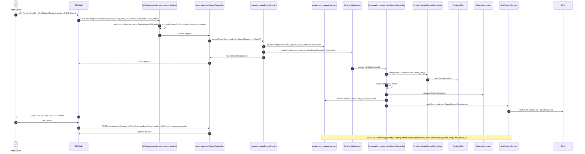
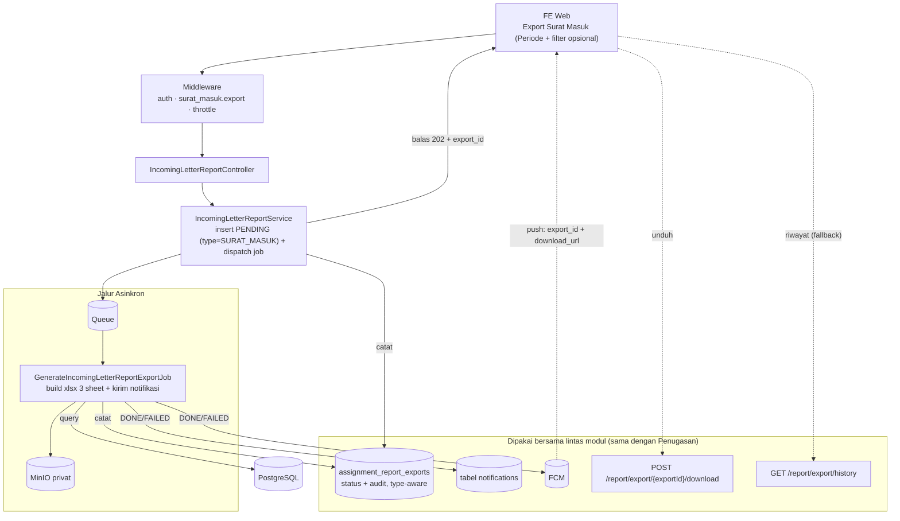

# Surat Masuk | Laporan Excel Surat Masuk

# Informasi Dokumen

**e-PARLEMEN DPRD KOTA MAGELANG — Modul Surat Masuk** Laporan Excel Surat Masuk (Filter Periode & Unit Organisasi): Spesifikasi Fungsional, Rekomendasi TRD & API Contract

| Atribut      | Keterangan                                                                                                                                        |
| ------------ | ------------------------------------------------------------------------------------------------------------------------------------------------- |
| Nama Dokumen | IncomingLetter_Report_Export_Spec_TRD_v0.1 — Laporan Excel Surat Masuk                                                                            |
| Versi        | 0.1                                                                                                                                               |
| Tanggal      | 23 November 2026                                                                                                                                  |
| Disusun oleh | Claude (atas permintaan Ayu Widya Inggit)                                                                                                         |
| Isi Dokumen  | Bagian A – Spesifikasi Fungsional · Bagian B – Rekomendasi Analisa TRD · Bagian C – API Docs                                                      |
| Acuan        | `docs/rekomendasi_teknis/report_penugasan.md` (pola arsitektur export laporan yang sudah disepakati untuk modul Penugasan, dipakai ulang di sini) |

## Riwayat Revisi

| Versi | Tanggal     | Perubahan     |
| ----- | ----------- | ------------- |
| 0.1   | 23 Nov 2026 | Initial draft |

# Bagian A — Spesifikasi Fungsional

## 1\. Pendahuluan

### 1.1 Tujuan

Dokumen ini menjelaskan kebutuhan fungsional fitur **Export Laporan Excel** pada modul **Surat Masuk** (`IncomingLetter`), menyusul pola yang sudah disepakati untuk modul Penugasan (`report_penugasan.md`).

Admin/staf yang berwenang (memegang akses fitur surat masuk) dapat mengunduh workbook `.xlsx` berisi data surat masuk, riwayat disposisi, dan lampiran, difilter berdasarkan **Periode (wajib)**, **Unit Organisasi (opsional)**, **Status (opsional)**, dan **rentang tanggal surat (opsional)**.

- **Bagian B** berisi rekomendasi teknis (arsitektur, query, performa, keamanan) untuk TRD.
- **Bagian C** berisi rancangan API — endpoint trigger baru khusus modul ini; endpoint riwayat & download dipakai bersama lintas modul (sudah didesain di `report_penugasan.md` §14.2–§14.3, lihat §12.2 IT-SM-08 di dokumen ini).

### 1.2 Ruang Lingkup

**Termasuk dalam lingkup:**

- Export laporan surat masuk dari tabel `incoming_letters` dan relasinya (`incoming_letter_dispositions`, `letter_attachments` → `uploads`).
- Filter Periode wajib (`incoming_letters.period_id`), filter Unit Organisasi opsional (`incoming_letters.org_unit_id`), filter Status opsional (`incoming_letters.status`), dan filter rentang tanggal opsional (`incoming_letters.letter_date`) yang mempersempit periode terpilih.
- Workbook 3 sheet: Ringkasan Surat Masuk, Detail Riwayat Disposisi, Detail Lampiran.
- Jalur asinkron (job antrean + unduh lewat endpoint download terautentikasi, tanpa presigned URL) — mengikuti BR-11/BR-13 `report_penugasan.md`, tanpa jalur sinkron.
- Notifikasi push realtime (database + FCM) ke pengekspor saat job selesai — infrastruktur dipakai bersama dengan modul Penugasan.
- Audit trail setiap export lewat tabel `assignment_report_exports` (`type = SURAT_MASUK`).

**Di luar lingkup: (Tidak untuk di develop sekarang)**

| No  | Item                                                                         | Keterangan & Usulan                                                                                                                                                                                                                                                                                      | Ref.             |
| --- | ---------------------------------------------------------------------------- | -------------------------------------------------------------------------------------------------------------------------------------------------------------------------------------------------------------------------------------------------------------------------------------------------------- | ---------------- |
| 1   | Keunikan `incoming_letters.letter_number` bersifat global, bukan per periode | Operator tidak dapat memakai ulang format nomor surat yang sama di periode baru walau itu lazim dalam praktik administrasi persuratan (nomor surat sering direset tiap tahun/periode). Usulan: ubah constraint jadi composite `(letter_number, period_id)`. Perubahan skema di luar lingkup laporan ini. | §7.4.b, IT-SM-02 |

### 1.3 Aktor & Kanal

| Aktor                                                        | Kanal                                                                                                              | Peran                                                                                                          |
| ------------------------------------------------------------ | ------------------------------------------------------------------------------------------------------------------ | -------------------------------------------------------------------------------------------------------------- |
| Admin / Staf (pemegang permission baru `surat_masuk.export`) | WEB – Daftar Surat Masuk › Export Laporan                                                                          | Memilih Periode, Unit Organisasi, Status, rentang tanggal; memicu export; menerima notifikasi; mengunduh file. |
| Sistem - Queue worker                                        | Backend (`QUEUE_CONNECTION=database`)                                                                              | Menjalankan `GenerateIncomingLetterReportExportJob`, mengirim notifikasi di akhir job.                         |
| Sistem - Notifikasi                                          | Backend (`Illuminate\Notifications`, channel `database` + `FcmChannel`, infrastruktur sama dengan modul Penugasan) | Mengantarkan status selesai ke pengekspor.                                                                     |
| Sistem - Scheduler                                           | Backend (Artisan command harian, dipakai bersama lintas modul)                                                     | Menandai `PENDING`/`PROCESSING` yang macet jadi `FAILED` (sama dengan §9.3 `report_penugasan.md`).             |

### 1.4 Istilah

| Istilah                   | Arti                                                                                                                                                                                                                                                                                                         |
| ------------------------- | ------------------------------------------------------------------------------------------------------------------------------------------------------------------------------------------------------------------------------------------------------------------------------------------------------------ |
| Surat Masuk               | Fitur `IncomingLetter` (`IncomingLetterController`, tabel `incoming_letters`) — surat yang diterima dan didistribusikan ke anggota/pejabat DPRD lewat disposisi. Permission menu: `surat_masuk`.                                                                                                             |
| Periode                   | Baris `periods`. Surat masuk ter-tag ke satu periode lewat `incoming_letters.period_id`, diisi otomatis dari periode aktif saat surat dibuat (`period_id` wajib `prohibited` di request, lihat `StoreIncomingLetterRequest`).                                                                                |
| Unit Organisasi Tujuan    | `incoming_letters.org_unit_id` Unit organisasi yang dituju surat (wajib diisi saat status `SUBMIT`).                                                                                                                                                                                                         |
| Penerima Awal             | Anggota yang dituju surat saat dibuat/disubmit (`incoming_letters.recipient_id` → `users`), beserta penempatan spesifiknya (`incoming_letters.user_assignment_id` → `user_assignments`) yang menjadi alamat leg disposisi pertama.                                                                           |
| Disposisi / Leg Disposisi | Satu baris `incoming_letter_dispositions` — satu tahap distribusi surat ke satu penempatan anggota (`recipient_id` → `user_assignments`). Leg pertama (`parent_id IS NULL`) dialamatkan ke Penerima Awal; leg berikutnya adalah hasil "diteruskan" (`assigner_id` → `user_assignments` dari leg sebelumnya). |
| Status Surat              | `incoming_letters.status`: `DRAFT` / `SUBMIT` / `SELESAI` (`LetterStatusType`).                                                                                                                                                                                                                              |
| Status Disposisi          | `incoming_letter_dispositions.status`: `PENDING` / `TERIMA` / `DISPOSISI` (`DispositionStatusType`).                                                                                                                                                                                                         |
| Lampiran Surat            | Berkas yang dilampirkan ke surat lewat tabel pivot `letter_attachments` (`incoming_letter_id` ↔ `upload_id` → `uploads`). Berbeda dari `incoming_letter_dispositions.attachment_id` yang tidak terpakai (§7.4.d).                                                                                            |
| Jalur asinkron            | Mekanisme proses export: workbook dibuat job antrean, disimpan di disk privat, diunduh lewat endpoint download terautentikasi — identik dengan modul Penugasan (`report_penugasan.md` §2.7).                                                                                                                 |

## 2\. Kebutuhan Fungsional

### 2.1 Form Filter & Tombol Export (WEB)

API: `POST /incoming-letters/export` (§14.1). Export berjalan di background; selesai/gagal diberitahukan lewat notifikasi push, bukan di-poll FE — sama seperti modul Penugasan.

| Field           | Tipe        | Wajib | Request Body  | Sumber Data / Validasi                                                                                                                                                                 |
| --------------- | ----------- | ----- | ------------- | -------------------------------------------------------------------------------------------------------------------------------------------------------------------------------------- |
| Periode         | Dropdown    | Ya    | `period_id`   | Data: `GET /periods`. Filter ke `incoming_letters.period_id` (kesetaraan langsung — sudah jadi pola existing di `IncomingLetterRepository::paginate()`, tidak ada isu rentang-tanggal. |
| Unit Organisasi | Dropdown    | Tidak | `org_unit_id` | Data: `GET /org-units` (di-scope `period_id`). Filter ke `incoming_letters.org_unit_id`. Harus milik `period_id` terpilih (BR-04).                                                     |
| Tanggal Mulai   | Date picker | Tidak | `start_date`  | Mempersempit `incoming_letters.letter_date >=` nilai ini; harus di dalam rentang `periods.start_date`–`periods.end_date` milik `period_id` (BR-06).                                    |
| Tanggal Selesai | Date picker | Tidak | `end_date`    | Mempersempit `incoming_letters.letter_date <=` nilai ini; harus `>= start_date` dan di dalam rentang periode terpilih (BR-06).                                                         |
| Export Laporan  | Button      | —     | —             | Nonaktif sampai Periode dipilih. Respons selalu `202` → toast "Laporan sedang diproses, Anda akan diberi tahu saat selesai", tanpa polling.                                            |

> **Catatan desain.** Pola filter opsional (Unit Organisasi, Status, rentang tanggal) mengikuti keputusan yang sudah diambil untuk modul Penugasan (`report_penugasan.md` BR-18/BR-19): mempersempit periode yang sudah dipilih, bukan jalur filter independen.

### 2.2 Struktur Workbook

Satu surat punya relasi 1-ke-banyak ke leg disposisi dan lampiran, sehingga laporan dibuat sebagai **workbook 3 sheet**, bukan satu tabel data.

| Sheet                        | Grain (1 baris =)         | Query  |
| ---------------------------- | ------------------------- | ------ |
| 1\. Ringkasan Surat Masuk    | 1 surat                   | §9.4.1 |
| 2\. Detail Riwayat Disposisi | 1 surat × 1 leg disposisi | §9.4.2 |
| 3\. Detail Lampiran          | 1 surat × 1 lampiran      | §9.4.3 |

Urutan baris seluruh sheet: `letter_date ASC, letter_number ASC`, lalu kunci sekunder per sheet (urutan leg disposisi / waktu unggah lampiran).

### 2.3 Sheet 1 — Ringkasan Surat Masuk

| Kolom Excel                         | Sumber Field                                   | Logic                                                                                                                                |
| ----------------------------------- | ---------------------------------------------- | ------------------------------------------------------------------------------------------------------------------------------------ |
| No. Surat                           | `incoming_letters.letter_number`               | Kosong untuk surat `DRAFT` yang belum diisi nomor.                                                                                   |
| Perihal                             | `incoming_letters.title`                       | —                                                                                                                                    |
| Tanggal Surat                       | `incoming_letters.letter_date`                 | Bisa `NULL` pada `DRAFT` (§7.4.c).                                                                                                   |
| Jam Mulai / Jam Selesai             | `start_time` / `end_time`                      | Relevan untuk surat berupa undangan acara.                                                                                           |
| Tempat                              | `incoming_letters.place`                       | —                                                                                                                                    |
| Unit Organisasi Tujuan              | `org_units.name`                               | Join `incoming_letters.org_unit_id`.                                                                                                 |
| Periode                             | `periods.name`                                 | —                                                                                                                                    |
| Status Surat                        | `incoming_letters.status`                      | Label Indonesia (§3.2).                                                                                                              |
| Penerima Awal                       | `users.name`                                   | Join `incoming_letters.recipient_id`.                                                                                                |
| Jabatan Penerima Awal               | `positions.name`                               | Lewat `incoming_letters.user_assignment_id` → `user_assignments.position_id`. Kosong bila `user_assignment_id NULL` (§7.4.c, BR-08). |
| Unit/Fraksi Penerima Awal           | `org_units.name` (alias kedua)                 | Lewat `user_assignments.org_unit_id` dari penempatan yang sama. Bisa berbeda dari "Unit Organisasi Tujuan" (BR-07).                  |
| Dibuat Oleh / Tanggal Dibuat        | `users.name` (`created_by`) / `created_at`     | —                                                                                                                                    |
| Disubmit Oleh / Tanggal Disubmit    | `users.name` (`submitted_by`) / `submitted_at` | Kosong untuk `DRAFT`.                                                                                                                |
| Diselesaikan Oleh / Tanggal Selesai | `users.name` (`accepted_by`) / `accepted_at`   | Terisi hanya saat status `SELESAI`.                                                                                                  |
| Jumlah Disposisi                    | count `incoming_letter_dispositions`           | Seluruh leg milik surat, tanpa filter status (BR-09).                                                                                |
| Jumlah Lampiran                     | count `letter_attachments`                     | Bukan `incoming_letter_dispositions.attachment_id` (BR-10, §7.4.d).                                                                  |
| Catatan                             | `incoming_letters.notes`                       | —                                                                                                                                    |

### 2.4 Sheet 2 — Detail Riwayat Disposisi

| Kolom Excel                                     | Sumber Field                               | Logic                                                                                                                                                                                                                                                    |
| ----------------------------------------------- | ------------------------------------------ | -------------------------------------------------------------------------------------------------------------------------------------------------------------------------------------------------------------------------------------------------------- |
| No. Surat, Perihal, Status Surat, Tanggal Surat | `incoming_letters`                         | Kolom konteks, diulang di setiap baris leg.                                                                                                                                                                                                              |
| Urutan Disposisi                                | (hitung)                                   | `ROW_NUMBER()` per surat, diurutkan `incoming_letter_dispositions.created_at ASC`.                                                                                                                                                                       |
| Diteruskan Dari                                 | `users.name`                               | Lewat `incoming_letter_dispositions.assigner_id` → `user_assignments.user_id`. **Kosong untuk leg pertama** (`parent_id IS NULL`) — bukan bug, berarti leg itu dialamatkan langsung ke Penerima Awal, bukan hasil forward antar anggota (BR-07, §7.4.a). |
| Diteruskan Ke / Penerima Disposisi              | `users.name`                               | Lewat `incoming_letter_dispositions.recipient_id` → `user_assignments.user_id`.                                                                                                                                                                          |
| Jabatan & Unit Penerima Disposisi               | `positions.name` / `org_units.name`        | Lewat `user_assignments` milik `recipient_id` leg ini.                                                                                                                                                                                                   |
| Status Disposisi                                | `incoming_letter_dispositions.status`      | Label Indonesia (§3.2).                                                                                                                                                                                                                                  |
| Catatan Disposisi                               | `incoming_letter_dispositions.note`        | —                                                                                                                                                                                                                                                        |
| Waktu Dibuat Leg                                | `incoming_letter_dispositions.created_at`  | —                                                                                                                                                                                                                                                        |
| Waktu Dibaca                                    | `incoming_letter_dispositions.read_at`     | —                                                                                                                                                                                                                                                        |
| Waktu Ditindaklanjuti                           | `incoming_letter_dispositions.actioned_at` | —                                                                                                                                                                                                                                                        |

### 2.5 Sheet 3 — Detail Lampiran

| Kolom Excel        | Sumber Field            | Logic                                                                                    |
| ------------------ | ----------------------- | ---------------------------------------------------------------------------------------- |
| No. Surat, Perihal | `incoming_letters`      | Kolom konteks.                                                                           |
| Nama File          | `uploads.original_name` | Lewat `letter_attachments.upload_id`.                                                    |
| Tipe File          | `uploads.mime`          | —                                                                                        |
| Ukuran File        | `uploads.size`          | Disimpan dalam byte; ditampilkan dalam KB (`ROUND(size / 1024, 1)`) lewat `WithMapping`. |
| Diunggah Oleh      | `users.name`            | Lewat `uploads.user_id`.                                                                 |
| Tanggal Diunggah   | `uploads.created_at`    | —                                                                                        |

### 2.6 Penamaan File

- Tanpa filter unit: `Laporan-SuratMasuk_{nama_periode}.xlsx` → mis. `Laporan-SuratMasuk_Periode-Sekarang.xlsx`
- Dengan filter unit: `Laporan-SuratMasuk_{nama_periode}_{nama_unit}.xlsx` → mis. `Laporan-SuratMasuk_Periode-Sekarang_Sekretariat-DPRD.xlsx`

### 2.7 Pemberitahuan Selesai & Unduh

Mekanisme identik dengan modul Penugasan (`report_penugasan.md` §2.7): notifikasi `database` + `FcmChannel` saat job `DONE`/`FAILED`, ditambah `GET /report/export/history?filter[type]=SURAT_MASUK` sebagai fallback manual, dan unduh lewat `POST /report/export/{exportId}/download` (tidak ada endpoint status yang di-poll). Tidak ada komponen baru — tabel, job infrastructure, dan endpoint-endpoint ini dipakai bersama lintas modul.

## 3\. Status & Kamus Label

### 3.1 Status Proses Export

Sama dengan `report_penugasan.md` §3.1 — dicatat di `assignment_report_exports` (`PENDING` / `PROCESSING` / `DONE` / `FAILED`), tidak diulang di sini.

### 3.2 Kamus Kode → Label di Excel

| Kolom                                                    | Kode BE     | Label Indonesia |
| -------------------------------------------------------- | ----------- | --------------- |
| Status Surat (`incoming_letters.status`)                 | `DRAFT`     | Draf            |
|                                                          | `SUBMIT`    | Terkirim        |
|                                                          | `SELESAI`   | Selesai         |
| Status Disposisi (`incoming_letter_dispositions.status`) | `PENDING`   | Menunggu        |
|                                                          | `TERIMA`    | Diterima        |
|                                                          | `DISPOSISI` | Diteruskan      |

## 4\. Alur Proses

### 4.1 Alur Export (Asinkron)



_Gambar 1. Sequence – Alur Export Laporan Surat Masuk (identik secara arsitektur dengan Penugasan, hanya beda entitas sumber data)._

## 5\. Aturan Bisnis

| Kode  | Aturan                                                                                                                                                                                                                                                                                                |
| ----- | ----------------------------------------------------------------------------------------------------------------------------------------------------------------------------------------------------------------------------------------------------------------------------------------------------- |
| BR-01 | Periode **wajib** dipilih; `period_id` harus UUID valid dan ada di `periods`.                                                                                                                                                                                                                         |
| BR-02 | Filter Periode memakai kesetaraan langsung `incoming_letters.period_id = :period_id` — ini **sudah** jadi pola existing di `IncomingLetterRepository::paginate()` (`AllowedFilter::exact('period_id')`), jadi tidak ada risiko perbedaan angka seperti IT-01 pada modul Penugasan.                    |
| BR-03 | Unit Organisasi **opsional**; bila diisi, hanya surat dengan `incoming_letters.org_unit_id` tersebut yang ditampilkan. Namun jika tidak , ditampilkan semua.                                                                                                                                          |
| BR-04 | `org_unit_id` harus milik `period_id` yang dipilih (`org_units.period_id = period_id`) — divalidasi BE (`withValidator`), sama seperti validasi dapil pada modul Penugasan.                                                                                                                           |
| BR-05 | Status **opsional**; tanpa filter, seluruh status (`DRAFT`/`SUBMIT`/`SELESAI`) disertakan — termasuk `DRAFT`, karena laporan ini juga dipakai untuk audit internal, bukan hanya surat resmi yang sudah terkirim.                                                                                      |
| BR-06 | `start_date`/`end_date` **opsional**, mempersempit `incoming_letters.letter_date` di dalam rentang `periods.start_date`–`periods.end_date` milik `period_id` terpilih; `end_date >= start_date` bila keduanya diisi — selain itu `422`.                                                               |
| BR-07 | Pada Sheet 2, "Diteruskan Dari" kosong untuk leg disposisi pertama (`parent_id IS NULL`) — berarti leg itu dialamatkan langsung ke Penerima Awal surat, bukan hasil forward antar anggota.                                                                                                            |
| BR-08 | "Jabatan Penerima Awal" dan "Unit/Fraksi Penerima Awal" (Sheet 1) diambil dari `incoming_letters.user_assignment_id`; kosong bila kolom tersebut `NULL` — termasuk pada sebagian data historis yang dibuat sebelum validasi `assignment_id` wajib saat `SUBMIT` diterapkan secara konsisten (§7.4.c). |
| BR-09 | "Jumlah Disposisi" (Sheet 1) menghitung seluruh baris `incoming_letter_dispositions` milik surat tanpa filter status.                                                                                                                                                                                 |
| BR-10 | "Jumlah Lampiran" (Sheet 1) dan Sheet 3 memakai `letter_attachments`, bukan `incoming_letter_dispositions.attachment_id` yang tidak terpakai pada data produksi (§7.4.d).                                                                                                                             |
| BR-11 | Seluruh kolom status (Status Surat, Status Disposisi) ditulis label Indonesia (§3.2), bukan kode mentah.                                                                                                                                                                                              |
| BR-12 | Seluruh export diproses **asinkron** lewat job antrean — tidak ada jalur sinkron, mengikuti BR-11 `report_penugasan.md`.                                                                                                                                                                              |
| BR-13 | Export hanya dapat dilakukan oleh pemegang permission baru `surat_masuk.export`.                                                                                                                                                                                                                      |
| BR-14 | File hasil export disimpan di disk privat dan hanya dapat diunduh lewat endpoint API terautentikasi lintas modul (`POST /report/export/{exportId}/download`) — tidak ada presigned URL, mengikuti BR-13 `report_penugasan.md`.                                                                        |
| BR-15 | Setiap export dicatat di `assignment_report_exports` dengan `type = SURAT_MASUK`; `dapil_id` selalu `NULL` untuk tipe ini, `org_unit_id` diisi bila difilter (§7.2).                                                                                                                                  |
| BR-16 | Notifikasi hanya dikirim ke pengekspor (`assignment_report_exports.user_id`), sama seperti BR-17 `report_penugasan.md`.                                                                                                                                                                               |

# Bagian B — Rekomendasi Analisa untuk TRD

## 6\. Asumsi Teknis & Arsitektur

### 6.1 Komponen & Pemetaan ke Struktur Existing

| Layer        | Komponen Baru                                                                                                    | Mengikuti Pola                                                     | Tanggung Jawab                                                                                                                                                            |
| ------------ | ---------------------------------------------------------------------------------------------------------------- | ------------------------------------------------------------------ | ------------------------------------------------------------------------------------------------------------------------------------------------------------------------- |
| Route        | `POST /incoming-letters/export`                                                                                  | Grup `incoming-letters` di `routes/V1/api.php`                     | Trigger export. Endpoint download (`/report/export/{exportId}/download`) dan riwayat (`/report/export/history`) **dipakai bersama**, tidak didefinisikan ulang.           |
| Controller   | `App\Http\Controllers\V1\IncomingLetterReportController`                                                         | `AssignmentReportController`                                       | Validasi auth user, delegasi ke service, bentuk response.                                                                                                                 |
| FormRequest  | `App\Http\Requests\V1\ExportIncomingLetterReportRequest`                                                         | `ExportAssignmentReportRequest`                                    | `period_id` wajib; `org_unit_id`, `status`, `start_date`, `end_date` opsional; validasi silang unit milik periode dan tanggal di dalam rentang periode (`withValidator`). |
| DTO          | `App\Data\V1\IncomingLetterReportFilterData`                                                                     | `AssignmentReportFilterData`                                       | `{ periodId, orgUnitId, status, startDate, endDate }`.                                                                                                                    |
| Service      | `App\Contracts\V1\Services\IncomingLetterReportServiceInterface` + `App\Services\V1\IncomingLetterReportService` | `AssignmentReportService`                                          | Insert baris `PENDING` (`type = SURAT_MASUK`), dispatch job, cek kepemilikan saat download (ditangani controller lintas modul).                                           |
| Repository   | `App\Repositories\V1\IncomingLetterReportRepository`                                                             | `AssignmentReportRepository`                                       | 3 query read-only (Query Builder berbinding).                                                                                                                             |
| Job          | `App\Jobs\V1\GenerateIncomingLetterReportExportJob`                                                              | `GenerateAssignmentReportExportJob`                                | 3 query, build workbook, simpan ke disk privat, update status, kirim notifikasi di akhir `handle()`.                                                                      |
| Notification | `App\Notifications\V1\IncomingLetterReportExportDoneNotification` / `...FailedNotification`                      | `AssignmentReportExportDoneNotification` / `...FailedNotification` | `via()` → `['database', FcmChannel::class]`.                                                                                                                              |
| Storage      | Disk `minio` (existing)                                                                                          | Sama dengan Penugasan                                              | File privat, tanpa presigned URL.                                                                                                                                         |
| Status/audit | `assignment_report_exports` (**sudah ada desainnya**, perlu 1 kolom tambahan)                                    | Dipakai bersama lintas modul (IT-08 `report_penugasan.md`)         | Baris `type = SURAT_MASUK` memakai kolom `org_unit_id` baru (§7.2) alih-alih `dapil_id`.                                                                                  |

### 6.2 Diagram Arsitektur Komponen



_Gambar 2. Arsitektur komponen export laporan Surat Masuk — bagian "Dipakai bersama" identik dengan yang sudah dibangun untuk Penugasan, tidak diduplikasi._

### 6.3 Pencegahan Duplikasi Export — Koreksi pada Desain yang Sudah Ada

`report_penugasan.md` §6.3 mengusulkan partial unique index:

```sql
CREATE UNIQUE INDEX uq_assignment_report_exports_in_flight
  ON assignment_report_exports (user_id, period_id, dapil_id)
  WHERE status IN ('PENDING', 'PROCESSING');
```

**Temuan.** Index ini punya gap begitu `dapil_id` (atau kolom filter opsional lain) bernilai `NULL` — PostgreSQL menganggap setiap `NULL` dalam unique index sebagai **berbeda** satu sama lain, sehingga dua request "export semua dapil" (`dapil_id = NULL`) yang nyaris bersamaan **tidak akan saling memblokir**, padahal itu justru skenario yang paling umum (admin sering export tanpa filter sekunder). Begitu `org_unit_id` ditambahkan untuk tipe `SURAT_MASUK` (§7.2), masalah yang sama berlaku untuknya.

**Rekomendasi perbaikan** (berlaku untuk kedua tipe, Penugasan maupun Surat Masuk): pakai sentinel non-NULL di dalam indeks lewat `COALESCE`, bukan kolom mentah:

```sql
DROP INDEX IF EXISTS uq_assignment_report_exports_in_flight;

CREATE UNIQUE INDEX uq_assignment_report_exports_in_flight
  ON assignment_report_exports (
    user_id,
    type,
    period_id,
    COALESCE(dapil_id, '00000000-0000-0000-0000-000000000000'::uuid),
    COALESCE(org_unit_id, '00000000-0000-0000-0000-000000000000'::uuid)
  )
  WHERE status IN ('PENDING', 'PROCESSING');
```

`type` ditambahkan ke indeks supaya kombinasi `period_id` yang sama tidak saling memblokir antar tipe laporan yang berbeda. Perbaikan ini sebaiknya diterapkan **sebelum** kolom `org_unit_id` dipakai oleh tipe `SURAT_MASUK`, karena tanpa itu anti-duplikasi untuk laporan Surat Masuk tanpa filter unit tidak akan pernah bekerja.

## 7\. Model Data

### 7.1 Tabel Sumber (Existing)

| Tabel                            | Dipakai di                         | Peran                                                                                     |
| -------------------------------- | ---------------------------------- | ----------------------------------------------------------------------------------------- |
| `incoming_letters`               | Sheet 1, 2, 3                      | Data utama surat masuk; kolom filter `period_id`, `org_unit_id`, `status`, `letter_date`. |
| `periods`                        | Semua                              | Nama periode & validasi filter.                                                           |
| `org_units`                      | Sheet 1, 2                         | Unit organisasi tujuan surat, dan unit/fraksi penerima (lewat `user_assignments`).        |
| `users`                          | Sheet 1, 2, 3                      | Nama penerima, pembuat, submitter, acceptor, assigner, pengunggah lampiran.               |
| `user_assignments`               | Sheet 1, 2                         | Penempatan spesifik (jabatan + unit) penerima awal dan tiap leg disposisi.                |
| `positions`                      | Sheet 1, 2                         | Jabatan penerima, lewat `user_assignments.position_id`.                                   |
| `incoming_letter_dispositions`   | Sheet 2 (grain), Sheet 1 (agregat) | Riwayat disposisi/alur distribusi surat.                                                  |
| `letter_attachments` + `uploads` | Sheet 3 (grain), Sheet 1 (agregat) | Lampiran tingkat surat.                                                                   |

### 7.2 Perubahan Tabel `assignment_report_exports` (rekomendasi, menyelesaikan IT-08 `report_penugasan.md`)

Tabel ini sudah didesain di `report_penugasan.md` §7.2 sebagai riwayat export lintas modul, dengan kolom `type` yang eksplisit menyiapkan tipe `SURAT_MASUK` — tapi filter spesifiknya belum didesain (IT-08). Berikut penyelesaiannya:

| **Kolom**     | **Perubahan**                           | **Keterangan**                                                                                                                                                   |
| ------------- | --------------------------------------- | ---------------------------------------------------------------------------------------------------------------------------------------------------------------- |
| `org_unit_id` | **Baru.** FK nullable ke `org_units.id` | Dipakai hanya saat `type = SURAT_MASUK`; `NULL` = semua unit. Untuk `type = PENUGASAN`, kolom ini selalu `NULL` (dapil memakai `dapil_id`, bukan `org_unit_id`). |

Kolom lain (`id`, `type`, `user_id`, `period_id`, `start_date`, `end_date`, `dapil_id`, `status`, `row_count`, `file_path`, `error_message`, `created_at`, `updated_at`) tetap seperti desain `report_penugasan.md` §7.2.

### 7.3 Index

| Index                                                                                                        | Status                                                | Tujuan                                                                                                                                                                   |
| ------------------------------------------------------------------------------------------------------------ | ----------------------------------------------------- | ------------------------------------------------------------------------------------------------------------------------------------------------------------------------ |
| `incoming_letters_period_id_index`                                                                           | **Sudah ada** (dicek lewat `pg_indexes`, 23 Nov 2026) | Filter periode — tidak perlu index baru, berbeda dari temuan `idx_duty_assignments_period_id_dapil_id` pada modul Penugasan yang sebelumnya belum ada index sama sekali. |
| `incoming_letters_status_index`, `incoming_letters_letter_date_index`, `incoming_letters_recipient_id_index` | **Sudah ada**                                         | Mendukung filter status dan rentang tanggal tanpa index tambahan.                                                                                                        |
| `idx_incoming_letters_org_unit_id` ON `incoming_letters (org_unit_id)`                                       | **Baru — direkomendasikan**                           | Belum ada index pada `org_unit_id` (dicek lewat `pg_indexes`, 23 Nov 2026), padahal jadi filter sekunder laporan ini.                                                    |
| `idx_incoming_letter_dispositions_incoming_letter_id` ON `incoming_letter_dispositions (incoming_letter_id)` | Cek kembali sebelum rilis                             | Mendukung Sheet 2 dan subquery agregat Sheet 1; constraint FK biasanya sudah membawa index implisit, verifikasi lewat `pg_indexes` saat implementasi.                    |
| Perbaikan `uq_assignment_report_exports_in_flight` (§6.3)                                                    | **Perlu migrasi ulang**                               | Lihat §6.3 — index lama diganti, bukan ditambah.                                                                                                                         |

### 7.4 Temuan Data & Keterbatasan

Seluruh temuan berikut diverifikasi langsung ke `e_parlemen_develop` pada 23 November 2026.

**a. Filter periode sudah bersih — tidak ada isu setara IT-01**

`incoming_letters` punya 25 baris, tersebar di **2 periode berbeda**, dan filter `period_id` sudah memakai kesetaraan langsung di `IncomingLetterRepository::paginate()` (bukan rentang tanggal). Tidak ditemukan baris `period_id IS NULL` (0 dari 25). Laporan ini tidak mewarisi masalah "angka laporan berbeda dari daftar" seperti IT-01 pada modul Penugasan.

**b.** `letter_number` **unik secara global, bukan per periode**

```sql
-- constraint saat ini:
CREATE UNIQUE INDEX incoming_letters_letter_number_unique ON incoming_letters USING btree (letter_number)
```

Tidak scoped ke `period_id`. Dengan pola nomor surat administratif yang umumnya memakai format bernomor-urut-per-tahun (terlihat dari data riil: `"006/123/DPRD/2026"`, `"SRT/001/2026"`), constraint global ini berisiko menolak penomoran ulang yang sah ketika periode baru dimulai dan nomor urut direset. Di luar lingkup laporan ini untuk diperbaiki (lihat §1.2 item 1, IT-SM-02).

**c. Leg disposisi pertama selalu tanpa "assigner"**

20 dari 35 leg disposisi adalah root (`parent_id IS NULL`), dan seluruhnya berkolom `assigner_id = NULL` — konsisten dengan desain: leg pertama dialamatkan sistem langsung ke Penerima Awal, bukan hasil forward antar anggota. Dikonfirmasi di query §9.4.2 real data (lihat BR-07).

## 8\. Ringkasan Desain API

| No  | Method | Endpoint                             | Kanal / Aktor    | Fungsi                                                                                                               | Ref.                        |
| --- | ------ | ------------------------------------ | ---------------- | -------------------------------------------------------------------------------------------------------------------- | --------------------------- |
| 1   | POST   | `/incoming-letters/export`           | WEB – Admin/Staf | Memicu export laporan Surat Masuk; selalu balas `202 {export_id}`. **Baru**, khusus modul ini.                       | §14.1                       |
| 2   | POST   | `/report/export/{exportId}/download` | WEB – Admin/Staf | Unduh file hasil export. **Dipakai bersama** — sudah didesain di `report_penugasan.md` §14.3, tidak diulang di sini. | `report_penugasan.md` §14.3 |
| 3   | GET    | `/report/export/history`             | WEB – Admin/Staf | Riwayat export milik user, filter `filter[type]=SURAT_MASUK`. **Dipakai bersama**.                                   | `report_penugasan.md` §14.2 |

## 9\. Logic Proses & Query

### 9.1 Validasi Request

1. `period_id` (request body) wajib, format UUID, ada di `periods` → selain itu `422`.
2. `org_unit_id` (request body) opsional, format UUID, ada di `org_units` → selain itu `422`.
3. Bila `org_unit_id` diisi: `org_units.period_id` harus sama dengan `period_id` → selain itu `422` (BR-04).
4. `status` (request body) opsional, harus salah satu dari `DRAFT`/`SUBMIT`/`SELESAI` → selain itu `422` (BR-05).
5. `start_date`/`end_date` opsional, format tanggal valid; bila keduanya diisi, `end_date >= start_date` → selain itu `422` (BR-06).
6. Bila `start_date`/`end_date` diisi: harus di dalam rentang `periods.start_date`–`periods.end_date` milik `period_id` terpilih → selain itu `422` (BR-06).
7. Validasi format UUID dilakukan sebelum query untuk mencegah error Postgres `22P02` (konvensi proyek).

### 9.2 Proses Export (Asinkron) & Notifikasi

Identik dengan `report_penugasan.md` §9.2, hanya beda nama job/kelas dan `type = SURAT_MASUK` saat insert baris `assignment_report_exports`. Tidak diulang di sini.

### 9.3 Cleanup Terjadwal

Dipakai bersama lintas modul — scheduler yang sama (`report_penugasan.md` §9.3) sudah menjangkau seluruh baris `assignment_report_exports` tanpa memandang `type`.

### 9.4 Query Referensi

Query berikut sudah diuji terhadap `e_parlemen_develop` (23 Nov 2026, periode aktif `d0eefc99-e99f-5ba3-a818-6d5555d829f9` / `PRD-2024`). Di implementasi Repository, query dipindah ke Query Builder berbinding.

#### 9.4.1 Query Sheet 1 — Ringkasan Surat Masuk

```sql
WITH params AS (
    SELECT
        'd0eefc99-e99f-5ba3-a818-6d5555d829f9'::uuid AS period_id,  -- WAJIB
        NULL::uuid AS org_unit_id,                                  -- OPSIONAL
        NULL::varchar AS status,                                    -- OPSIONAL: DRAFT/SUBMIT/SELESAI
        NULL::date AS start_date,                                   -- OPSIONAL
        NULL::date AS end_date                                      -- OPSIONAL
)
SELECT
    il.letter_number                                    AS "No. Surat",
    il.title                                             AS "Perihal",
    il.letter_date                                       AS "Tanggal Surat",
    il.start_time                                        AS "Jam Mulai",
    il.end_time                                          AS "Jam Selesai",
    il.place                                             AS "Tempat",
    ou.name                                              AS "Unit Organisasi Tujuan",
    p.name                                                AS "Periode",
    il.status                                            AS "Status Surat",
    recipient.name                                        AS "Penerima Awal",
    pos.name                                              AS "Jabatan Penerima Awal",
    rou.name                                              AS "Unit/Fraksi Penerima Awal",
    creator.name                                          AS "Dibuat Oleh",
    il.created_at                                         AS "Tanggal Dibuat",
    submitter.name                                        AS "Disubmit Oleh",
    il.submitted_at                                       AS "Tanggal Disubmit",
    acceptor.name                                         AS "Diselesaikan Oleh",
    il.accepted_at                                        AS "Tanggal Selesai",
    (SELECT count(*) FROM incoming_letter_dispositions d
       WHERE d.incoming_letter_id = il.id)                AS "Jumlah Disposisi",
    (SELECT count(*) FROM letter_attachments la
       WHERE la.incoming_letter_id = il.id)                AS "Jumlah Lampiran",
    il.notes                                              AS "Catatan"
FROM incoming_letters il
CROSS JOIN params
JOIN periods p              ON p.id = params.period_id
LEFT JOIN org_units ou      ON ou.id = il.org_unit_id
LEFT JOIN users recipient   ON recipient.id = il.recipient_id
LEFT JOIN user_assignments ua ON ua.id = il.user_assignment_id
LEFT JOIN positions pos     ON pos.id = ua.position_id
LEFT JOIN org_units rou     ON rou.id = ua.org_unit_id
LEFT JOIN users creator     ON creator.id = il.created_by
LEFT JOIN users submitter   ON submitter.id = il.submitted_by
LEFT JOIN users acceptor    ON acceptor.id = il.accepted_by
WHERE il.period_id = params.period_id
  AND (params.org_unit_id IS NULL OR il.org_unit_id = params.org_unit_id)
  AND (params.status IS NULL OR il.status = params.status)
  AND (params.start_date IS NULL OR il.letter_date >= params.start_date)
  AND (params.end_date IS NULL OR il.letter_date <= params.end_date)
ORDER BY il.letter_date ASC, il.letter_number ASC;
```

#### 9.4.2 Query Sheet 2 — Detail Riwayat Disposisi

```sql
WITH params AS (
    SELECT
        'd0eefc99-e99f-5ba3-a818-6d5555d829f9'::uuid AS period_id,
        NULL::uuid AS org_unit_id,
        NULL::varchar AS status,
        NULL::date AS start_date,
        NULL::date AS end_date
)
SELECT
    il.letter_number                                    AS "No. Surat",
    il.title                                             AS "Perihal",
    il.status                                            AS "Status Surat",
    il.letter_date                                        AS "Tanggal Surat",
    row_number() OVER (PARTITION BY il.id ORDER BY d.created_at) AS "Urutan Disposisi",
    assigner_u.name                                       AS "Diteruskan Dari",
    recipient_u.name                                      AS "Diteruskan Ke",
    recipient_pos.name                                     AS "Jabatan Penerima Disposisi",
    recipient_ou.name                                      AS "Unit Penerima Disposisi",
    d.status                                              AS "Status Disposisi",
    d.note                                                AS "Catatan Disposisi",
    d.created_at                                           AS "Waktu Dibuat Leg",
    d.read_at                                              AS "Waktu Dibaca",
    d.actioned_at                                          AS "Waktu Ditindaklanjuti"
FROM incoming_letters il
CROSS JOIN params
JOIN periods p                     ON p.id = params.period_id
JOIN incoming_letter_dispositions d ON d.incoming_letter_id = il.id
LEFT JOIN user_assignments assigner_ua ON assigner_ua.id = d.assigner_id
LEFT JOIN users assigner_u             ON assigner_u.id = assigner_ua.user_id
JOIN user_assignments recipient_ua     ON recipient_ua.id = d.recipient_id
JOIN users recipient_u                 ON recipient_u.id = recipient_ua.user_id
LEFT JOIN positions recipient_pos      ON recipient_pos.id = recipient_ua.position_id
LEFT JOIN org_units recipient_ou       ON recipient_ou.id = recipient_ua.org_unit_id
WHERE il.period_id = params.period_id
  AND (params.org_unit_id IS NULL OR il.org_unit_id = params.org_unit_id)
  AND (params.status IS NULL OR il.status = params.status)
  AND (params.start_date IS NULL OR il.letter_date >= params.start_date)
  AND (params.end_date IS NULL OR il.letter_date <= params.end_date)
ORDER BY il.letter_date ASC, il.letter_number ASC, d.created_at ASC;
```

#### 9.4.3 Query Sheet 3 — Detail Lampiran

```sql
WITH params AS (
    SELECT
        'd0eefc99-e99f-5ba3-a818-6d5555d829f9'::uuid AS period_id,
        NULL::uuid AS org_unit_id,
        NULL::varchar AS status,
        NULL::date AS start_date,
        NULL::date AS end_date
)
SELECT
    il.letter_number                                    AS "No. Surat",
    il.title                                             AS "Perihal",
    up.original_name                                      AS "Nama File",
    up.mime                                               AS "Tipe File",
    round(up.size / 1024.0, 1)                            AS "Ukuran File (KB)",
    uploader.name                                          AS "Diunggah Oleh",
    up.created_at                                          AS "Tanggal Diunggah"
FROM incoming_letters il
CROSS JOIN params
JOIN periods p                   ON p.id = params.period_id
JOIN letter_attachments la       ON la.incoming_letter_id = il.id
JOIN uploads up                  ON up.id = la.upload_id
LEFT JOIN users uploader         ON uploader.id = up.user_id
WHERE il.period_id = params.period_id
  AND (params.org_unit_id IS NULL OR il.org_unit_id = params.org_unit_id)
  AND (params.status IS NULL OR il.status = params.status)
  AND (params.start_date IS NULL OR il.letter_date >= params.start_date)
  AND (params.end_date IS NULL OR il.letter_date <= params.end_date)
ORDER BY il.letter_date ASC, il.letter_number ASC, up.created_at ASC;
```

> **Catatan:** Kolom status (`il.status`, `d.status`) masih kode mentah di query; label Indonesia diterapkan di `WithMapping` (§3.2, BR-11).

## 10\. Rekomendasi Performa

1. **Index baru wajib sebelum rilis:** `CREATE INDEX idx_incoming_letters_org_unit_id ON incoming_letters (org_unit_id);` (§7.3) — filter periode & status sudah ter-index, hanya unit organisasi yang belum.
2. `FromQuery`**, bukan** `FromCollection`, pada seluruh class sheet — sama dengan alasan di modul Penugasan; Sheet 2 & 3 tumbuh lebih cepat dari Sheet 1 (relasi 1-ke-banyak).
3. **Query via Repository dengan Query Builder berbinding**, bukan Eloquent relation per baris — menghindari N+1 pada dua subquery agregat Sheet 1 dan `ROW_NUMBER()` Sheet 2.
4. **Perbaiki index anti-duplikasi sebelum tipe** `SURAT_MASUK` **dipakai** — lihat temuan §6.3; tanpa ini, anti-duplikasi untuk export tanpa filter unit tidak pernah bekerja.
5. Ukuran data saat ini (25 surat, 35 leg disposisi, 16 lampiran) terlalu kecil untuk kesimpulan performa empiris — tinjau ulang ukuran batch/chunk begitu ada data produksi, sama seperti rekomendasi Penugasan.

## 11\. Rekomendasi Keamanan

1. **Permission granular baru** `surat_masuk.export`, terpisah dari `surat_masuk` (akses CRUD) — konsisten dengan pola `penugasan.export` pada modul Penugasan.
2. **Throttle khusus** `throttle:incoming-letter-export`, terpisah dari `throttle:incoming-letter` (CRUD) — satu export jauh lebih mahal daripada satu request list.
3. **Validasi silang** `org_unit_id` terhadap `period_id` di FormRequest (BR-04) — mencegah kombinasi filter yang secara logis tidak mungkin.
4. **File export tidak pernah di disk** `public` — identik dengan BR-13 `report_penugasan.md`.
5. **Audit trail wajib** (`user_id`, `period_id`, `org_unit_id`, `status` filter, rentang tanggal, jumlah baris, waktu) di `assignment_report_exports` — perlu memastikan kolom baru (§7.2) ikut tercatat, bukan hanya kolom yang sudah ada untuk tipe Penugasan.
6. **Perlu keputusan yang sama dengan Penugasan (IT-05** `report_penugasan.md`**):** laporan ini juga membawa data personal (nama penerima, isi catatan disposisi) — kebijakan retensi file belum ditentukan, berlaku untuk kedua tipe laporan, bukan isu baru.

## 12\. Dependency, Migration & Isu Terbuka

### 12.1 Dependency & Migration yang Perlu Approval

| Perubahan                                                                                      | Jenis                                      | Catatan                                                                                                                                                  |
| ---------------------------------------------------------------------------------------------- | ------------------------------------------ | -------------------------------------------------------------------------------------------------------------------------------------------------------- |
| Migration: tambah kolom `org_unit_id`, `start_date`, `end_date` ke `assignment_report_exports` | Migration skema                            | Hanya relevan bila tabel ini belum dimigrasikan dari `report_penugasan.md`; bila sudah, ini jadi migration susulan (ALTER TABLE).                        |
| Migration: ganti `uq_assignment_report_exports_in_flight` (§6.3)                               | Migration skema (index)                    | Memperbaiki gap NULL-safety — berlaku untuk kedua tipe laporan, bukan hanya Surat Masuk.                                                                 |
| Migration: index `idx_incoming_letters_org_unit_id`                                            | Migration skema (index saja)               | Risiko rendah, reversibel.                                                                                                                               |
| Permission `surat_masuk.export`                                                                | Data seeder / konfigurasi permission       | Tambahkan ke `PermissionType` dan role terkait, sama seperti `penugasan.export`.                                                                         |
| Kelas baru: Controller, Service, Repository, Job, 2 Notifikasi (§6.1)                          | Kode baru, bukan dependency/migration baru | `maatwebsite/excel` sudah menjadi dependency begitu modul Penugasan rilis (lihat `report_penugasan.md` §12.1) — tidak perlu dependency tambahan di sini. |

### 12.2 Pemetaan Isu ke Keputusan

| Kode     | Isu                                                                                                                                                                                          | Rekomendasi                                                                                                                                                             | Pemilik Keputusan |
| -------- | -------------------------------------------------------------------------------------------------------------------------------------------------------------------------------------------- | ----------------------------------------------------------------------------------------------------------------------------------------------------------------------- | ----------------- |
| IT-SM-01 | Partial unique index anti-duplikasi (`report_penugasan.md` §6.3) punya gap NULL-safety begitu kolom filter sekunder (`dapil_id`/`org_unit_id`) kosong.                                       | Ganti ke index berbasis `COALESCE` + tambahkan `type` (§6.3). **Wajib sebelum tipe** `SURAT_MASUK` **dipakai.**                                                         | Tim BE            |
| IT-SM-02 | `incoming_letters.letter_number` unik secara global, bukan per periode — berisiko menolak penomoran ulang yang sah antar periode.                                                            | Evaluasi ubah constraint jadi composite `(letter_number, period_id)`; perlu keputusan produk (apakah nomor surat memang harus unik sepanjang sejarah atau per periode). | PO + Tim BE       |
| IT-SM-03 | `incoming_letters.user_assignment_id` banyak `NULL` pada data historis `SUBMIT`/`SELESAI` walau kini divalidasi wajib (§7.4.c) — kolom "Jabatan/Unit Penerima Awal" kosong untuk baris lama. | Terima sebagai keterbatasan data historis; tidak perlu backfill karena penempatan saat itu tidak dapat direkonstruksi secara andal.                                     | PO                |
| IT-SM-04 | `incoming_letter_dispositions.attachment_id` tidak terpakai pada data produksi (§7.4.d) — berpotensi kolom mati.                                                                             | Konfirmasi ke tim produk apakah fitur lampiran per-leg disposisi memang tidak dipakai (deprecated) atau belum diimplementasikan di FE.                                  | PO + Tim FE       |
| IT-SM-05 | Kebijakan retensi file export belum ditentukan — sama dengan IT-05 `report_penugasan.md`, berlaku lintas modul.                                                                              | Satu keputusan retensi untuk seluruh `assignment_report_exports`, tidak perlu keputusan terpisah per modul.                                                             | PO + Keamanan     |
| IT-SM-06 | Status filter (`status`) pada form export belum ada presedennya sebagai filter _checkbox_ multi-pilih di FE manapun di aplikasi ini.                                                         | Konfirmasi desain FE (single-select dropdown vs multi-select) sebelum implementasi — di dokumen ini diasumsikan single value opsional.                                  | UI/UX             |
| IT-SM-07 | Dua modul (Penugasan, Surat Masuk) kini memakai job/notifikasi/controller dengan pola identik namun kelas terpisah.                                                                          | Pertimbangkan generalisasi (service/job generik berbasis `type`) sebagai refactor lanjutan setelah modul kedua ini stabil — bukan syarat rilis.                         | Tech Lead         |
| IT-SM-08 | Endpoint download & riwayat (§8) tidak didefinisikan ulang di dokumen ini, hanya dirujuk ke `report_penugasan.md` §14.2–§14.3.                                                               | Pastikan kedua dokumen tetap sinkron bila endpoint tersebut berubah di kemudian hari.                                                                                   | Tim BE            |

# Bagian C — API Docs

> **Status:** Seluruh endpoint di bagian ini adalah **rancangan** (belum diimplementasikan). Contoh request/response bersifat ilustratif.

## 13\. Konvensi Umum

Sama dengan `report_penugasan.md` §13 — base URL, autentikasi (`auth:api` + `token.version`), format respons JSON, dan kode error utama identik. Yang berbeda hanya:

| Aspek        | Ketentuan Khusus Modul Ini                                                                                                  |
| ------------ | --------------------------------------------------------------------------------------------------------------------------- |
| Permission   | `surat_masuk.export` (baru)                                                                                                 |
| Throttle     | `throttle:incoming-letter` (existing, CRUD) + `throttle:incoming-letter-export` (baru)                                      |
| Format input | `POST /incoming-letters/export`: `period_id`, `org_unit_id`, `status`, `start_date`, `end_date` di **request body** (JSON). |

## 14\. Endpoint WEB — Export Laporan Surat Masuk

### 14.1 POST /incoming-letters/export — Export Laporan

| Atribut       | Keterangan                                                                                                                                                                                        |
| ------------- | ------------------------------------------------------------------------------------------------------------------------------------------------------------------------------------------------- |
| Method & Path | `POST /incoming-letters/export`                                                                                                                                                                   |
| Aktor         | Admin / Staf (permission `surat_masuk.export`)                                                                                                                                                    |
| Fungsi        | Memicu pembuatan workbook 3 sheet di **background** (asinkron); balasan selalu `202` + `export_id`. Hasil diberitahukan lewat notifikasi push — mekanisme dipakai bersama dengan modul Penugasan. |
| Referensi     | §2.1, §4.1, §9.1–§9.2                                                                                                                                                                             |

**Request body**

| Field         | Tipe | Wajib | Keterangan                                                           |
| ------------- | ---- | ----- | -------------------------------------------------------------------- |
| `period_id`   | uuid | Ya    | Harus ada di `periods`.                                              |
| `org_unit_id` | uuid | Tidak | Harus ada di `org_units` dan milik `period_id` terpilih (BR-04).     |
| `start_date`  | date | Tidak | Harus di dalam rentang periode terpilih (BR-06).                     |
| `end_date`    | date | Tidak | Harus `>= start_date` dan di dalam rentang periode terpilih (BR-06). |

**Contoh request — semua surat pada periode aktif**

```bash
curl 'https://api-dev-eparlemen.geekgarden.my.id/api/v1/incoming-letters/export' \
  --request POST \
  --header 'Accept: application/json' \
  --header 'Content-Type: application/json' \
  --header 'Authorization: Bearer <token>' \
  --data '{"period_id": "d0eefc99-e99f-5ba3-a818-6d5555d829f9"}'
```

**Contoh request — dengan filter unit, status, dan rentang tanggal**

```bash
curl 'https://api-dev-eparlemen.geekgarden.my.id/api/v1/incoming-letters/export' \
  --request POST \
  --header 'Accept: application/json' \
  --header 'Content-Type: application/json' \
  --header 'Authorization: Bearer <token>' \
  --data '{"period_id": "d0eefc99-e99f-5ba3-a818-6d5555d829f9", "org_unit_id": "<uuid-unit>", "status": "SELESAI", "start_date": "2026-11-01", "end_date": "2026-11-30"}'
```

**Response 202 Accepted**

```json
{
  "statusCode": 202,
  "code": "ACCEPTED",
  "message": "Export Incoming Letter Report Queued",
  "data": {
    "export_id": "01a1f000-0000-7000-8000-000000000002",
    "status": "PENDING"
  }
}
```

> Unduh dan riwayat export memakai endpoint lintas modul yang sama dengan Penugasan — lihat `report_penugasan.md` §14.2–§14.3, cukup filter `filter[type]=SURAT_MASUK` pada riwayat.
