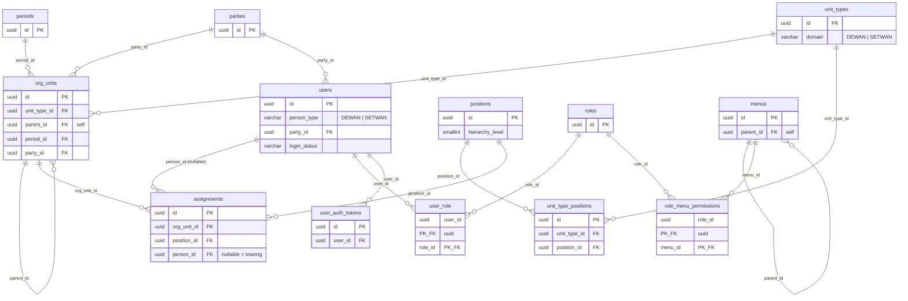

# TRD — Database `eparlemen`

*Per 12 Oktober 2026*

## 1. Ringkasan

Dokumen ini adalah **Technical Requirements Document (TRD)** untuk database `eparlemen` (PostgreSQL, `localhost:5432`) yang menjadi basis data bagi prototipe e-Parlemen. Isinya: struktur tabel apa adanya di database (bukan rancangan di atas kertas), constraint & trigger yang menegakkan aturan bisnis di level DB, relasi antar tabel, dan riwayat perubahan skema yang relevan untuk tim development (BE/FE) yang akan mengintegrasikan API di atas skema ini.

Database berisi **13 tabel** terbagi dua domain:
- **DEWAN** — anggota legislatif: Pimpinan DPRD, Fraksi, Komisi, Alat Kelengkapan DPRD (AKD/Badan).
- **SETWAN** — struktur kepegawaian Sekretariat DPRD: Sekretariat → Bagian → Sub Bagian → staf.

Ditambah lapisan **Auth, Role & RBAC** (akun login, role, menu, hak akses per menu) yang menempel ke entitas orang (`users`) dari kedua domain tersebut.

## 2. Diagram ER

**Catatan diagram**: kolom audit `created_by`/`updated_by` (ada di **semua** tabel, FK ke `users(id)`) sengaja tidak digambar di atas supaya diagram tetap terbaca — detailnya ada di tabel per-tabel bagian 4.

## 3. Konvensi Desain yang Dipakai Konsisten di Semua Tabel

1. **PK selalu `uuid`**, bukan serial/bigint (kecuali tabel pivot murni `user_role` dan `role_menu_permissions` yang pakai composite PK dari 2 FK, tanpa surrogate `id`).
2. **Audit kolom di semua tabel**: `created_at`, `updated_at` (`timestamptz default now()`), `created_by`, `updated_by` (`uuid`, nullable, FK ke `users(id)`).
3. **Enum via `varchar` + `CHECK`**, bukan tipe `ENUM` Postgres asli — lebih mudah di-`ALTER` tanpa migrasi tipe saat daftar nilai berubah.
4. **Partial unique index untuk aturan "hanya satu yang aktif/satu kombinasi aktif"** — contoh: `ux_periods_one_active` (`UNIQUE (is_active) WHERE is_active`), `ux_assignments_active_person_unit` (`UNIQUE (org_unit_id, person_id) WHERE end_date IS NULL AND person_id IS NOT NULL`).
5. **Partial index untuk query yang hanya butuh baris aktif** — `ix_assignments_person`/`ix_assignments_unit` (`WHERE end_date IS NULL`). Baris historis/nonaktif tidak ikut ter-index, index lebih kecil & query hot-path lebih cepat.
6. **Soft-delete/soft-deactivate** via `is_active` (master data) atau `end_date`/`login_status` (data transaksional), bukan `DELETE` fisik.
7. **Self-referencing hierarchy** dipakai di 2 tempat yang memang butuh pohon: `org_units.parent_id` (struktur organisasi) dan `menus.parent_id` (grup/child sidebar) — tabel lain flat.
8. **Validasi lintas-tabel lewat trigger, bukan `CHECK` polos** — `CHECK` constraint tidak bisa query tabel lain, dipakai hanya untuk aturan dalam satu baris (lihat Bagian 5).

## 4. Definisi Tabel

### 4.1 `periods` — Periode DPRD

| Kolom | Tipe | Null | Keterangan |
|---|---|---|---|
| `id` | uuid PK | tidak | |
| `name` | varchar(50) | tidak | **UNIQUE** |
| `start_date`, `end_date` | date | tidak | `CHECK (end_date > start_date)` |
| `is_active` | boolean | tidak, default `false` | partial unique `ux_periods_one_active` — hanya 1 periode boleh aktif |
| `created_at/updated_at/created_by/updated_by` | — | — | audit standar |

### 4.2 `parties` — Partai Politik

| Kolom | Tipe | Null | Keterangan |
|---|---|---|---|
| `id` | uuid PK | | |
| `code` | varchar(20) | tidak | UNIQUE |
| `name` | varchar(150) | tidak | |
| `abbreviation` | varchar(30) | tidak | |
| `logo_url` | text | ya | |
| `is_active` | boolean | tidak, default `true` | |

Direferensikan oleh `org_units.party_id` (Fraksi terikat 1 Partai) dan `users.party_id` (anggota DEWAN terikat 1 Partai).

### 4.3 `unit_types` — Jenis Unit Organisasi

| Kolom | Tipe | Null | Keterangan |
|---|---|---|---|
| `id` | uuid PK | | |
| `code` | varchar(20) | tidak | UNIQUE — `PIMPINAN`, `FRAKSI`, `KOMISI`, `AKD`, `SEKRETARIAT`, `BAGIAN`, `SUBBAGIAN` (8 baris saat ini) |
| `name` | varchar(100) | tidak | |
| `domain` | varchar(10) | tidak | `CHECK IN ('DEWAN','SETWAN')` |
| `max_per_member` | smallint | ya | `CHECK (> 0)` — maks berapa unit sejenis ini boleh dijabat 1 orang bersamaan (dipakai trigger `trg_assignments_validate`) |
| `allows_vacancy` | boolean | tidak, default `false` | boleh/tidak assignment di jenis unit ini punya `person_id IS NULL` (formasi lowong) |
| `sort_order` | smallint | tidak | |

### 4.4 `org_units` — Unit Organisasi (instance nyata, mis. "Komisi A", "Bagian Umum")

| Kolom | Tipe | Null | Keterangan |
|---|---|---|---|
| `id` | uuid PK | | |
| `unit_type_id` | uuid FK → `unit_types` | tidak | |
| `parent_id` | uuid FK → `org_units` (self) | ya | `CHECK (parent_id <> id)`; `NULL` = root (Pimpinan DPRD, tiap Fraksi, Sekretariat DPRD) |
| `period_id` | uuid FK → `periods` | ya | |
| `party_id` | uuid FK → `parties` | ya | hanya terisi utk unit bertipe FRAKSI |
| `code` | varchar(30) | tidak | UNIQUE |
| `name` | varchar(150) | tidak | |
| `scope`, `duties` | text | ya | lingkup & tugas unit |
| `sort_order` | smallint | tidak | urutan tampil dalam scope parent-nya |
| `is_active` | boolean | tidak, default `true` | |

Index: `ix_org_units_parent` (`parent_id`), `ix_org_units_type` (`unit_type_id`).

### 4.5 `positions` — Jabatan (katalog, lintas unit)

| Kolom | Tipe | Null | Keterangan |
|---|---|---|---|
| `id` | uuid PK | | |
| `category` | varchar(20) | tidak | `CHECK IN ('KELOMPOK','STRUKTURAL','FUNGSIONAL','PELAKSANA')` |
| `code` | varchar(60) | tidak | UNIQUE |
| `name` | varchar(150) | tidak | mis. "Ketua", "Kepala Bagian", "Penelaah Teknis Kebijakan" (26 baris saat ini) |
| `is_single_holder` | boolean | tidak, default `false` | |
| `hierarchy_level` | smallint | tidak | peringkat jabatan **dalam konteks unit tempat ia dipegang** — 1=Ketua/Sekretaris DPRD (pemimpin unit), lalu makin besar makin "bawahan". Lihat Bagian 6 utk cara pakainya merekonstruksi bagan. |

### 4.6 `unit_type_positions` — Jabatan apa yang valid untuk jenis unit apa

| Kolom | Tipe | Null | Keterangan |
|---|---|---|---|
| `id` | uuid PK | | |
| `unit_type_id` | uuid FK → `unit_types` | tidak | |
| `position_id` | uuid FK → `positions` | tidak | |
| `max_holders` | smallint | ya | `CHECK (> 0)` — maks berapa orang boleh pegang jabatan ini **dalam 1 org_unit** yang sama (mis. "Anggota" di Komisi boleh banyak, "Ketua" cuma 1) |
| `is_required` | boolean | tidak, default `false` | |

UNIQUE `(unit_type_id, position_id)` — 40 baris saat ini (katalog kombinasi valid, ditegakkan oleh trigger `trg_assignments_validate` di tabel `assignments`, lihat Bagian 5).

### 4.7 `users` — Orang (DEWAN & SETWAN) + Akun Login Digabung

**Riwayat**: tabel ini awalnya bernama `persons` (data biografis), lalu di-rename jadi `users` dan menyerap kolom akun login (`password_hash`, `login_status`, `last_login_at`) dari tabel `users` lama — lihat Bagian 7.

| Kolom | Tipe | Null | Keterangan |
|---|---|---|---|
| `id` | uuid PK | | |
| `person_type` | varchar(10) | tidak | `CHECK IN ('DEWAN','SETWAN')` |
| `employment_type` | varchar(10) | ya* | `CHECK IN ('PNS','PPPK','NON_ASN')` — *wajib utk SETWAN, wajib NULL utk DEWAN (`ck_users_type_rules`) |
| `name` | varchar(150) | tidak | |
| `title_prefix` | varchar(30) | ya | gelar depan, mis. "Hj." |
| `title_suffix` | varchar(60) | ya | gelar belakang, mis. "S.H., M.M." |
| `employee_number_nip` | varchar(18) | ya | UNIQUE — **hanya SETWAN** |
| `member_code` | varchar(30) | ya | UNIQUE — **hanya DEWAN**, format `DPRD-AGT-00xx` |
| `party_id` | uuid FK → `parties` | ya* | *wajib utk DEWAN, wajib NULL utk SETWAN |
| `electoral_district_id` | uuid | ya | FK belum ditambahkan (lihat Bagian 8) |
| `photo_url` | text | ya | |
| `email` | varchar(150) | ya | UNIQUE |
| `phone_number` | varchar(20) | ya | |
| `employment_status` | varchar(20) | tidak, default `'AKTIF'` | `CHECK IN ('AKTIF','NONAKTIF','DIGANTIKAN_PAW')` — status kepegawaian/keanggotaan |
| `password_hash` | text | ya | kredensial login |
| `login_status` | varchar(20) | tidak, default `'PENDING_ACTIVATION'` | `CHECK IN ('PENDING_ACTIVATION','ACTIVE','SUSPENDED','DEACTIVATED')` — status akun login, **beda konsep** dari `employment_status` |
| `last_login_at` | timestamptz | ya | |

**`ck_users_type_rules`** (CHECK gabungan): `person_type='DEWAN'` → `employment_type IS NULL AND party_id IS NOT NULL AND member_code IS NOT NULL`; `person_type='SETWAN'` → `employment_type IS NOT NULL AND party_id IS NULL AND member_code IS NULL`. Baris tidak bisa disimpan kalau melanggar aturan ini — DB menegakkan konsistensi DEWAN-vs-SETWAN secara otomatis.

52 baris data saat ini (semua real, bukan dummy).

### 4.8 `assignments` — Penugasan Orang ke Unit + Jabatan (riwayat & aktif)

| Kolom | Tipe | Null | Keterangan |
|---|---|---|---|
| `id` | uuid PK | | |
| `org_unit_id` | uuid FK → `org_units` | tidak | |
| `position_id` | uuid FK → `positions` | tidak | |
| `person_id` | uuid FK → `users` | **ya** | `NULL` = jabatan lowong (formasi belum terisi) |
| `start_date`, `end_date` | date | ya | `end_date IS NULL` = masih aktif; `CHECK (end_date >= start_date)` |
| `decree_number` | varchar(100) | ya | nomor SK |
| `notes` | text | ya | |
| `sort_order` | smallint | tidak | urutan tampil dalam 1 org_unit |

Index: `ix_assignments_person`/`ix_assignments_unit` (partial, `WHERE end_date IS NULL`), `ux_assignments_active_person_unit` (`UNIQUE (org_unit_id, person_id) WHERE end_date IS NULL AND person_id IS NOT NULL` — satu orang tidak boleh dobel-assignment aktif ke unit yang sama).

123 baris data saat ini, 11 di antaranya `person_id IS NULL` (formasi lowong).

**Trigger `assignments_validate`** (BEFORE INSERT/UPDATE) — lihat Bagian 5, ini tabel paling "dijaga" di seluruh skema.

### 4.9 `roles` — Role Akses

| Kolom | Tipe | Null | Keterangan |
|---|---|---|---|
| `id` | uuid PK, default `gen_random_uuid()` | | |
| `code` | varchar(30) | tidak | UNIQUE |
| `name` | varchar(100) | tidak | |
| `can_access_web`, `can_access_mobile` | boolean | tidak, default `false` | `CHECK (can_access_web OR can_access_mobile)` — role wajib punya minimal 1 platform |
| `is_active` | boolean | tidak, default `true` | |

0 baris saat ini (belum di-seed).

### 4.10 `user_role` — Pivot Many-to-Many User ↔ Role

**Riwayat**: dulu bernama `users` (tabel akun login 1-role-per-user dengan `role_id` tunggal), direstrukturisasi jadi pivot many-to-many murni — lihat Bagian 7.

| Kolom | Tipe | Null | Keterangan |
|---|---|---|---|
| `user_id` | uuid FK → `users` ON DELETE CASCADE | tidak | bagian composite PK |
| `role_id` | uuid FK → `roles` ON DELETE CASCADE | tidak | bagian composite PK |
| `created_at/updated_at/created_by/updated_by` | — | — | audit standar |

PK `(user_id, role_id)`. Index tambahan `ix_user_role_role_id` utk query "semua user dengan Role X" (composite PK sudah cepat utk arah "semua role milik User X"). 0 baris saat ini.

### 4.11 `menus` — Katalog Menu per Platform

| Kolom | Tipe | Null | Keterangan |
|---|---|---|---|
| `id` | uuid PK, default `gen_random_uuid()` | | |
| `parent_id` | uuid FK → `menus` (self) | ya | `NULL` = grup/section; `CHECK (parent_id <> id)` |
| `level` | smallint | tidak | 1=grup, 2=child bisa-klik; `ck_menus_level_matches_parent` memastikan `level` selalu sinkron dgn `parent_id` |
| `platform` | varchar(10) | tidak | `CHECK IN ('WEB','MOBILE')` |
| `code` | varchar(60) | ya | slug halaman; `NULL` utk baris grup |
| `label` | varchar(100) | tidak | |
| `sort_order` | smallint | tidak | |
| `is_active` | boolean | tidak, default `true` | |

UNIQUE `(platform, code)`. 0 baris saat ini (belum di-seed).

### 4.12 `role_menu_permissions` — Hak Akses CRUD per Role × Menu

| Kolom | Tipe | Null | Keterangan |
|---|---|---|---|
| `role_id` | uuid FK → `roles` ON DELETE CASCADE | tidak | bagian composite PK |
| `menu_id` | uuid FK → `menus` ON DELETE CASCADE | tidak | bagian composite PK |
| `can_create/can_read/can_update/can_delete` | boolean | tidak | default: `can_read=true`, lainnya `false` |

PK `(role_id, menu_id)`. `ck_role_menu_permissions_any` — minimal 1 izin harus `true`, baris "tanpa akses sama sekali" tidak boleh disimpan. 0 baris saat ini.

> Dokumen desain awal (`rekomendasi-skema-user-role-rbac.md`) merekomendasikan trigger tambahan `role_menu_permissions_validate` yang memastikan `menu_id` menunjuk ke baris child (`level=2`), bukan baris grup — **trigger ini belum diterapkan** di database saat ini (hanya `assignments_validate` yang sudah aktif, lihat Bagian 5).

### 4.13 `user_auth_tokens` — Token Aktivasi Akun / Reset Password

| Kolom | Tipe | Null | Keterangan |
|---|---|---|---|
| `id` | uuid PK, default `gen_random_uuid()` | | |
| `user_id` | uuid FK → `users` ON DELETE CASCADE | tidak | |
| `token_type` | varchar(20) | tidak | `CHECK IN ('ACTIVATION','PASSWORD_RESET')` |
| `token_hash` | text | tidak | |
| `expires_at` | timestamptz | tidak | |
| `used_at` | timestamptz | ya | `NULL` = belum dipakai |

Tidak ada kolom `updated_at`/`created_by`/`updated_by` di tabel ini (satu-satunya pengecualian dari konvensi audit Bagian 3) — token bersifat write-once, tidak pernah diedit. 0 baris saat ini.

## 5. Business Rules yang Ditegakkan di Level Database

Selain `CHECK`/`UNIQUE` yang sudah disebut per-tabel di Bagian 4, ada **1 trigger aktif** yang menegakkan aturan lintas-tabel pada `assignments` (`BEFORE INSERT OR UPDATE`, fungsi `trg_assignments_validate`):

1. **Jabatan harus valid untuk jenis unit itu** — `(unit_type_id, position_id)` baris yang akan di-assign wajib ada di `unit_type_positions`, kalau tidak: `RAISE EXCEPTION 'Jabatan tidak diizinkan untuk jenis unit %'`.
2. **Formasi lowong hanya boleh di jenis unit yang mengizinkannya** — `person_id IS NULL` ditolak kalau `unit_types.allows_vacancy = false`.
3. **Batas rangkap jabatan per jenis unit** (`unit_types.max_per_member`) — satu orang tidak boleh punya lebih dari N assignment aktif di jenis unit yang sama (mis. 1 orang maksimal rangkap sekian jabatan di tipe unit "AKD").
4. **Batas jumlah pemegang per jabatan per unit** (`unit_type_positions.max_holders`) — mis. "Ketua" di satu Komisi maksimal 1 orang, "Anggota" bisa banyak sesuai `max_holders` yang didefinisikan.

Trigger ini berjalan **hanya saat INSERT/UPDATE** (bukan di jalur baca), jadi tidak membebani query read-heavy seperti rekonstruksi bagan struktur organisasi.

## 6. Cara Merekonstruksi Hierarki/Bagan dari Skema Ini

Skema **tidak menyimpan hierarki "siapa atasan siapa" secara langsung** — itu diturunkan di query time dari kombinasi `org_units.parent_id` (hierarki unit) + `positions.hierarchy_level` (siapa "pemimpin" di dalam satu unit, yaitu baris dengan `hierarchy_level` terkecil pada unit tersebut). Pola ini sudah dipakai di `docs/query-struktur-pimpinan-dprd.sql` dan `docs/query-struktur-setwan.sql` (recursive CTE + window function `ROW_NUMBER() OVER (PARTITION BY org_unit_id ORDER BY hierarchy_level)`), dan didokumentasikan sbg kontrak API di `docs/api-kontrak-struktur-organisasi-setwan.md`.

## 7. Riwayat Perubahan Skema yang Relevan

| Perubahan | Alasan |
|---|---|
| `persons` → `users` (rename), menyerap `password_hash`/`login_status`/`last_login_at` dari tabel `users` lama, kolom `user_id` di-drop | Keputusan desain: 1 orang = 1 identitas login, bukan 2 tabel saling menunjuk. `status` lama di-rename jadi `employment_status` utk menghindari konflik nama dgn `login_status` (login) yang beda konsep. |
| `users` (lama, 1 role per akun via `role_id`) → `user_role` (pivot many-to-many `user_id`+`role_id`) | Kebutuhan bisnis berubah: 1 user bisa punya banyak role. Kolom kredensial (`password_hash` dst.) pindah ke `users` krn cuma ada 1 per orang terlepas dari berapa role yang dipegang. |
| Semua FK audit (`created_by`/`updated_by`) di 8 tabel yang sudah ada + tabel RBAC baru, diarahkan ke `users(id)` yang baru | Konsekuensi dari rename di atas — siapa pun yang sebelumnya dianggap "aktor" (pemilik akun) sekarang direpresentasikan oleh baris `users`, bukan `user_role`. |

Skrip migrasi lengkap: `docs/migration-rename-persons-to-users.sql`.

## 8. Yang Belum Diterapkan / Pertanyaan Terbuka

1. **`users.electoral_district_id`** belum punya FK constraint (kolom ada, tapi tabel referensinya — Dapil — di luar lingkup 13 tabel dokumen ini).
2. **Trigger `role_menu_permissions_validate`** (menu_id harus child, bukan grup) direkomendasikan di `rekomendasi-skema-user-role-rbac.md` tapi belum dibuat.
3. **`roles`, `menus`, `role_menu_permissions`, `user_role`, `user_auth_tokens` masih 0 baris** — skema sudah siap tapi belum ada data seed maupun alur "Create New Account" yang benar-benar menulis ke tabel-tabel ini dari sisi aplikasi.
4. Siapa `created_by` untuk baris pertama yang dibuat sebelum ada akun admin sama sekali (bootstrap) — belum ada keputusan resmi, lihat poin ini juga di `rekomendasi-skema-user-role-rbac.md`.
